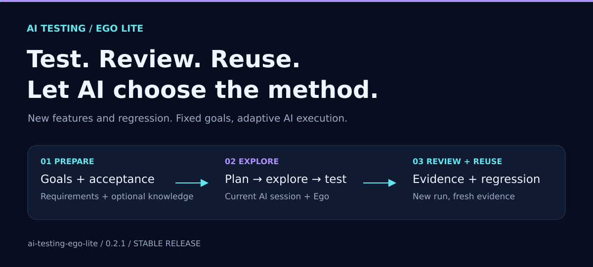
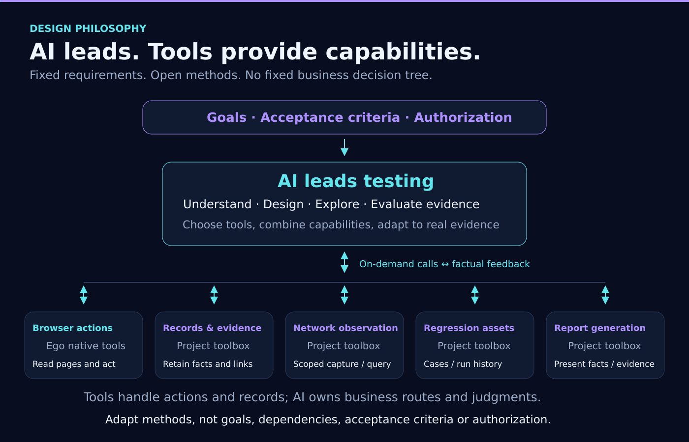
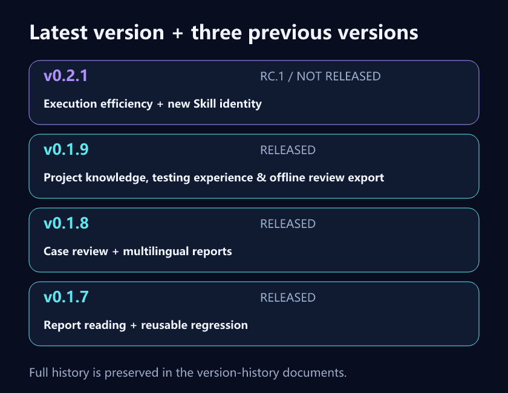
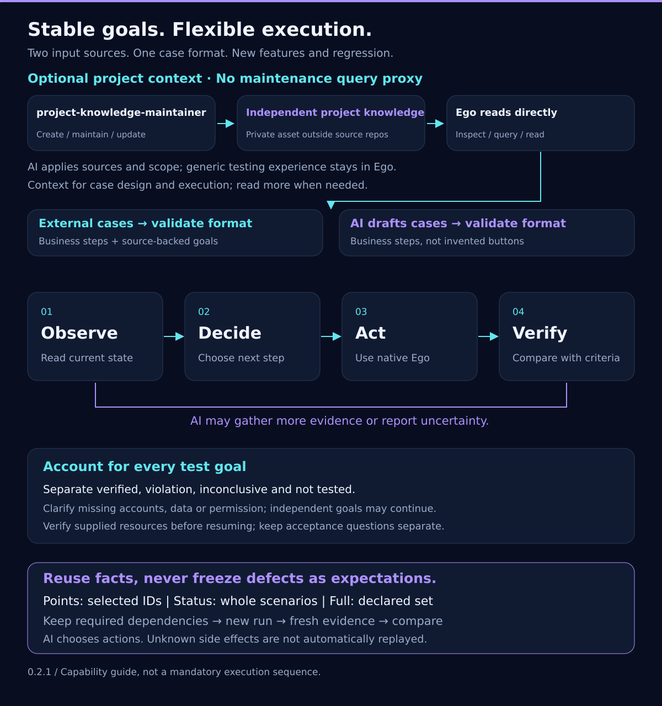
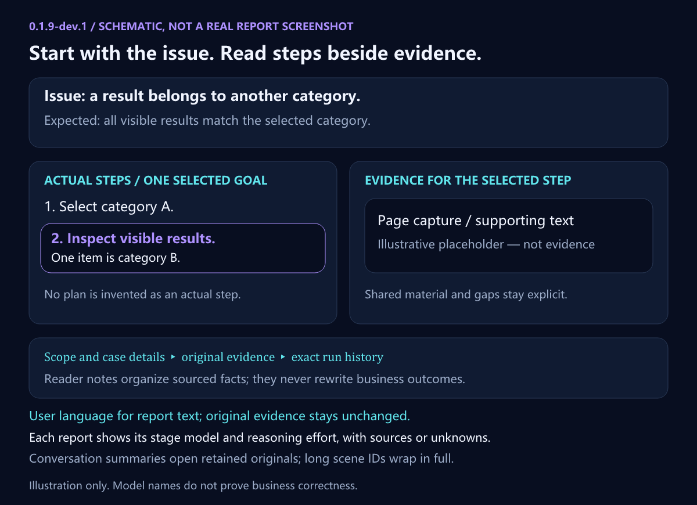
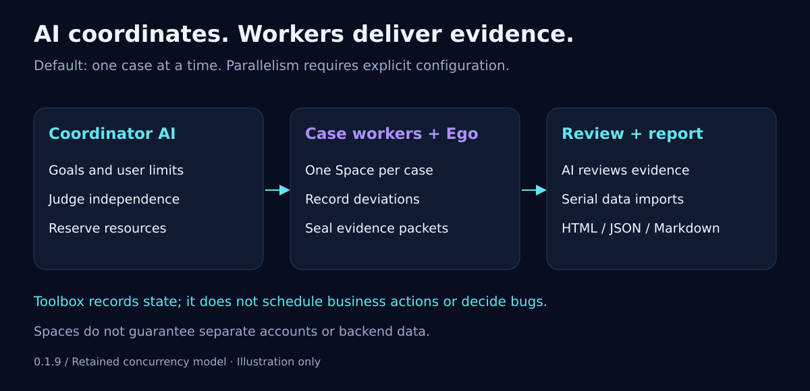

<p align="center"></p>

<h1 align="center">AI Autonomous Testing with Ego Lite</h1>

<p align="center"><strong>English</strong> · <a href="README.md">简体中文</a></p>

**An AI-led Web testing Skill built on Ego Lite.** For first launches, new features and regression, using existing cases or cases generated from requirements.

## Design philosophy: AI leads, tools provide capabilities

AI leads the testing: understanding requirements, designing cases, exploring pages, choosing actions and verification methods, and judging results from actual evidence. We provide composable capabilities, testing guidance and experience references to support this work, rather than a fixed process that decides every step for the AI.

- **AI chooses how to test.** It selects tools, organizes steps, gathers evidence, adapts methods or asks for clarification according to the goal and observed situation.
- **Tools deliver concrete capabilities.** Ego provides browser operations; this project provides test records, evidence retention, network observation, regression assets and reports. Tools do not decide whether the business behavior is correct.
- **Open methods, explicit requirements.** Methods can change, but business goals, acceptance standards, necessary dependencies and authorization cannot be silently changed or weakened. A successful operation is not a passed test.

As models improve, we aim to let AI use these capabilities more effectively. Actual testing quality must still be verified; a model upgrade does not guarantee improvement.



## Current release

Current source is **0.1.8-rc.2 / report-language-model-1**, not a formal release. It implements the approved lean case/review/run design, stable-point reruns, official Ego download evidence/file inspection and historical comparisons. The case reader now provides a scene/case overview, three-column review workbench, shared report themes and native feedback files that avoid browser download-zone metadata. Contracts are v9, regressionVersion 2 and networkVersion 1. The last stable release remains [0.1.7](https://github.com/99Like-wjj/ai-autonomous-testing-ego-lite/releases/tag/v0.1.7). See [development validation](docs/v0.1.8-development-validation.md) and [review save details](docs/v0.1.8-case-review.md); builds do not update installed Skills. This revision adds [report language and two-stage model provenance](docs/v0.1.8-report-language-model-design.md), long scene IDs and baseline-aware scope labels.

Adds provider-neutral conversation evidence, step input/reply summaries and the selected conversation drawer/fullscreen layout. Four quality layers address expected/observed phases, retained originals, readable findings and source validation; see the [design and validation](docs/v0.1.8-conversation-review.md). Main contracts remain v9; conversations use conversationVersion 1. Historical runs and reports are preserved.


Invoke `$ai-autonomous-testing-ego-lite`. Complete packages include Skill guidance, compiled Node ESM tools, schemas, examples and an integrity manifest. Source is TypeScript; installed use requires Node.js >=22.

## Version evolution



README shows the current version plus three previous versions. 0.1.8-rc.2 is a development candidate, followed by stable 0.1.7–0.1.5. [Full version history](docs/version-history.en.md) retains older releases. Hero, workflow, architecture, concurrency and report illustrations now describe this version, not real test evidence. 0.1.8 is in authorized development/self-test, not released.

## What changed in 0.1.8

- Whole case versions, stable IDs and same-source review; unchanged reruns add only a run.
- points/status/full scope retains dependencies and never inherits unselected passes.
- Official Ego download/saveAs, explicit manager reconciliation and read-only file facts.
- Exact parent runs, original-problem checks and historical media; verdict and repair attribution stay separate.
- **Reports follow the user’s language.** Explicit language requests take priority. Complete mappings provide interface text while the AI writes business descriptions in that language; original evidence is not translated.
- **Model provenance stays explicit.** Each report shows its corresponding stage’s model and reasoning effort in one place, retaining multiple configurations, unknown values and sources without inferring quality from model names.
- **Readable conversations and long IDs.** Steps expose input/reply summaries and full conversation access. Long scene IDs wrap without truncation, and first-run/regression scope labels follow the actual comparison baseline.

See [final design](docs/v0.1.8-design.md) and [contracts](docs/asset-formats.en.md).

Regression interfaces and behavior are documented in [regression assets](docs/regression-reuse.md) and the [usage guide](skills/ai-autonomous-testing-ego-lite/references/regression-reuse.md).

All current test-asset JSON contracts use **schemaVersion 9**, and execution query viewVersion is 9. Older formats are explicitly rejected, without readers or converters. Keep historical reports, files and runs unchanged; prepare new v9 cases from original sources instead of changing only version fields. See [formats](docs/asset-formats.en.md).

## What changed in 0.1.7

The previous stable release focused on report reading, whole-scope resource clarification and reusable first-run results. Its full description and validation remain in [version history](docs/version-history.en.md); old task/rule write interfaces are not current v9 usage.

## Cases, evidence and delivery



Before freezing, the AI maps each expectation to sources, prerequisites, actions and observation methods. Different role/data dependencies can be assessed separately without dropping workflow dependencies. Acceptance ambiguity belongs to goal.clarificationQuestions; actual resource and authorization gaps require real clarification. User-deferred goals remain visible. Do not expand acceptance scope after execution to justify a result.

Successful tool calls do not prove business success. Key UI findings require real screenshots, with AI-selected capture timing. DOM, logs and action receipts supplement images. Submission, drag, context and download uncertainty can benefit from targeted observations; capabilities must be verified against the current Ego version. A method name or timeout is not proof of a browser defect.

Default deliverables are standalone HTML, JSON and Markdown from one result projection. Reports expose expectations, observations, evidence, gaps, diagnosis and history. Screenshot gaps, record completeness and file integrity remain distinct. Hash consistency does not establish business correctness; file verification and actual browser opening are separate.

Scheme B retains every goal entrance in a scene and focuses on one goal at a time. The issue/result and full original expectation lead, actual steps occupy the middle and selected evidence appears alongside them. The directory starts/resets collapsed and filters preserve the selection. Scope notes show three items before an outer disclosure; case, scope and source details remain available on demand. Pending actions use business descriptions in the selected report language. Sourced readerNotes organize existing actions and evidence without inventing execution or overriding verdicts; shared material and missing step evidence are explicit. Original records/history and old reports remain intact under v9. See the [current language/provenance guide](skills/ai-autonomous-testing-ego-lite/references/report-language-model.md); the [0.1.7 reader design](docs/v0.1.7-step-evidence.md) remains historical context. Builds do not update the installed Skill.

Network observation implements the v3 design through network start/status/query/stop: a dedicated native context records scoped Fetch/XHR, SSE and WebSocket evidence; the AI chooses queries, evidence and business judgments. It never replays business requests. Network data uses independent networkVersion 1, while current business contracts use v9 and v5 historical runs remain untouched. See [observation guidance (Chinese)](skills/ai-autonomous-testing-ego-lite/references/network-observation.md).



## Quick start on Windows

This source example targets the current 0.1.8-rc.2 development candidate in .build/runtime, without replacing the user installation. The 0.1.7 download below is the previous stable release; do not mix it with these v9 commands. Verify a released installation against its actual version and revision.

Download the full installation package, SHA-256 checksums and release notes from [v0.1.7 Release](https://github.com/99Like-wjj/ai-autonomous-testing-ego-lite/releases/tag/v0.1.7). GitHub-generated Source code archives are not full installation packages.

Prepare Ego and the official ego-browser Skill using the [official guide](https://lite.ego.app/document/en/docs/windows/quick-start). This project does not install or replace Ego. Case design alone requires no browser connection.

From the confirmed source root:

```powershell
npm ci
npm run build
$Tool = Join-Path (Get-Location).Path '.build/runtime/scripts/ego.mjs'
node $Tool tool-info --expect-version 0.1.8-rc.2 --expect-revision report-language-model-1
$LocalRoot = Join-Path $env:LOCALAPPDATA 'EgoLiteTest'
New-Item -ItemType Directory -Force -Path $LocalRoot | Out-Null
$Project = Join-Path $LocalRoot ('project-' + [guid]::NewGuid().ToString('N'))
node $Tool init --project-dir $Project
```

For a complete installed package, use scripts/ego.mjs under the actual loaded Skill root. Keep real assets outside source control. Review the generated example against trusted requirements before freezing:

```powershell
$SaveRequest = Join-Path $Project 'cases-save-request.example.json'
# Edit against trusted requirements before saving and human review.
node $Tool cases save --work-dir $Project --request $SaveRequest
$Cases = Join-Path $Project 'cases/v001.json'
node $Tool cases render --cases $Cases --output-dir (Join-Path $Project 'case-documents')
node $Tool cases serve --cases $Cases --output-dir (Join-Path $Project 'review-files')
$Run = Join-Path $LocalRoot ('run-' + [guid]::NewGuid().ToString('N'))
node $Tool validate-cases --cases $Cases
# AI prepares this file from actual review, scope and current conditions.
$Binding = Join-Path $Project 'run-binding-request.json'
node $Tool start --project-dir $Project --cases $Cases --binding $Binding --output-dir $Run
```

Open the actual private loopback URL returned by serve in Ego. Native feedback saves write readable HTML/JSON without registering approval or running tests. Offline HTML remains readable and can restore opinions. cases export-review provides the same writer for a received JSON/HTML file. See [review save details](docs/v0.1.8-case-review.md).

start creates local assets, not browser actions. Use the [toolbox guide](skills/ai-autonomous-testing-ego-lite/references/local-toolbox.en.md) and [synthetic requests](examples/record-request.example.json) to register evidence and goal assessments. Unique operation IDs and revisions protect data transactions; replaying a request recovers its receipt, not a business action.

```text
node ABS_TOOL evidence-add --run-dir ABS_RUN --request ABS_EVIDENCE_REQUEST
node ABS_TOOL record --run-dir ABS_RUN --request ABS_RECORD_REQUEST
node ABS_TOOL progress --run-dir ABS_RUN
node ABS_TOOL check --run-dir ABS_RUN
node ABS_TOOL report --run-dir ABS_RUN
node ABS_TOOL verify-report --run-dir ABS_RUN --report-dir ABS_REPORT_DIR
```

Reports refuse overwrite; use a new directory for later reports. browserOpen:not_checked is not a browser validation claim. Open and inspect the actual HTML through Ego before claiming that validation. Examples contain fictional data only.

## Operational limits

Spaces do not guarantee separate accounts or backend data. File updates are not a general multi-file transaction or power-loss guarantee. Evidence registration does not redact data; keep credentials, real sites and screenshots private and do not auto-upload reports. Enable network observation only within authorization; it never replays business requests. See [privacy](docs/privacy.md) and [architecture and responsibilities](docs/architecture.en.md).

## Configurable concurrency



Repair commit 8e6e2d9 is integrated while retaining v8 goal assessment and the API-monitoring design. Hosts own real workers, context, permissions, waiting and cleanup; this package adds no fixed host dispatcher. Read [host conditions and handoff (Chinese)](skills/ai-autonomous-testing-ego-lite/references/host-compatibility.md). Codex uses $ai-autonomous-testing-ego-lite; Claude Code uses /ai-autonomous-testing-ego-lite. Complete live host workflows still need separate acceptance. See the [integration record](docs/v0.1.6-cross-host-integration.md).

The default is **1 (serial)**. Without a user request for concurrency or an explicit setting, execute cases one at a time. Set `start --max-parallel-cases N` or project execution-config.json to opt in; N is a positive safe integer with no fixed 2/4/8 product ceiling. The AI chooses tool calls, batches and worker use within that limit; it need not fill all slots. Host limits are recorded only when explicitly available, otherwise unknown. No automatic host probing or global configuration changes occur. Workers seal local packets; the coordinator reviews and imports them. See the [parallel guide](skills/ai-autonomous-testing-ego-lite/references/parallel-testing.md). npm test builds and tests emitted JS; npm run check:public checks publishable source assets.

## Requirements and implementation boundaries

0.1.8 is in development and self-test, rather than planning only. The current implemented scope is described above. Original [requirements](docs/v0.1.8-requirements.md), [research](docs/v0.1.8-feasibility-research.md) and [preview](docs/v0.1.8-preview.en.md) remain design history, not proof that every proposal shipped. Review and verification remain required before a formal release.

## Further reading

- [Installation and updates](INSTALL.zh-CN.md), [packaging and release guide](docs/releasing.md) (Chinese; development guides are not installed with the Skill)

- [Full version history](docs/version-history.en.md), [historical requirements](docs/requirements.md), [v0.1.5 naming and upgrade history (Chinese)](docs/rename-upgrade.md)
- [Design experience](skills/ai-autonomous-testing-ego-lite/references/case-design-guide.md), [execution experience](skills/ai-autonomous-testing-ego-lite/references/experience-guide.md), [network observation](skills/ai-autonomous-testing-ego-lite/references/network-observation.md) (Chinese)

- [Skill](skills/ai-autonomous-testing-ego-lite/SKILL.md), [case design](skills/ai-autonomous-testing-ego-lite/references/case-authoring.md), [judgment](skills/ai-autonomous-testing-ego-lite/references/judgment-and-diagnosis.md)
- [Architecture](docs/architecture.en.md), [formats](docs/asset-formats.en.md), [validation](docs/testing.en.md), [changelog](CHANGELOG.md)
- [Cases](examples/cases.example.json), [evidence requests](examples/evidence-request.example.json), [result requests](examples/record-request.example.json)

## Feedback and contact

Report bugs or suggest improvements through [GitHub Issues](https://github.com/99Like-wjj/ai-autonomous-testing-ego-lite/issues) or the contacts below. Include the version, reproduction steps, and redacted errors or screenshots. Do not submit passwords, tokens, keys, or confidential company information.

- Author: [99Like-wjj](https://github.com/99Like-wjj)
- Email: [wjj990517@gmail.com](mailto:wjj990517@gmail.com)
- WeChat: A2326543144

  
- QQ: 2326543144
- X: [@99Like_ovo](https://x.com/99Like_ovo)

## License

Original code and documentation in this repository are licensed under the [MIT License](LICENSE), copyright 2026 99Like-wjj. This license does not cover Ego, Ego's official browser, or other third-party software; their own licenses and official terms continue to apply. This is an independent project, not affiliated with or endorsed by Ego. The source is available under the MIT License. Development is ongoing; refer to each release's notes for its capabilities and validation scope.
