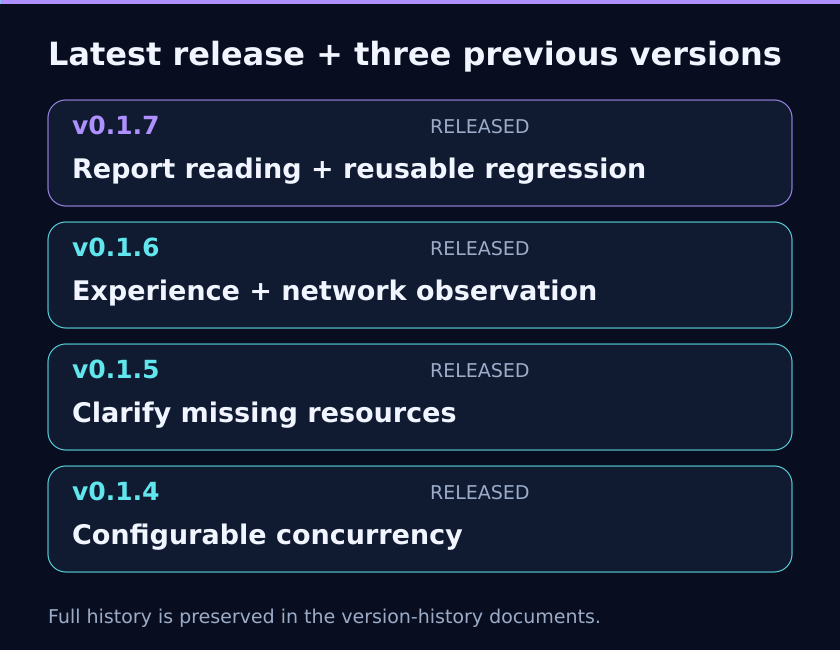
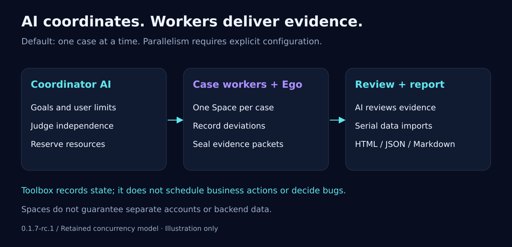

<p align="center"></p>

<h1 align="center">AI Autonomous Testing with Ego Lite</h1>

<p align="center"><strong>English</strong> · <a href="README.md">简体中文</a></p>

**An AI-led Web testing Skill for first delivery and regression.** The current AI session interprets trusted requirements, designs independently assessable business goals, explores through Ego Lite and judges actual outcomes using evidence. Users may provide existing cases or requirements. Methods remain flexible; goals, necessary semantics and authorization do not.

## Current release

The independent development candidate is **0.1.7-rc.1 / regression-reuse-1**, unreleased. It clarifies whole-scope resource communication before starting or resuming execution and partial replies. Main contracts are v7; regression assets use regressionVersion 1. The separate v0.1.7 report work is not included. See [resource-readiness validation](docs/v0.1.8-resource-readiness-validation.md) and [regression-reuse validation](docs/v0.1.8-regression-reuse-validation.md) for scope and limitations.

**0.1.6 / native-network-observation-1**. Download the complete package and checksums from [v0.1.6](https://github.com/99Like-wjj/ai-autonomous-testing-ego-lite/releases/tag/v0.1.6). The maintainer reported a usable local trial with one requirements document; this is not broad acceptance across products, models or hosts. See [validation](docs/testing.en.md). Builds do not update installed Skills.


Invoke `$ai-autonomous-testing-ego-lite`. Complete packages include Skill guidance, compiled Node ESM tools, schemas, examples and an integrity manifest. Source is TypeScript; installed use requires Node.js >=22.

## Version evolution



README shows the latest release plus three previous versions. [Full version history](docs/version-history.en.md) retains older releases; v0.1.7 remains a plan.

## First-run records and two regression modes

The AI preserves normative sources, actual observations, failures and incomplete work, then authors project-specific reusable tasks. Select one or more formal goal statuses from a fixed source run to rerun each matching whole scenario, or select the complete declared scope. Missing tasks and blocked goals remain visible.

Task definition, current resources/authorization and business verdicts are separate. Every regression creates an independent run with frozen task/rule revisions and selection. Unknown side effects require read-only reconciliation, not automatic replay. Comparisons expose conditions and AI comparability reasoning without automatically blaming a newer release.

Local tools only perform data transactions and explicit selection; the current AI owns task authoring and execution. See [regression assets and binding](docs/regression-reuse.md). Main contracts are v7 and regressionVersion is 1. Existing v5/v6 data remains untouched and is not automatically migrated. Separate v0.1.7 report work is not included.

## What changed

- Stage-specific design and execution experience: concise indexes, concrete scenarios and human-maintained, read-only guidance. AI retains method selection within goals and authorization.

- Cases group related workflows; source-backed goals hold independently assessable expectations. Steps, conditions and paths retain necessary semantics without becoming extra business goals.
- Serial record and reviewed worker import write the same observations/assessments/entries. Serial reporting does not require fabricated assignments or packets.
- Four explicit outcomes are verified, violation, inconclusive and not_tested. Missing assessments are visibly separate recording gaps, never defaulted to inconclusive.
- Outcomes and causes are separate. Sufficient evidence of a violation can coexist with an unknown cause; uncertainty about the actual action or result is stated specifically.
- Parent scenarios show goal distributions. final updates submitted goals incrementally; attempt preserves history. Follow-up links do not overwrite original anomalies or old conclusions.

All current test-asset JSON contracts use **schemaVersion 7**, and execution query viewVersion is 7. Older formats are explicitly rejected, without readers or converters. Keep historical reports, files and runs unchanged; prepare new v7 assets from original sources instead of changing only version fields. See [formats](docs/asset-formats.en.md).

## Cases, evidence and delivery


Before freezing, the AI maps each expectation to sources, prerequisites, actions and observation methods. Different role/data dependencies can be assessed separately without dropping workflow dependencies. Acceptance ambiguity belongs to goal.clarificationQuestions; actual resource and authorization gaps require real clarification. User-deferred goals remain visible. Do not expand acceptance scope after execution to justify a result.

Successful tool calls do not prove business success. Key UI findings require real screenshots, with AI-selected capture timing. DOM, logs and action receipts supplement images. Submission, drag, context and download uncertainty can benefit from targeted observations; capabilities must be verified against the current Ego version. A method name or timeout is not proof of a browser defect.

Default deliverables are standalone HTML, JSON and Markdown from one result projection. Reports expose expectations, observations, evidence, gaps, diagnosis and history. Screenshot gaps, record completeness and file integrity remain distinct. Hash consistency does not establish business correctness; file verification and actual browser opening are separate.

Network observation implements the v3 design through network start/status/query/stop: a dedicated native context records scoped Fetch/XHR, SSE and WebSocket evidence; the AI chooses queries, evidence and business judgments. It never replays business requests. Network data uses independent networkVersion 1, while current business contracts use v7 and v5 historical runs remain untouched. See [observation guidance (Chinese)](skills/ai-autonomous-testing-ego-lite/references/network-observation.md).


## Quick start on Windows

This source example targets the current development candidate in .build/runtime, without replacing the user installation. Verify a released installation against its actual version and revision.

Prepare Ego and the official ego-browser Skill using the [official guide](https://lite.ego.app/document/en/docs/windows/quick-start). This project does not install or replace Ego. Case design alone requires no browser connection.

From the confirmed source root:

```powershell
npm ci
npm run build
$Tool = Join-Path (Get-Location).Path '.build/runtime/scripts/ego.mjs'
node $Tool tool-info --expect-version 0.1.7-rc.1 --expect-revision regression-reuse-1
$LocalRoot = Join-Path $env:LOCALAPPDATA 'EgoLiteTest'
New-Item -ItemType Directory -Force -Path $LocalRoot | Out-Null
$Project = Join-Path $LocalRoot ('project-' + [guid]::NewGuid().ToString('N'))
node $Tool init --project-dir $Project
```

For a complete installed package, use scripts/ego.mjs under the actual loaded Skill root. Keep real assets outside source control. Review the generated example against trusted requirements before freezing:

```powershell
$Cases = Join-Path $Project 'cases.example.json'
$Run = Join-Path $LocalRoot ('run-' + [guid]::NewGuid().ToString('N'))
node $Tool validate-cases --cases $Cases
node $Tool start --project-dir $Project --cases $Cases --output-dir $Run
```

start creates local assets, not browser actions. Use the [toolbox guide](skills/ai-autonomous-testing-ego-lite/references/local-toolbox.en.md) and [synthetic requests](examples/record-request.example.json) to register evidence and goal assessments. Unique operation IDs and revisions protect data transactions; replaying a request recovers its receipt, not a business action.

```text
node ABS_TOOL evidence-add --run-dir ABS_RUN --request ABS_EVIDENCE_REQUEST
node ABS_TOOL record --run-dir ABS_RUN --request ABS_RECORD_REQUEST
node ABS_TOOL progress --run-dir ABS_RUN
node ABS_TOOL check --run-dir ABS_RUN
node ABS_TOOL report --run-dir ABS_RUN
node ABS_TOOL verify-report --run-dir ABS_RUN --report-dir ABS_REPORT_DIR
```

Reports refuse overwrite; use a new directory for later reports. browserOpen:not_checked is not a browser validation claim. Open and inspect the actual HTML through Ego before claiming that validation. Examples contain fictional data only.

## Responsibilities and limits


The diagram summarizes responsibilities; v0.1.6 also includes the scoped native network collector described below.

AI owns planning, authorized operation and judgment. Ego supplies supported browser primitives. Local tools own freezing, records, references, revisions, evidence-file checks and reports; they do not call models, decide bugs or retry business writes. Network observation starts a scoped Ego native collector; business UI actions remain AI-driven. Space separation is not account/backend isolation. File transactions are not a general multi-file or power-loss guarantee. Registration does not redact evidence. Keep credentials, real sites, screenshots and run data private and outside the repository; do not auto-upload reports. See [privacy](docs/privacy.md).

## Further reading

- [Full version history](docs/version-history.en.md), [historical requirements](docs/requirements.md), [v0.1.5 naming and upgrade history (Chinese)](docs/rename-upgrade.md)
- [Design experience](skills/ai-autonomous-testing-ego-lite/references/case-design-guide.md), [execution experience](skills/ai-autonomous-testing-ego-lite/references/experience-guide.md), [network observation](skills/ai-autonomous-testing-ego-lite/references/network-observation.md) (Chinese)

- [Skill](skills/ai-autonomous-testing-ego-lite/SKILL.md), [case design](skills/ai-autonomous-testing-ego-lite/references/case-authoring.md), [judgment](skills/ai-autonomous-testing-ego-lite/references/judgment-and-diagnosis.md)
- [Architecture](docs/architecture.en.md), [formats](docs/asset-formats.en.md), [validation](docs/testing.en.md), [changelog](CHANGELOG.md)
- [Cases](examples/cases.example.json), [evidence requests](examples/evidence-request.example.json), [result requests](examples/record-request.example.json)

## Feedback and contact

Report bugs or suggest improvements through [GitHub Issues](https://github.com/99Like-wjj/ai-autonomous-testing-ego-lite/issues) or the contacts below. Include the version, reproduction steps, and redacted errors or screenshots. Do not submit passwords, tokens, keys, or confidential company information.

- Author: [99Like-wjj](https://github.com/99Like-wjj)
- Email: [wjj990517@gmail.com](mailto:wjj990517@gmail.com)
- WeChat: A2326543144

  
- QQ: 2326543144
- X: [@99Like_ovo](https://x.com/99Like_ovo)

## License

Original code and documentation in this repository are licensed under the [MIT License](LICENSE), copyright 2026 99Like-wjj. This license does not cover Ego, Ego's official browser, or other third-party software; their own licenses and official terms continue to apply. This is an independent project, not affiliated with or endorsed by Ego. The source is available under the MIT License. Development is ongoing; refer to each release's notes for its capabilities and validation scope.

## Configurable concurrency



Repair commit 8e6e2d9 is integrated while retaining v7 goal assessment and the API-monitoring design. Hosts own real workers, context, permissions, waiting and cleanup; this package adds no fixed host dispatcher. Read [host conditions and handoff (Chinese)](skills/ai-autonomous-testing-ego-lite/references/host-compatibility.md). Codex uses $ai-autonomous-testing-ego-lite; Claude Code uses /ai-autonomous-testing-ego-lite. Complete live host workflows still need separate acceptance. See the [integration record](docs/v0.1.6-cross-host-integration.md).

The default is **1 (serial)**. Without a user request for concurrency or an explicit setting, execute cases one at a time. Set `start --max-parallel-cases N` or project execution-config.json to opt in; N is a positive safe integer with no fixed 2/4/8 product ceiling. The AI chooses tool calls, batches and worker use within that limit; it need not fill all slots. Host limits are recorded only when explicitly available, otherwise unknown. No automatic host probing or global configuration changes occur. Workers seal local packets; the coordinator reviews and imports them. See the [parallel guide](skills/ai-autonomous-testing-ego-lite/references/parallel-testing.md). npm test builds and tests emitted JS; npm run check:public checks publishable source assets.

## v0.1.7 preview (planned, not shipped)

- Improve requirements coverage, relevant experience use, observations and recovery based on reviewed real trials, while preserving AI autonomy.
- Define reviewable evaluation scenarios and criteria for coverage, judgment accuracy, evidence, authorization boundaries and cost. Engineering test passes do not establish AI testing quality.
- Improve report summaries, goal outcomes, defects, screenshots and network evidence navigation; preserve unknown/untested outcomes and consistent HTML/JSON/Markdown statistics.
- Keep README, usage and evaluation/report examples aligned with verified capabilities. Scope, thresholds and schedule remain subject to design review. See the [v0.1.7 preview (Chinese)](docs/v0.1.7-preview.md).

The existing diagrams retain the last released capability overview. Development candidates are not included in the four-release timeline; current v7 action facts and regression contracts are described in the documentation.
