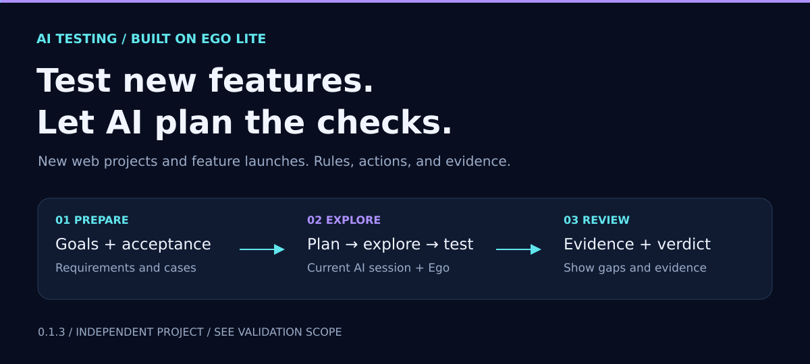
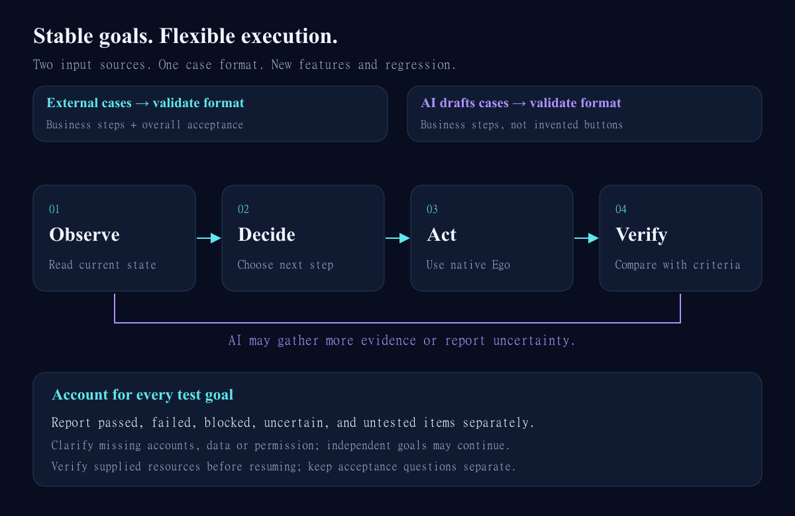
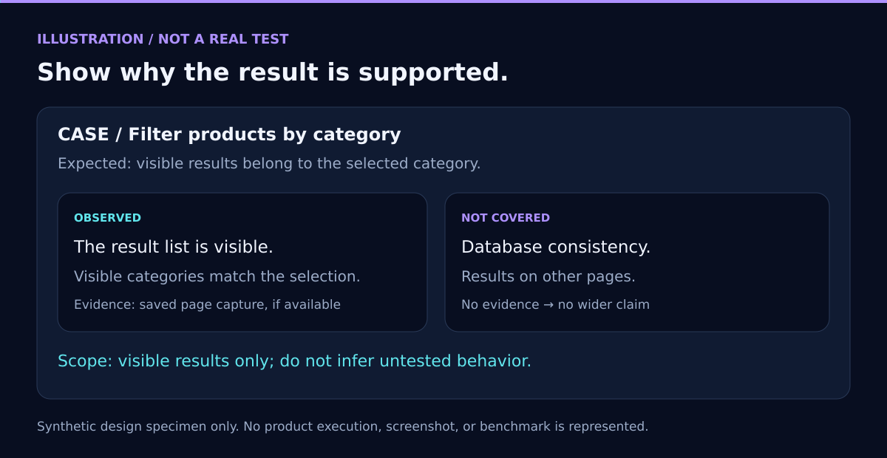

<p align="center"></p>

# AI-led Testing Skill Built on Ego Lite

<p align="center"><strong>English</strong> · <a href="README.md">简体中文</a><br><a href="#quick-start-on-windows">Quick start</a> · <a href="docs/architecture.en.md">Architecture</a> · <a href="docs/asset-formats.en.md">Format and commands</a> · <a href="docs/privacy.md">Privacy</a> · <a href="docs/testing.en.md">Validation</a></p>

**An AI-led Web testing Skill for new projects before their first launch and new features at their first delivery.** The current AI session analyzes requirements, plans tests, explores the application through Ego Lite, and checks outcomes against business rules and expectations. Observations and evidence make conclusions reviewable, rather than reducing them to a success/failure badge.

An existing automated test suite is not required. Supply prepared cases, or provide requirements, business rules, and acceptance expectations so the AI can draft cases in the Skill format. The AI may adapt its actions, gather more evidence, and adjust execution order while preserving goals, expectations, dependencies, and permission boundaries.

First launch is a target use case, not a promise to infer missing rules or guarantee release readiness. Missing requirements need clarification, and insufficient evidence must remain uncertain. Existing-feature regression is also supported.

**Version 0.1.3.** This independent project is not affiliated with or endorsed by Ego. v0.1.3 uses schemaVersion 3 in place of v0.1.2's schemaVersion 2. This is an intentional format change; no migration command is provided. Historical synthetic checks and this repair are documented separately; file checks do not establish real business acceptance. See the [validation record](docs/testing.en.md).


## 0.1.3 report delivery fix

Unless the user explicitly requests another format, completed test execution delivers standalone offline HTML, JSON, and Markdown. Chat summaries are insufficient. Key UI outcomes and defects require real screenshots; DOM, logs and summaries supplement them. The AI chooses capture moments, without a screenshot or expectation for every step. Missing screenshots must be visible and trigger conclusion review, not automatic product failure.

Build a complete standalone directory from the source repository with `npm run build:skill -- --output-dir ABS_NEW_EXTERNAL_SKILL_DIR`. The package contains the Skill, guides, scripts, schemas, synthetic examples and `runtime-manifest.json`. Copying only the source Skill instructions is incomplete. Before updating an existing installation, compare known source files and report unknown edits instead of overwriting them, creating duplicate installations or adding old-version backups.

Use the absolute root of the actually loaded SKILL.md, then run `node ABS_TOOL_ROOT/scripts/ego.mjs tool-info --expect-version 0.1.3 --expect-revision html-report-delivery-1`. Check paths, schemaVersion 3 and installationIntegrity. Every CLI command verifies installed files. Source mode uses an explicitly confirmed repository root. Fingerprints check consistency, not publisher identity.

`report` reads back all three outputs. `verify-report --run-dir ABS_RUN --report-dir ABS_REPORT_DIR` compares the files with current records, retained evidence and context sources. Receipts include paths, sizes, hashes and `browserOpen: not_checked`; actual browser opening is separate. Report access restrictions honestly without routing around them.

To retain an existing report, prepare a new external directory and pass `report --output-dir ABS_EXISTING_NEW_DIR`. Post-execution assembly also passes `--context ABS_CONTEXT_JSON`, defined by [the context schema](schemas/report-context.schema.json). It records limitations, existing source files and hashes, supplemental case IDs and AI-supplied reviews for every goal. Original claims remain separate; no pre-execution freeze, screenshot, timestamp or execution step is invented. No business actions run to fill a report.

This release is `0.1.3`, tool revision `html-report-delivery-1`. Cases and runs keep schemaVersion 3. Reports add screenshot coverage and optional retrospective context (context version 1); existing data is neither migrated nor deleted. See [validation](docs/testing.en.md).

## Cases and judgments



External cases and cases drafted by the AI following the Skill guidelines can support new-feature testing and regression. Cases describe business intent and necessary input. The current AI chooses an authorized execution route from the page it observes. `strict` preserves business-step order. `adaptive` may adjust a route or order only when intent, prerequisites, and coverage remain intact.

Keep the overall expected outcome and requirement basis. A step-level `expected` is optional; when supplied, it needs an independent source. Omitting it does not mean the step was skipped or passed automatically. When acceptance questions remain, put them in the frozen case's `clarificationQuestions`. While this list is nonempty, neither the final result nor any attempt may be `pass` or `fail`. After clarification, freeze a revised case rather than editing the old baseline.

Statuses remain distinct: `pass`, `fail`, `inconclusive`, `blocked`, and `not_run`. `not_run` means no final outcome is recorded and may coexist with exploratory attempts; the report distinguishes never-attempted cases from attempted cases without a final outcome. The helper validates local structures, revisions, and evidence-file hashes. It does not diagnose defects, select routes, retry business actions, or decide whether evidence supports a conclusion.

## Quick start on Windows

### Prepare the runtime

Follow the [official Ego Windows quick start](https://lite.ego.app/document/en/docs/windows/quick-start) to configure Ego and its official `ego-browser` Skill. This repository neither installs Ego nor replaces its official usage guide. The local report helper uses Node.js 22 or newer and has no third-party runtime package dependency.

### Keep private assets outside the source directory

Open PowerShell at the repository root. The private root must be outside the repository. `init` and `start` require a destination that does not already exist and never overwrite one.

```powershell
$Source = (Get-Location).Path
$LocalRoot = Join-Path $env:LOCALAPPDATA 'EgoLiteTest'
New-Item -ItemType Directory -Force -Path $LocalRoot | Out-Null
$Project = Join-Path $LocalRoot 'demo-project'
node .\scripts\ego.mjs init --project-dir $Project
```

Replace `$Project\cases.example.json` with cases checked against their sources. Validate, then freeze a new run:

```powershell
$Cases = Join-Path $Project 'cases.example.json'
$Run = Join-Path $LocalRoot ('run-' + [guid]::NewGuid().ToString('N'))
node .\scripts\ego.mjs validate-cases --cases $Cases
node .\scripts\ego.mjs start --project-dir $Project --cases $Cases --output-dir $Run
```

`start` creates local files only; it does not run a browser or business action. See the [Skill workflow](skills/ego-lite-test/SKILL.md) and its [local toolbox guide](skills/ego-lite-test/references/local-toolbox.en.md).

### Register evidence and record outcomes

Use a local file as evidence source only when it should be retained, and write a UTF-8 JSON request. Requests need a unique `operationId` and the current `expectedRevision`. Omit `capturedAt` when the source time is unknown:

```json
{
  "schemaVersion": 3,
  "operationId": "evidence-first-observation",
  "expectedRevision": 0,
  "caseId": "CONFIG-01",
  "sourceFile": "C:\\Users\\example\\AppData\\Local\\EgoLiteTest\\capture.png",
  "kind": "screenshot",
  "source": "Local page capture saved during this test",
  "description": "Observation of the settings page in a synthetic environment"
}
```

Run `evidence-add --run-dir $Run --request <absolute request file path>`. The helper copies a regular local file into the run's `evidence/` folder and calculates SHA-256 and byte count from the retained copy. It returns the evidence ID and catalog revision. The helper sets `collectedAt`; supply `capturedAt` only when the source provides that time.

Put the returned evidence ID in a `record` request's `evidenceIds`. `mode: "final"` updates the current outcome. `mode: "attempt"` appends a historical observation and leaves the current outcome unchanged. Example:

```json
{
  "schemaVersion": 3,
  "operationId": "CONFIG-01-first-attempt",
  "expectedRevision": 0,
  "caseId": "CONFIG-01",
  "mode": "attempt",
  "record": {
    "status": "inconclusive",
    "observed": "Synthetic observation: the page did not show a clear result after saving.",
    "rationale": "This page alone does not establish the frozen overall expectation.",
    "remainingQuestions": ["Is persistence after refresh required?"],
    "evidenceIds": ["replace-with-the-ID-returned-by-evidence-add"],
    "cause": "unknown"
  }
}
```

`operationId` is the idempotency key. Repeating the same ID with the same content returns the original receipt without appending again. Reusing the ID with changed content is rejected. A new request with an old `expectedRevision` is rejected as a conflict. A run-level exclusive lock rejects concurrent writers instead of retrying. If a response is lost, retry the exact same request to retrieve its receipt.

### Check progress and write a report

```powershell
node .\scripts\ego.mjs progress --run-dir $Run
node .\scripts\ego.mjs check --run-dir $Run
node .\scripts\ego.mjs report --run-dir $Run
Invoke-Item (Join-Path $Run 'report.html')
```

Progress counts each frozen case's **current final status**. `blocked`, `inconclusive`, and `not_run` stay separate; pending clarifications have their own list. Historical attempts are not counted again as current pass/fail outcomes. `report` writes `report.json`, `report.md`, and a standalone offline `report.html` in the run directory; it refuses to overwrite any of them. The HTML shows frozen goals, critical conditions, required path, order policy, observations, rationale, requirement basis, unverified items, each attempt and its remaining questions, and evidence source/SHA-256 metadata. Hash/size-verified PNG, JPEG, and WebP screenshots are embedded; missing, unsupported, or browser-undecodable images are called out without substituting an image. You can copy `report.html` by itself for an authorized reviewer; it does not need the run directory or network access. See the [schema v3 format and runtime contract](docs/asset-formats.en.md).

Business outcomes and file integrity are shown separately. A matching SHA-256 does not prove a screenshot is authentic or an outcome is correct. Before writing any report, the helper validates the run and every registered evidence file; a failed check writes no report. No image does not automatically mean failure; the AI decides whether more evidence or testing is needed under the user's authorization. A successful click or enabled button does not prove a submission succeeded; observe the actual result and persistence when required.



## Responsibilities and limits


| Part | Responsible for | Not responsible for |
| --- | --- | --- |
| Current AI session | Understand goals, select tests, use an authorized browser, review observations | Invent missing requirements or exceed authorization |
| Native Ego browser | Page reads and user-authorized browser actions | Decide whether business rules are correct |
| Local toolbox | Register files, validate records, hash current files, report progress, display an offline evidence report | Network/model/Ego access, automatic bug verdicts, retrying business actions |

SHA-256 detects whether retained bytes still match the catalog. It does not prove authenticity, source identity, or a business conclusion. The helper is not a security boundary against direct file edits or other local programs. A single JSON file is updated with a temporary file and rename. Evidence and catalog updates are not a general multi-file transaction and do not promise power-loss durability. A leftover `.run.lock` blocks writes; an operator should verify its process has exited before inspecting and handling the lock.

Evidence registration does not redact data. Screenshots, logs, URLs, and descriptions may contain personal or business information; limit their scope and review them before storage. Keep real cases, sites, credentials, and run output outside the repository. A private repository, hashes, ignore rules, and heuristic scans are not a secrets vault. See the [privacy guide](docs/privacy.md).

## Further reading

- [Skill workflow](skills/ego-lite-test/SKILL.md) and [local toolbox calling guide](skills/ego-lite-test/references/local-toolbox.en.md)
- [Architecture](docs/architecture.en.md), [schema v3 format and commands](docs/asset-formats.en.md)
- [v0.1.4 research backlog (Chinese)](docs/requirements.md): parallel cases and Space binding (not implemented)
- [Synthetic cases](examples/cases.example.json), [evidence request](examples/evidence-request.example.json), [result request](examples/record-request.example.json)
- [Validation status](docs/testing.en.md), [privacy](docs/privacy.md), [changelog](CHANGELOG.md)

## License

Original code and documentation in this repository are licensed under the [MIT License](LICENSE), copyright 2026 99Like-wjj. This license does not cover Ego, Ego's official browser, or other third-party software; their own licenses and official terms continue to apply. This is an independent project, not affiliated with or endorsed by Ego. The repository remains a private development repository; the license notice does not change repository visibility or mean a public release was created.
