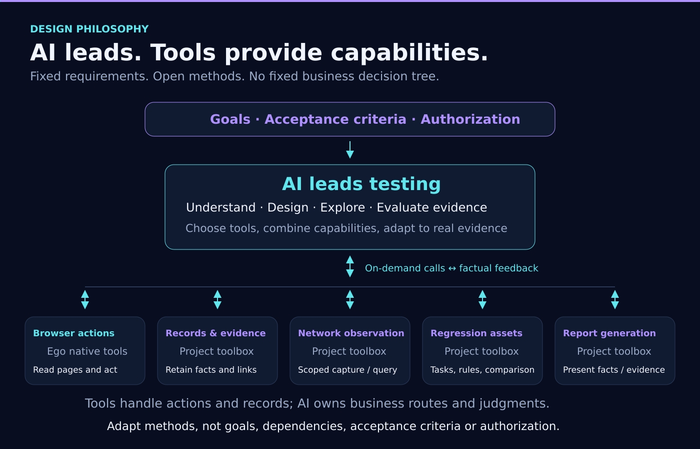

<p align="center"></p>

<h1 align="center">AI Autonomous Testing with Ego Lite</h1>

<p align="center"><strong>English</strong> · <a href="README.md">简体中文</a></p>

**An AI-led Web testing Skill built on Ego Lite.** For first launches, new features and regression, using existing cases or cases generated from requirements.

## Design philosophy: AI leads, tools provide capabilities

AI leads the testing: understanding requirements, designing cases, exploring pages, choosing actions and verification methods, and judging results from actual evidence. We provide composable capabilities, testing guidance and experience references to support this work, rather than a fixed process that decides every step for the AI.

- **AI chooses how to test.** It selects tools, organizes steps, gathers evidence, adapts methods or asks for clarification according to the goal and observed situation.
- **Tools deliver concrete capabilities.** Ego provides browser operations; this project provides test records, evidence retention, network observation, regression assets and reports. Tools do not decide whether the business behavior is correct.
- **Open methods, explicit requirements.** Methods can change, but business goals, acceptance standards, necessary dependencies and authorization cannot be silently changed or weakened. A successful operation is not a passed test.

As models improve, we aim to let AI use these capabilities more effectively. Actual testing quality must still be verified; a model upgrade does not guarantee improvement.



## Current release

The current release is **0.1.7 / report-step-evidence-1**. It integrates whole-scope resource clarification, first-run records, immutable task/rule revisions, whole-scenario status reruns, full declared scope and scheme-B report reading. Main contracts are v8, regressionVersion 1 and networkVersion 1. Scheme B places the issue/result and original expectation above actual steps and selected evidence, with independent nested scope disclosures. See [scheme B](docs/v0.1.7-step-evidence.md), [resource-readiness validation](docs/v0.1.7-resource-readiness-validation.md), [regression-reuse validation](docs/v0.1.7-regression-reuse-validation.md) and [local closeout (Chinese)](docs/v0.1.7-local-closeout.md).


Invoke `$ai-autonomous-testing-ego-lite`. Complete packages include Skill guidance, compiled Node ESM tools, schemas, examples and an integrity manifest. Source is TypeScript; installed use requires Node.js >=22.

See the [cloud integration review](docs/v0.1.7-cloud-review.md) for branch ancestry and review scope. All four branch heads are already included in the latest baseline; no duplicate merge is needed. Human review is approved; see the [release validation](docs/v0.1.7-release-validation.md) for scope and limitations.

## Version evolution


README shows the current version plus three previous versions. v0.1.4–v0.1.7 are released. [Full version history](docs/version-history.en.md) retains older releases. Hero, workflow, architecture, concurrency and report illustrations now describe this version, not real test evidence. v0.1.8 remains requirements planning.

## What changed in 0.1.7

This version brings together **readable reports, whole-scope resource clarification and reusable first-run results** in one record model.

- **Read the issue and reproduction path.** Scheme B leads with the issue and original expectation, then places actual steps beside selected evidence. Scenario/goal navigation and filters help locate problems; scope, original records and history expand on demand.
- **Inspect evidence in context.** Screenshots, API/log and document bodies retain context, shared-material boundaries and gaps. Offline HTML, JSON, Markdown, attachment delivery and eight reading themes are available.
- **Clarify resources for the whole requested scope.** Before first execution or resumption, review identities, objects, data, observation conditions and authorization; communicate known gaps together, retain partial answers and verify supplied conditions. Independent authorized goals can continue.
- **Retain first-run results for regression.** The AI authors project-specific immutable task/rule revisions from normative sources and actual observations, including failures and incomplete work. Historical defects never become correct expectations; general experience guidance remains human-maintained and read-only.
- **Choose between two regression scopes.** A historical goal-status match selects the entire scenario, or full mode selects the explicitly declared complete test set. This is not test-point-ID rerunning. Verify current conditions and create independent runs without overwriting old evidence.
- **Compare outcomes with their limits.** Bind task/rule revisions and actual actions to each run, exposing goal changes and condition differences. Reconcile unknown side effects instead of replaying them automatically; a status change alone does not prove a particular bug fix or version regression.

See [scheme B](docs/v0.1.7-step-evidence.md), [resource clarification](docs/v0.1.7-resource-readiness-validation.md), [regression validation](docs/v0.1.7-regression-reuse-validation.md) and [cloud review](docs/v0.1.7-cloud-review.md). The expanded v0.1.6 experience, goal-assessment and network-observation descriptions now live in [full version history](docs/version-history.en.md); this overview focuses on 0.1.7.

Regression interfaces and behavior are documented in [regression assets](docs/regression-reuse.md) and the [usage guide](skills/ai-autonomous-testing-ego-lite/references/regression-reuse.md).

All current test-asset JSON contracts use **schemaVersion 8**, and execution query viewVersion is 8. Older formats are explicitly rejected, without readers or converters. Keep historical reports, files and runs unchanged; prepare new v8 assets from original sources instead of changing only version fields. See [formats](docs/asset-formats.en.md).

## Cases, evidence and delivery


Before freezing, the AI maps each expectation to sources, prerequisites, actions and observation methods. Different role/data dependencies can be assessed separately without dropping workflow dependencies. Acceptance ambiguity belongs to goal.clarificationQuestions; actual resource and authorization gaps require real clarification. User-deferred goals remain visible. Do not expand acceptance scope after execution to justify a result.

Successful tool calls do not prove business success. Key UI findings require real screenshots, with AI-selected capture timing. DOM, logs and action receipts supplement images. Submission, drag, context and download uncertainty can benefit from targeted observations; capabilities must be verified against the current Ego version. A method name or timeout is not proof of a browser defect.

Default deliverables are standalone HTML, JSON and Markdown from one result projection. Reports expose expectations, observations, evidence, gaps, diagnosis and history. Screenshot gaps, record completeness and file integrity remain distinct. Hash consistency does not establish business correctness; file verification and actual browser opening are separate.

Scheme B retains every goal entrance in a scene and focuses on one goal at a time. The issue/result and full original expectation lead, actual steps occupy the middle and selected evidence appears alongside them. The directory starts/resets collapsed and filters preserve the selection. Scope notes show three items before an outer disclosure; exact task/rule details stay independently collapsed inside. Pending actions use Chinese business descriptions. Sourced readerNotes organize existing actions and evidence without inventing execution or overriding verdicts; shared material and missing step evidence are explicit. Original records/history and old reports remain intact under v8. See [the current reader design](docs/v0.1.7-step-evidence.md) and [the preceding reader revision](docs/v0.1.7-reader-review.md). Builds do not update the installed Skill.

Network observation implements the v3 design through network start/status/query/stop: a dedicated native context records scoped Fetch/XHR, SSE and WebSocket evidence; the AI chooses queries, evidence and business judgments. It never replays business requests. Network data uses independent networkVersion 1, while current business contracts use v8 and v5 historical runs remain untouched. See [observation guidance (Chinese)](skills/ai-autonomous-testing-ego-lite/references/network-observation.md).


## Quick start on Windows

This source example targets the current release in .build/runtime, without replacing the user installation. Verify a released installation against its actual version and revision.

Download the full installation package, SHA-256 checksums and release notes from [v0.1.7 Release](https://github.com/99Like-wjj/ai-autonomous-testing-ego-lite/releases/tag/v0.1.7). GitHub-generated Source code archives are not full installation packages.

Prepare Ego and the official ego-browser Skill using the [official guide](https://lite.ego.app/document/en/docs/windows/quick-start). This project does not install or replace Ego. Case design alone requires no browser connection.

From the confirmed source root:

```powershell
npm ci
npm run build
$Tool = Join-Path (Get-Location).Path '.build/runtime/scripts/ego.mjs'
node $Tool tool-info --expect-version 0.1.7 --expect-revision report-step-evidence-1
$LocalRoot = Join-Path $env:LOCALAPPDATA 'EgoLiteTest'
New-Item -ItemType Directory -Force -Path $LocalRoot | Out-Null
$Project = Join-Path $LocalRoot ('project-' + [guid]::NewGuid().ToString('N'))
node $Tool init --project-dir $Project
```

For a complete installed package, use scripts/ego.mjs under the actual loaded Skill root. Keep real assets outside source control. Review the generated example against trusted requirements before freezing:

```powershell
$Cases = Join-Path $Project 'cases.example.json'
$Run = Join-Path $LocalRoot ('run-' + [guid]::NewGuid().ToString('N'))
node $Tool validate-cases --cases $Cases
node $Tool start --project-dir $Project --cases $Cases --output-dir $Run
```

start creates local assets, not browser actions. Use the [toolbox guide](skills/ai-autonomous-testing-ego-lite/references/local-toolbox.en.md) and [synthetic requests](examples/record-request.example.json) to register evidence and goal assessments. Unique operation IDs and revisions protect data transactions; replaying a request recovers its receipt, not a business action.

```text
node ABS_TOOL evidence-add --run-dir ABS_RUN --request ABS_EVIDENCE_REQUEST
node ABS_TOOL record --run-dir ABS_RUN --request ABS_RECORD_REQUEST
node ABS_TOOL progress --run-dir ABS_RUN
node ABS_TOOL check --run-dir ABS_RUN
node ABS_TOOL report --run-dir ABS_RUN
node ABS_TOOL verify-report --run-dir ABS_RUN --report-dir ABS_REPORT_DIR
```

Reports refuse overwrite; use a new directory for later reports. browserOpen:not_checked is not a browser validation claim. Open and inspect the actual HTML through Ego before claiming that validation. Examples contain fictional data only.

## Operational limits

Spaces do not guarantee separate accounts or backend data. File updates are not a general multi-file transaction or power-loss guarantee. Evidence registration does not redact data; keep credentials, real sites and screenshots private and do not auto-upload reports. Enable network observation only within authorization; it never replays business requests. See [privacy](docs/privacy.md) and [architecture and responsibilities](docs/architecture.en.md).

## Configurable concurrency


Repair commit 8e6e2d9 is integrated while retaining v8 goal assessment and the API-monitoring design. Hosts own real workers, context, permissions, waiting and cleanup; this package adds no fixed host dispatcher. Read [host conditions and handoff (Chinese)](skills/ai-autonomous-testing-ego-lite/references/host-compatibility.md). Codex uses $ai-autonomous-testing-ego-lite; Claude Code uses /ai-autonomous-testing-ego-lite. Complete live host workflows still need separate acceptance. See the [integration record](docs/v0.1.6-cross-host-integration.md).

The default is **1 (serial)**. Without a user request for concurrency or an explicit setting, execute cases one at a time. Set `start --max-parallel-cases N` or project execution-config.json to opt in; N is a positive safe integer with no fixed 2/4/8 product ceiling. The AI chooses tool calls, batches and worker use within that limit; it need not fill all slots. Host limits are recorded only when explicitly available, otherwise unknown. No automatic host probing or global configuration changes occur. Workers seal local packets; the coordinator reviews and imports them. See the [parallel guide](skills/ai-autonomous-testing-ego-lite/references/parallel-testing.md). npm test builds and tests emitted JS; npm run check:public checks publishable source assets.

## v0.1.8 requirements preview (testing quality optimization)

First-run testing, failed-scope reruns and report review exposed candidate-task/data review costs, wider whole-scenario selection and imprecise step/evidence associations. The next requirements target those testing-quality gaps:

- Stable IDs for every minimum independently assessable test point across all four outcomes. IDs persist across runs, separately from revisions and attempts; users can request a point rerun by ID while retaining required dependencies. IDs are not reserved for bugs.
- Separate original-defect recurrence, new findings and goal outcomes. Full regression checks a current confirmed target inventory, retaining new, blocked, unorganized and unassessed scope.
- Precise action/input/readback/evidence links at record time, explicit data parameters and reusable Ego operation fragments selected by AI under stated conditions.
- Auditable available usage and time by run/point/phase, with unavailable tokens marked missing. Do not infer savings from target counts. Preserve coverage, judgment, evidence, authorization and completion evaluation work.

See the [v0.1.8 requirements and background](docs/v0.1.8-preview.en.md). Identifier, dependency, parameter and usage designs require review before development. Software/contracts remain unchanged; the [v0.1.7 preview](docs/v0.1.7-preview.md) remains historical rather than a claim that all quality-evaluation work shipped.

## Further reading

- [Full version history](docs/version-history.en.md), [historical requirements](docs/requirements.md), [v0.1.5 naming and upgrade history (Chinese)](docs/rename-upgrade.md)
- [Design experience](skills/ai-autonomous-testing-ego-lite/references/case-design-guide.md), [execution experience](skills/ai-autonomous-testing-ego-lite/references/experience-guide.md), [network observation](skills/ai-autonomous-testing-ego-lite/references/network-observation.md) (Chinese)

- [Skill](skills/ai-autonomous-testing-ego-lite/SKILL.md), [case design](skills/ai-autonomous-testing-ego-lite/references/case-authoring.md), [judgment](skills/ai-autonomous-testing-ego-lite/references/judgment-and-diagnosis.md)
- [Architecture](docs/architecture.en.md), [formats](docs/asset-formats.en.md), [validation](docs/testing.en.md), [changelog](CHANGELOG.md)
- [Cases](examples/cases.example.json), [evidence requests](examples/evidence-request.example.json), [result requests](examples/record-request.example.json)

## Feedback and contact

Report bugs or suggest improvements through [GitHub Issues](https://github.com/99Like-wjj/ai-autonomous-testing-ego-lite/issues) or the contacts below. Include the version, reproduction steps, and redacted errors or screenshots. Do not submit passwords, tokens, keys, or confidential company information.

- Author: [99Like-wjj](https://github.com/99Like-wjj)
- Email: [wjj990517@gmail.com](mailto:wjj990517@gmail.com)
- WeChat: A2326543144

  
- QQ: 2326543144
- X: [@99Like_ovo](https://x.com/99Like_ovo)

## License

Original code and documentation in this repository are licensed under the [MIT License](LICENSE), copyright 2026 99Like-wjj. This license does not cover Ego, Ego's official browser, or other third-party software; their own licenses and official terms continue to apply. This is an independent project, not affiliated with or endorsed by Ego. The source is available under the MIT License. Development is ongoing; refer to each release's notes for its capabilities and validation scope.
