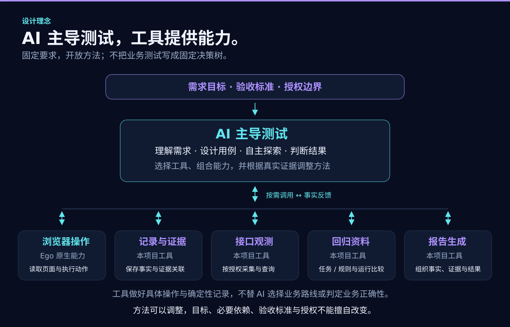

<p align="center"></p>

<h1 align="center">基于 Ego Lite 的 AI 自主测试 Skill</h1>

<p align="center"><a href="README.en.md">English</a> · <strong>简体中文</strong><br><a href="#windows-快速开始">快速开始</a> · <a href="docs/architecture.md">架构</a> · <a href="docs/asset-formats.md">格式与命令</a> · <a href="docs/testing.md">验证状态</a></p>

**基于 Ego Lite 的 AI 自主 Web 测试 Skill。** 面向新项目首次上线、新功能交付和已有功能回归，支持接收现成用例或根据需求生成用例。

## 设计理念：AI 主导，工具提供能力

本项目由 AI 主导自动化测试。AI 负责理解需求、设计用例、自主探索页面、选择操作与验证方法，并依据实际证据判断结果。我们提供可按需组合的具体能力工具，以及测试规范和经验参考，帮助 AI 完成工作，而不是用固定流程替它决定每一步。

- **AI 决定怎样测。** 根据目标和现场情况，自主选择工具、组织步骤、补充取证、调整方法，或提出澄清。
- **工具把具体能力做好。** Ego 提供浏览器操作；本项目工具提供测试记录、证据留存、接口观测、回归资料和报告生成等能力，不替 AI 判定业务是否正确。
- **方法开放，要求明确。** 可以灵活选择方法，但不能改变业务目标、降低验收标准、跳过必要依赖或扩大授权；操作成功不等于测试通过。

我们希望随着模型能力提升，让 AI 更好地运用这些能力完成测试；实际效果仍通过验证来判断，不预设升级就一定更好。



## 当前版本

当前开发候选为 **0.1.7-rc.1 / report-step-evidence-1**，已进入云端整合与人工审阅准备，尚未正式发布。已整合整轮资源沟通、首次成果留存、规则/任务修订、按状态整场景及全量回归、报告方案 B；主契约为 v8，regressionVersion 1，networkVersion 1。报告方案 B 将问题描述和原预期置顶，实际步骤与所选证据并排，范围说明采用独立两层折叠。范围和限制见[报告方案 B](docs/v0.1.7-step-evidence.md)、[资源澄清验证](docs/v0.1.7-resource-readiness-validation.md)、[回归复用验证](docs/v0.1.7-regression-reuse-validation.md)及[本地收尾核验](docs/v0.1.7-local-closeout.md)。

Skill 标识为 `ai-autonomous-testing-ego-lite`，显式调用 `$ai-autonomous-testing-ego-lite`。完整包提供 Skill、指南、Node ESM 工具、schema、示例和文件清单。源码维护 TypeScript，安装使用 Node.js >=22。

审阅入口与本轮范围见 [0.1.7 云端整合审阅](docs/v0.1.7-cloud-review.md)。四个工作分支均已包含在最新基线中，不重复应用提交；人工审阅通过前不合入 main、不创建 Tag 或 Release。

## 版本演变


README 展示当前版本与前三个历史版本：0.1.7 明确标为候选，0.1.4–0.1.6 为已发布版本。更早版本及完整介绍保留在[完整版本演变](docs/version-history.md)中。头图、流程、架构、并发与报告示意已对齐本候选；图片是能力说明，不是真实测试证据。0.1.8 仅为需求规划。

## 0.1.7 做了什么

这一版围绕 **报告更好读、测试资源先沟通、首次成果可回归复用** 三个方向，把报告优化与资源/回归能力整合到同一套记录中。

- **看清问题和复现过程。** 报告方案 B 把问题描述与原预期放在顶部，实际操作步骤与对应证据并排；按场景/目标筛选定位，范围、原始记录与历史按需展开，减少重复阅读。
- **证据就近查看。** 支持截图、接口/日志及资料正文，保留图片上下文、共享材料与缺口说明；支持离线 HTML、JSON、Markdown 和附件交付，八种主题便于阅读。
- **按整轮范围沟通资源。** 首次执行或恢复前核对身份、对象、数据、观察条件及操作授权，集中说明已知缺口；承接部分答复，核实补充条件，独立且获授权的目标可继续。
- **首次测试成果留作回归资料。** 保存规则依据、实际观察、失败及未完成信息，由 AI 整理项目专属任务与规则修订。历史异常不会被固化成正确预期，通用经验指南仍人工维护、运行时只读。
- **支持两种回归范围。** 按历史目标状态命中后重跑整条场景，或对明确的完整测试集执行全量回归；不是按测试点编号单点回测。每次重新核验条件，创建独立运行，不覆盖历史证据。
- **比较结果也保留限制。** 关联本轮任务/规则版本、实际动作及目标结论，展示跨轮变化和条件差异。未知副作用先核对，不自动重放；状态变化不直接等同于某个 Bug 被修复或新版本引入缺陷。

设计与验证依据：[报告方案 B](docs/v0.1.7-step-evidence.md)、[整轮资源澄清](docs/v0.1.7-resource-readiness-validation.md)、[回归复用](docs/v0.1.7-regression-reuse-validation.md)、[云端整合审阅](docs/v0.1.7-cloud-review.md)。0.1.6 的经验指南、目标评估、接口观测等补充说明已归入[完整版本历史](docs/version-history.md)，此处聚焦 0.1.7 的变化。

回归接口与行为边界见[回归资料](docs/regression-reuse.md)和[回归使用指南](skills/ai-autonomous-testing-ego-lite/references/regression-reuse.md)。

当前测试资产 JSON 契约统一为 **schemaVersion 8**，execution read 的 viewVersion 为 8。新版明确拒绝旧格式，不提供兼容读取或转换。旧报告、截图、运行与来源文件保持原样；重新使用来源时创建新的 v8 资产，不只改版本号，也不覆盖历史。具体见[格式说明](docs/asset-formats.md)。

## 用例与证据


冻结前，AI 核对每个 goal 的来源、前提、动作和观察方式；不同身份或数据依赖可分别表达，必要连续流程仍保留。验收歧义放在目标 clarificationQuestions，实际资源或授权缺口通过真实问答解决；用户明确暂缓的目标继续保留。不能在执行结束时临时扩大已有目标的验收范围。

工具操作成功不代表业务结果成功。关键 UI 结果与缺陷必须有真实页面截图，AI 自主选择取证时机，DOM/日志/动作回执补充截图。下载、拖动、上下文和提交异常可按需查有区分力的观察，具体 Ego 能力仍须以当次安装版本和实际验证为据；能力名称或一次超时不能证明浏览器缺陷。

默认交付独立 HTML、JSON、Markdown。报告显示目标预期、观察、证据、缺口、根因确认程度和历史；三种格式共享统计。缺图与文件完整性单独展示，哈希一致不证明业务判断正确。文件校验与实际浏览器打开分别验证。

当前报告采用方案 B：场景保留全部目标入口，一次聚焦一个目标；顶部呈现问题描述/验证结果及完整原预期，中间呈现实际步骤，右侧展示所选步骤证据。目录默认/重置收起，筛选保留正文选择；范围说明超过三条时外层折叠，其内精确任务/规则明细仍独立收起。未决动作使用中文业务说明，原始记录和历史保留。可选 readerNotes 只整理有来源的既有事实与问题位置，不能补造步骤、现场或改写四态；共享证据和逐步资料缺口明确说明。业务契约仍为 v8，旧报告不覆盖。见[最终阅读设计](docs/v0.1.7-step-evidence.md)及[此前阅读修复](docs/v0.1.7-reader-review.md)。开发构建不会自动替换用户安装。

接口观测按最终设计 v3 实现：network start/status/query/stop 通过独立 native 上下文自动记录已授权顶层页面的 Fetch/XHR、SSE 及 WebSocket 正文。AI 按需查询、选择证据并自主判断；不强制每步查询，不重发业务请求。网络格式独立为 networkVersion 1，当前结果契约为 v8，原 v5 运行历史保持原样。内容策略、容量、停止/恢复及来源限制见[接口观测指南](skills/ai-autonomous-testing-ego-lite/references/network-observation.md)。


## Windows 快速开始

本节源码示例针对当前开发候选，使用本仓库构建的 .build/runtime；不会自动替换用户安装。正式安装包按其实际版本和 revision 核对。

0.1.7 仍在人工审阅，尚无正式下载包；当前已发布的完整包仍为 [v0.1.6 Release](https://github.com/99Like-wjj/ai-autonomous-testing-ego-lite/releases/tag/v0.1.6)。不要把旧包当作本页 0.1.7 能力。

先按 [Ego 官方 Windows 快速开始](https://lite.ego.app/document/en/docs/windows/quick-start)准备 Ego 与官方 ego-browser Skill。本仓库不安装或替代官方浏览器。仅设计用例无需浏览器连接。

源码开发在已确认仓库执行：

```powershell
npm ci
npm run build
$Tool = Join-Path (Get-Location).Path '.build/runtime/scripts/ego.mjs'
node $Tool tool-info --expect-version 0.1.7-rc.1 --expect-revision report-step-evidence-1
```

独立安装包则使用实际加载 SKILL.md 根目录下 scripts/ego.mjs。核对安装完整性，不混用旧工具根。真实资产保存在源码仓库外：

```powershell
$LocalRoot = Join-Path $env:LOCALAPPDATA 'EgoLiteTest'
New-Item -ItemType Directory -Force -Path $LocalRoot | Out-Null
$Project = Join-Path $LocalRoot ('project-' + [guid]::NewGuid().ToString('N'))
node $Tool init --project-dir $Project
$Cases = Join-Path $Project 'cases.example.json'
```

将示例改成已核对来源和授权的 v8 用例，再冻结：

```powershell
$Run = Join-Path $LocalRoot ('run-' + [guid]::NewGuid().ToString('N'))
node $Tool validate-cases --cases $Cases
node $Tool start --project-dir $Project --cases $Cases --output-dir $Run
```

start 只创建本地基线与空账本，不自动执行浏览器。按[工具箱指南](skills/ai-autonomous-testing-ego-lite/references/local-toolbox.md)登记真实文件与显式目标评估：

```text
node ABS_TOOL evidence-add --run-dir ABS_RUN --request ABS_EVIDENCE_REQUEST
node ABS_TOOL record --run-dir ABS_RUN --request ABS_RECORD_REQUEST
node ABS_TOOL progress --run-dir ABS_RUN
node ABS_TOOL check --run-dir ABS_RUN
node ABS_TOOL report --run-dir ABS_RUN
node ABS_TOOL verify-report --run-dir ABS_RUN --report-dir ABS_REPORT_DIR
```

请求用唯一 operationId 和当前 expectedRevision。相同请求重放只取回数据回执，不重复业务；冲突拒绝后由 AI 核对现状。report 拒绝覆盖，另存使用新目录。verify-report 的 browserOpen:not_checked 不表示实际已打开，需单独通过 Ego 检查后再说明。示例只含合成数据，不能当真实通过证据。

## 使用边界

Space 不保证账号或后端数据隔离；文件更新不承诺通用多文件事务或断电持久性。证据登记不自动脱敏，真实账号、凭据、站点和截图放在私有工作区，不自动上传报告。接口观测只在授权范围内启用，不重发业务请求。详见[隐私指南](docs/privacy.md)与[完整架构及职责](docs/architecture.md)。

## 并发配置与开发


已整合跨宿主修复提交 8e6e2d9，当前保留 v8 目标评估与监控设计。宿主负责真实子 Agent 的创建、上下文、权限、等待和收尾；本工具不提供固定宿主调度器。跨终端执行前参阅[宿主条件与交接](skills/ai-autonomous-testing-ego-lite/references/host-compatibility.md)。Codex 使用 $ai-autonomous-testing-ego-lite，Claude Code 使用 /ai-autonomous-testing-ego-lite；各宿主完整真实链路仍须分别验收。整合验证见[记录](docs/v0.1.6-cross-host-integration.md)。

`maxParallelCases` 默认为 **1（逐条执行）**；用户未要求并发且未明确配置时保持串行。用户可用命令行或项目配置指定任意可准确表示的正整数，无固定产品上限。AI 决定工具调用、批次与 worker 使用，配置不要求跑满。宿主明确提供的限制单独记录，未知则保持未知，不主动探测客户端最大子代理数或修改全局配置。

```text
node ABS_TOOL_ROOT/scripts/ego.mjs start --project-dir ABS_PROJECT --cases ABS_CASES --output-dir ABS_NEW_RUN --max-parallel-cases 3
```

AI workers 独立留证、封存包，协调者显式复核并导入。完整调用和恢复语义见[并发指南](skills/ai-autonomous-testing-ego-lite/references/parallel-testing.md)。所有继续维护的 CLI、报告交互、测试、构建／检查、历史验证工具和图片生成程序以 TS 维护；`.build` 是忽略的编译产物。`npm test` 先构建再测试实际 JS；`npm run check:public` 检查源文件，独立包仍使用严格资源清单。本仓库的构建、测试不注册或更新用户级 Skill，也不推送、创建 Tag 或 Release。

## v0.1.8 需求前瞻（测试效果优化）

首次测试、失败范围复测和报告审阅表明：现有回归仍需 AI 重新核对候选任务和当前数据，整场景重跑范围可能大于原问题范围，动作与证据关联也有待更精确。下一版继续以测试效果为目标：

1. **稳定测试点编号：** 每个最小可独立判断目标都有编号，包含全部四态；同一目标跨运行沿用编号，内容修订与执行次数另记。支持用户给出编号后单点回测，保留必要依赖，不只给 Bug 编号。
2. **缺陷与全量回归：** 区分原问题是否复现、新发现及目标四态；全量对照最新已确认需求的完整目标清单，保留新增、受阻、未整理和缺少评估的范围。
3. **精确证据与任务复用：** 在入账时关联具体动作、输入、读回及证据；参数化日期和对象，按需复用有适用条件的稳定 Ego 操作片段，保持 AI 自主方法和业务判断。
4. **效果和成本实测：** 记录可取得的运行/测试点/阶段用量与耗时；拿不到 token 时明确缺失，不用目标数量推算节省比例。保留覆盖、误判、证据、授权和完成情况的评测方向。

完整背景、七项需求及验收方向见 [v0.1.8 需求前瞻](docs/v0.1.8-preview.md)。编号/依赖/参数/用量等具体设计须审核后开发；当前软件与契约不升级。原 [v0.1.7 前瞻](docs/v0.1.7-preview.md)作为历史保留，未完成的效果评测不写成已交付能力。

## 继续阅读

- [完整版本演变](docs/version-history.md)、[历史需求与调研](docs/requirements.md)、[v0.1.5 更名历史与升级说明](docs/rename-upgrade.md)
- [用例设计经验入口](skills/ai-autonomous-testing-ego-lite/references/case-design-guide.md)、[执行经验入口](skills/ai-autonomous-testing-ego-lite/references/experience-guide.md)、[接口观测指南](skills/ai-autonomous-testing-ego-lite/references/network-observation.md)

- [Skill](skills/ai-autonomous-testing-ego-lite/SKILL.md)、[用例生成](skills/ai-autonomous-testing-ego-lite/references/case-authoring.md)、[判断与归因](skills/ai-autonomous-testing-ego-lite/references/judgment-and-diagnosis.md)
- [架构](docs/architecture.md)、[格式](docs/asset-formats.md)、[验证状态](docs/testing.md)、[更新记录](CHANGELOG.md)
- [用例示例](examples/cases.example.json)、[证据请求](examples/evidence-request.example.json)、[结果请求](examples/record-request.example.json)

## 问题反馈与联系

欢迎通过 [GitHub Issues](https://github.com/99Like-wjj/ai-autonomous-testing-ego-lite/issues) 或以下联系方式反馈问题、提出建议。请附上版本号、复现步骤和脱敏后的报错或截图，不要提交密码、令牌、密钥或公司内部资料。

- 作者：[99Like-wjj](https://github.com/99Like-wjj)
- 邮箱：[wjj990517@gmail.com](mailto:wjj990517@gmail.com)
- 微信：A2326543144

  
- QQ：2326543144
- X：[@99Like_ovo](https://x.com/99Like_ovo)

## 许可证

本仓库原创代码和文档按 [MIT License](LICENSE) 授权，版权声明为 2026 99Like-wjj。此许可不覆盖 Ego、Ego 官方浏览器或其他第三方软件；它们仍受各自许可和官方条款约束。本项目非 Ego 官方项目，未获其背书。源码按 MIT 许可开放；项目仍在持续开发，具体版本能力与验证范围以对应版本说明为准。
