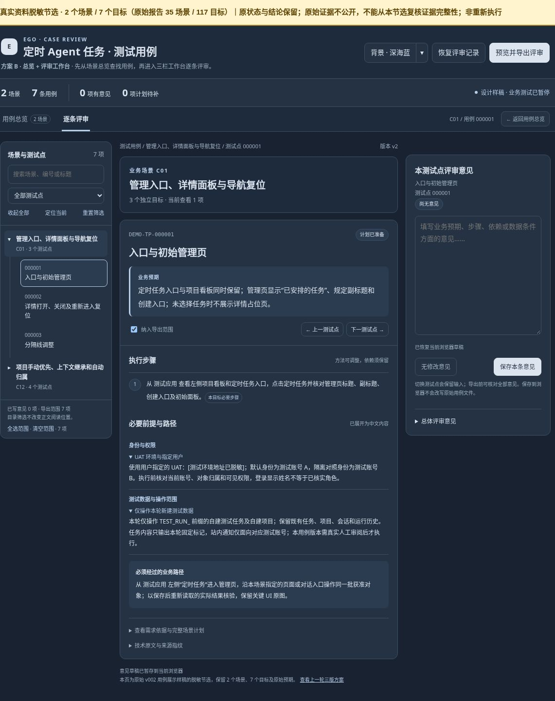
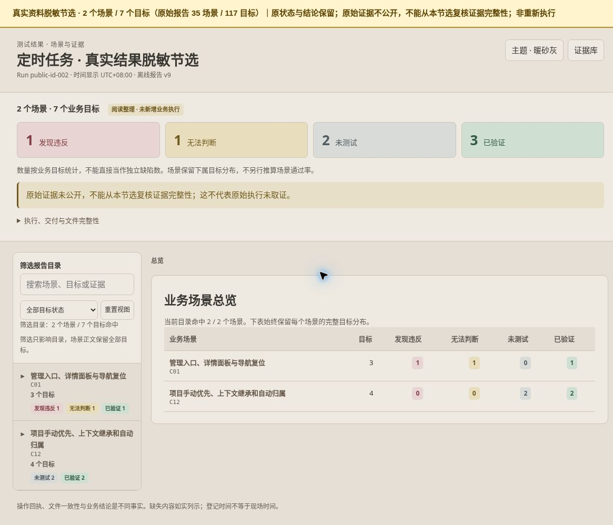
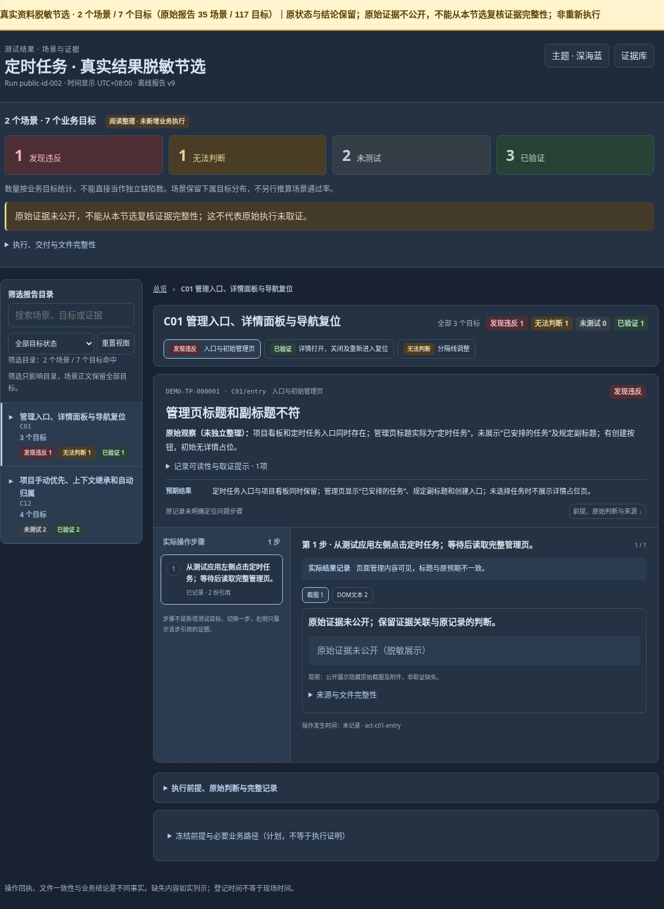
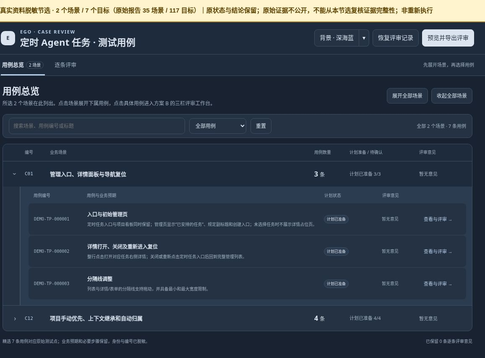
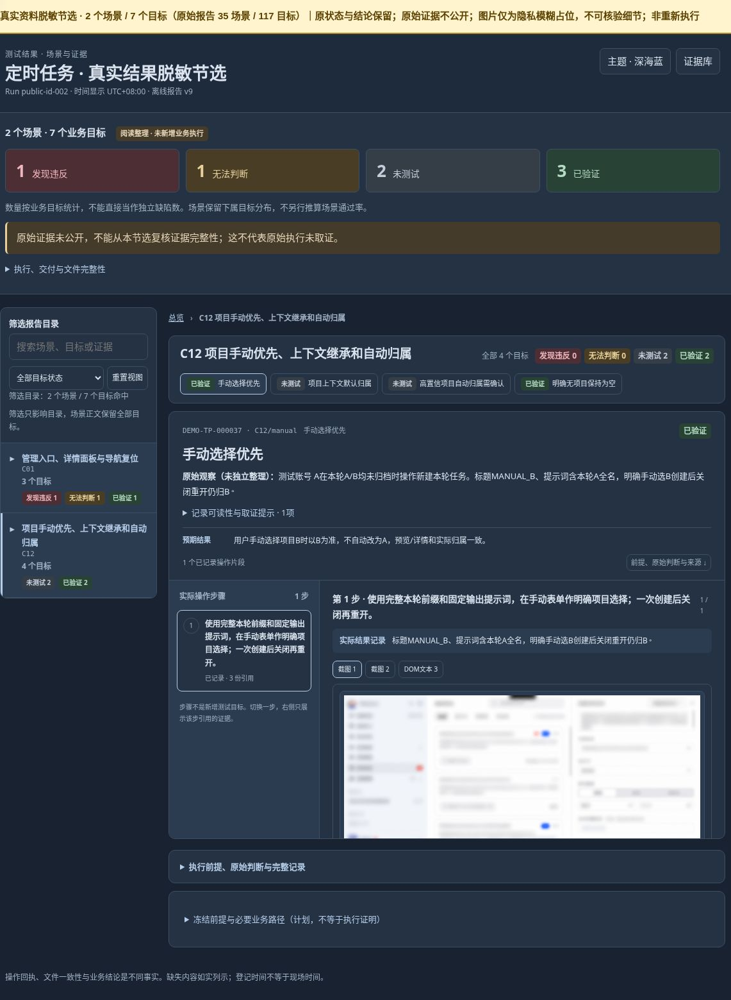
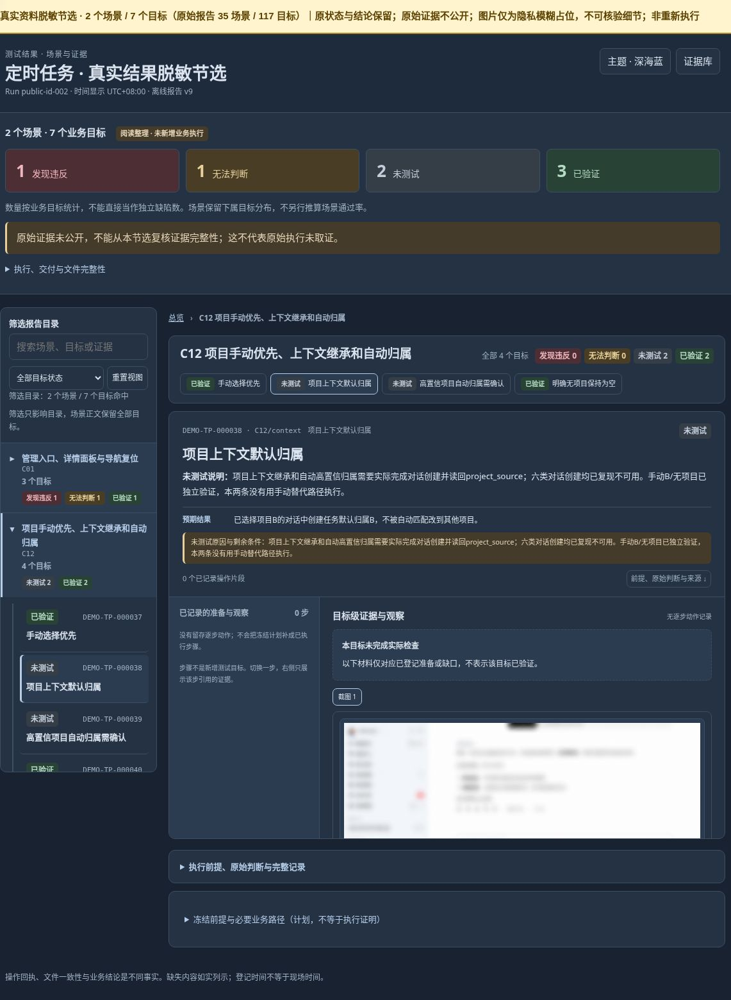
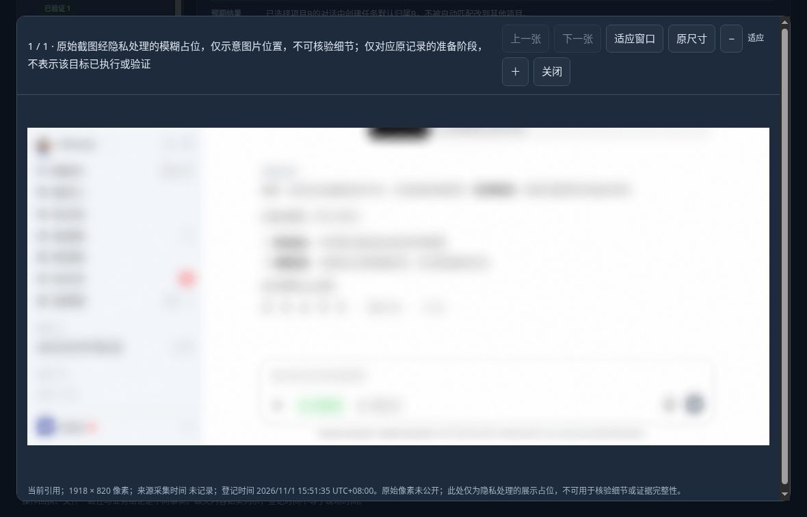

<p align="center"></p>

<h1 align="center">AI 自主自动化测试 · Ego Lite</h1>

<p align="center"><a href="README.en.md">English</a> · <strong>简体中文</strong><br><a href="#windows-快速开始">快速开始</a> · <a href="docs/architecture.md">架构</a> · <a href="docs/asset-formats.md">格式与命令</a> · <a href="docs/testing.md">验证状态</a></p>

**面向 Web 应用的 AI 自动化测试（AI testing / test automation）Skill。** AI 自主分析需求、设计用例、通过 Ego Lite 执行并依据真实证据判断结果，支持新功能与已有功能回归。

## 配套工具：项目知识库维护 Skill

[project-knowledge-maintainer](https://github.com/99Like-wjj/project-knowledge-maintainer) 负责创建、维护和更新项目知识库。本仓库负责在测试时按需读取、查询和使用知识，二者通过独立的**项目知识格式 v3**协作，而不是相互代理调用。维护仓库现已公开，可直接访问。真实项目资料与生成的知识库仍须保存在源码仓库外的私有目录。

使用顺序：先在授权范围内由维护 Skill 整理项目资料，保存到源码仓库外的私有知识目录；再向 Ego 提供该目录及独立确认的项目身份，按需调用 `knowledge inspect/query/read`。更新知识后重新读取，不自动改写已冻结用例或历史结果。无需在每次测试中调用维护 Skill；没有知识库时继续已有资料支持的工作。

通用测试经验留在 Ego 的设计/执行指南中，项目特有地图、公共规则和用户声明的配置/账号说明留在知识库中。配置是轻量记录，不强制建立权限矩阵；功能细则仍按任务读取原始需求。真实知识、原始业务资料和凭据不随任何 Skill 发布。详见[知识使用指南](skills/ai-testing-ego-lite/references/project-knowledge.md)。

## 设计理念：AI 主导，工具提供能力

本项目由 AI 主导自动化测试。AI 负责理解需求、设计用例、自主探索页面、选择操作与验证方法，并依据实际证据判断结果。我们提供可按需组合的具体能力工具，以及测试规范和经验参考，帮助 AI 完成工作，而不是用固定流程替它决定每一步。

- **AI 决定怎样测。** 根据目标和现场情况，自主选择工具、组织步骤、补充取证、调整方法，或提出澄清。
- **工具把具体能力做好。** Ego 提供浏览器操作；本项目工具提供测试记录、证据留存、接口观测、回归资料和报告生成等能力，不替 AI 判定业务是否正确。
- **方法开放，要求明确。** 可以灵活选择方法，但不能改变业务目标、降低验收标准、跳过必要依赖或扩大授权；操作成功不等于测试通过。

我们希望随着模型能力提升，让 AI 更好地运用这些能力完成测试；实际效果仍通过验证来判断，不预设升级就一定更好。


## 当前版本

当前开发候选为 **0.2.1-rc.1 / attachments-review-2**，新Skill标识`ai-testing-ego-lite`，显式调用`$ai-testing-ego-lite`。开发版本尚未发布，GitHub仓库地址仍保留旧名；使用前核对完整安装内容的身份。最近正式包仍是 [v0.1.9](https://github.com/99Like-wjj/ai-autonomous-testing-ego-lite/releases/tag/v0.1.9)。本次附件与评审改动及验证范围见[验证记录](docs/evaluations/attachment-review-20261106/validation.md)。

完整编译包与安装说明见[安装指南](INSTALL.zh-CN.md)，不把源码ZIP当作安装包。下次采用完整新名称安装并删除旧入口，不保留旧名别名；历史数据保持原样。实现设计见[0.2.1设计](docs/v0.2.1-design.md)，当前验证范围见[开发自测](docs/v0.2.1-development-validation.md)。

## 版本演变


图中保留最新版本与前三个历史版本；更早版本和原验证记录保留在[完整版本演变](docs/version-history.md)。

## 0.2.1 做了什么

- 在一次工具编排中组合已确定的本地步骤，避免只为运行脚本增加模型往返；AI仍自主判断业务路径。
- 按目标读取：progress/context默认摘要、goals索引、point完整必要语义，长内容明确导出，不覆盖原件。
- 入账即反馈：record提交收据与结构缺项分别返回，提示失败不改写已成功提交，重放仍使用原revision。
- 可选用量统计：只读显式导出、去重请求、区分缓存和推理子项；缺失保留未知，不自动计费。
- 统一新Skill身份与构建路径；用例审阅、知识读取、完整对话、证据报告、回归复用和并发约束继续适用。

存储契约仍为v9，知识为v3，回归为v2。新CLI读取和record输出使用独立版本，详情见[格式与命令](docs/asset-formats.md)及[工具箱](skills/ai-testing-ego-lite/references/local-toolbox.md)。已有v0.1.9包与旧报告不自动替换。

报告继续跟随用户语言，分别记录用例生成与执行阶段的模型和思考等级来源；未知不补造，原始证据不翻译。

## 用例与证据


冻结前，AI 核对每个 goal 的来源、前提、动作和观察方式；不同身份或数据依赖可分别表达，必要连续流程仍保留。验收歧义放在目标 clarificationQuestions，实际资源或授权缺口通过真实问答解决；用户明确暂缓的目标继续保留。不能在执行结束时临时扩大已有目标的验收范围。

工具操作成功不代表业务结果成功。关键 UI 结果与缺陷必须有真实页面截图，AI 自主选择取证时机，DOM/日志/动作回执补充截图。下载、拖动、上下文和提交异常可按需查有区分力的观察，具体 Ego 能力仍须以当次安装版本和实际验证为据；能力名称或一次超时不能证明浏览器缺陷。

默认交付独立 HTML、JSON、Markdown。报告显示目标预期、观察、证据、缺口、根因确认程度和历史；三种格式共享统计。缺图与文件完整性单独展示，哈希一致不证明业务判断正确。文件校验与实际浏览器打开分别验证。

当前报告采用方案 B：场景保留全部目标入口，一次聚焦一个目标；顶部呈现问题描述/验证结果及完整原预期，中间呈现实际步骤，右侧展示所选步骤证据。目录默认/重置收起，筛选保留正文选择；范围说明超过三条时外层折叠，其内用例、范围与来源明细按需查看。未决动作使用本次选定报告语言的业务说明，原始记录和历史保留。可选 readerNotes 只整理有来源的既有事实与问题位置，不能补造步骤、现场或改写四态；共享证据和逐步资料缺口明确说明。业务契约为 v9，旧报告不覆盖。当前语言与来源用法见[使用指南](skills/ai-testing-ego-lite/references/report-language-model.md)；[0.1.7 阅读设计](docs/v0.1.7-step-evidence.md)保留为沿革。开发构建不会自动替换用户安装。

接口观测按最终设计 v3 实现：network start/status/query/stop 通过独立 native 上下文自动记录已授权顶层页面的 Fetch/XHR、SSE 及 WebSocket 正文。AI 按需查询、选择证据并自主判断；不强制每步查询，不重发业务请求。网络格式独立为 networkVersion 1，当前结果契约为 v9，原 v5 运行历史保持原样。内容策略、容量、停止/恢复及来源限制见[接口观测指南](skills/ai-testing-ego-lite/references/network-observation.md)。

### 真实用例与测试报告（脱敏节选）

以下截图来自用户提供的实际用例资料和测试报告，保留原始导出格式；不是重绘的模拟结果。用例审阅原件带有“方案 B／设计样稿”标签，仅用于展示这份资料的审阅格式，不是当前 0.2.1-rc.1 界面的重新验收截图。

从原整轮 **35 个场景、117 个目标**中精选 **2 个场景、7 个目标**：3 个已验证、1 个发现违反、1 个无法判断、2 个未测试。节选保留原结论，未重新执行测试；统计只代表这些展示样本，不代表整体效果或通过率。

身份、网址、路径及关联标识已脱敏；原始高清截图、附件和对话内容未公开。报告中的图片区域显示经隐私处理的**强模糊占位图**，仅展示证据区布局，无法核验细节，也不表示像素级保真。这里展示的是**脱敏后的报告页面**，不能用它复核原始证据完整性，也不能将“未公开证据”理解为原执行缺少证据。仓库只保存经检查的页面截图，不包含原始或脱敏 HTML、JSON 及私有预览地址。

**用例审阅格式：目标、步骤、预期与评审区域。**



**报告总览：样本范围与四种结果状态。**



**发现违反：查看原预期、实际观察和执行步骤。**



<details>
<summary>展开查看用例总览、已验证和未测试示例</summary>

**用例总览与导航。**



**已验证目标。**



**未测试目标及原因。**



**证据图片查看区：强模糊占位。**



</details>

## Windows 快速开始

本节源码示例针对 0.2.1-rc.1，使用本仓库构建的 .build/runtime；不会自动替换用户安装。安装与升级请先阅读[安装说明](INSTALL.zh-CN.md)，并核对版本、revision 和实际加载目录。

完整安装包、SHA-256 校验值与发布说明见 [v0.1.9 Release](https://github.com/99Like-wjj/ai-autonomous-testing-ego-lite/releases/tag/v0.1.9)。GitHub 自动生成的 Source code 压缩包不是完整安装包。

先按 [Ego 官方 Windows 快速开始](https://lite.ego.app/document/en/docs/windows/quick-start)准备 Ego 与官方 ego-browser Skill。本仓库不安装或替代官方浏览器。仅设计用例无需浏览器连接。

源码开发在已确认仓库执行：

```powershell
npm ci
npm run build
$Tool = Join-Path (Get-Location).Path '.build/runtime/scripts/ego.mjs'
node $Tool tool-info --expect-version 0.2.1-rc.1 --expect-revision attachments-review-2
```

独立安装包则使用实际加载 SKILL.md 根目录下 scripts/ego.mjs。核对安装完整性，不混用旧工具根。真实资产保存在源码仓库外：

```powershell
$LocalRoot = Join-Path $env:LOCALAPPDATA 'EgoLiteTest'
New-Item -ItemType Directory -Force -Path $LocalRoot | Out-Null
$Project = Join-Path $LocalRoot ('project-' + [guid]::NewGuid().ToString('N'))
node $Tool init --project-dir $Project
$SaveRequest = Join-Path $Project 'cases-save-request.example.json'
# Edit against trusted requirements before saving and human review.
node $Tool cases save --work-dir $Project --request $SaveRequest
$Cases = Join-Path $Project 'cases/v001.json'
node $Tool cases render --cases $Cases --output-dir (Join-Path $Project 'case-documents')
```

直接打开生成的离线HTML即可填写并导出可读、可恢复的评审HTML，可选JSON；不启动服务器，不自动登记正式确认或开始测试。文件选择器支持时保存并读回，否则提供显式下载。实际文件和Windows打开能力需要分别核对；浏览器草稿不保证跨入口继承。cases export-review仅是收到反馈文件后的可选CLI。见[离线评审导出](docs/case-review.md)。

实际人工审阅后登记确认，选择范围并填写本轮条件和绑定请求，再冻结：

```powershell
$Run = Join-Path $LocalRoot ('run-' + [guid]::NewGuid().ToString('N'))
node $Tool validate-cases --cases $Cases
# AI prepares this file from actual review, scope and current conditions.
$Binding = Join-Path $Project 'run-binding-request.json'
node $Tool start --project-dir $Project --cases $Cases --binding $Binding --output-dir $Run
```

start 只创建本地基线与空账本，不自动执行浏览器。按[工具箱指南](skills/ai-testing-ego-lite/references/local-toolbox.md)登记真实文件与显式目标评估：

```text
node ABS_TOOL evidence-add --run-dir ABS_RUN --request ABS_EVIDENCE_REQUEST
node ABS_TOOL record --run-dir ABS_RUN --request ABS_RECORD_REQUEST
node ABS_TOOL progress --run-dir ABS_RUN
node ABS_TOOL check --run-dir ABS_RUN
node ABS_TOOL report --run-dir ABS_RUN
node ABS_TOOL verify-report --run-dir ABS_RUN --report-dir ABS_REPORT_DIR
```

请求用唯一 operationId 和当前 expectedRevision。相同请求重放只取回数据回执，不重复业务；冲突拒绝后由 AI 核对现状。report 拒绝覆盖，另存使用新目录。verify-report 的 browserOpen:not_checked 不表示实际已打开，需单独通过 Ego 检查后再说明。示例只含合成数据，不能当真实通过证据。

## 使用边界

Space 不保证账号或后端数据隔离；文件更新不承诺通用多文件事务或断电持久性。证据登记不自动脱敏，真实账号、凭据、站点和截图放在私有工作区，不自动上传报告。接口观测只在授权范围内启用，不重发业务请求。详见[隐私指南](docs/privacy.md)与[完整架构及职责](docs/architecture.md)。

## 并发配置与开发


已整合跨宿主修复提交 8e6e2d9，当前保留 v9 目标评估与监控设计。宿主负责真实子 Agent 的创建、上下文、权限、等待和收尾；本工具不提供固定宿主调度器。跨终端执行前参阅[宿主条件与交接](skills/ai-testing-ego-lite/references/host-compatibility.md)。Codex 使用 $ai-testing-ego-lite，Claude Code 使用 /ai-testing-ego-lite；各宿主完整真实链路仍须分别验收。整合验证见[记录](docs/v0.1.6-cross-host-integration.md)。

`maxParallelCases` 默认为 **1（逐条执行）**；用户未要求并发且未明确配置时保持串行。用户可用命令行或项目配置指定任意可准确表示的正整数，无固定产品上限。AI 决定工具调用、批次与 worker 使用，配置不要求跑满。宿主明确提供的限制单独记录，未知则保持未知，不主动探测客户端最大子代理数或修改全局配置。

```text
node ABS_TOOL_ROOT/scripts/ego.mjs start --project-dir ABS_PROJECT --cases ABS_CASES --binding ABS_BINDING --output-dir ABS_NEW_RUN --max-parallel-cases 3
```

AI workers 独立留证、封存包，协调者显式复核并导入。完整调用和恢复语义见[并发指南](skills/ai-testing-ego-lite/references/parallel-testing.md)。所有继续维护的 CLI、报告交互、测试、构建／检查、历史验证工具和图片生成程序以 TS 维护；`.build` 是忽略的编译产物。`npm test` 先构建再测试实际 JS；`npm run check:public` 检查源文件，独立包仍使用严格资源清单。本仓库的构建、测试不注册或更新用户级 Skill，也不推送、创建 Tag 或 Release。

## 需求与实现边界

0.1.9 已整理为正式版本，实际范围与限制见[发布验证](docs/v0.1.9-release-validation.md)。上一正式版 0.1.8 的原始[需求](docs/v0.1.8-requirements.md)、[调研](docs/v0.1.8-feasibility-research.md)和[前瞻](docs/v0.1.8-preview.md)保留为设计历史，不代表每项设想均已交付。后续发布仍需核对实际验证范围。

## 继续阅读

- [安装与更新](INSTALL.zh-CN.md)、[打包与发布指南](docs/releasing.md)（开发指引不随 Skill 安装）

- [完整版本演变](docs/version-history.md)、[历史需求与调研](docs/requirements.md)、[v0.1.5 更名历史与升级说明](docs/rename-upgrade.md)
- [用例设计经验入口](skills/ai-testing-ego-lite/references/case-design-guide.md)、[执行经验入口](skills/ai-testing-ego-lite/references/experience-guide.md)、[接口观测指南](skills/ai-testing-ego-lite/references/network-observation.md)

- [Skill](skills/ai-testing-ego-lite/SKILL.md)、[用例生成](skills/ai-testing-ego-lite/references/case-authoring.md)、[判断与归因](skills/ai-testing-ego-lite/references/judgment-and-diagnosis.md)
- [架构](docs/architecture.md)、[格式](docs/asset-formats.md)、[验证状态](docs/testing.md)、[更新记录](CHANGELOG.md)
- [用例示例](examples/cases.example.json)、[证据请求](examples/evidence-request.example.json)、[结果请求](examples/record-request.example.json)

## 问题反馈与联系

欢迎通过 [GitHub Issues](https://github.com/99Like-wjj/ai-autonomous-testing-ego-lite/issues) 或以下联系方式反馈问题、提出建议。请附上版本号、复现步骤和脱敏后的报错或截图，不要提交密码、令牌、密钥或公司内部资料。

- 作者：[99Like-wjj](https://github.com/99Like-wjj)
- 邮箱：[wjj990517@gmail.com](mailto:wjj990517@gmail.com)
- 微信：A2326543144

  
- QQ：2326543144
- X：[@99Like_ovo](https://x.com/99Like_ovo)

## 许可证

本仓库原创代码和文档按 [MIT License](LICENSE) 授权，版权声明为 2026 99Like-wjj。此许可不覆盖 Ego、Ego 官方浏览器或其他第三方软件；它们仍受各自许可和官方条款约束。本项目非 Ego 官方项目，未获其背书。源码按 MIT 许可开放；项目仍在持续开发，具体版本能力与验证范围以对应版本说明为准。
