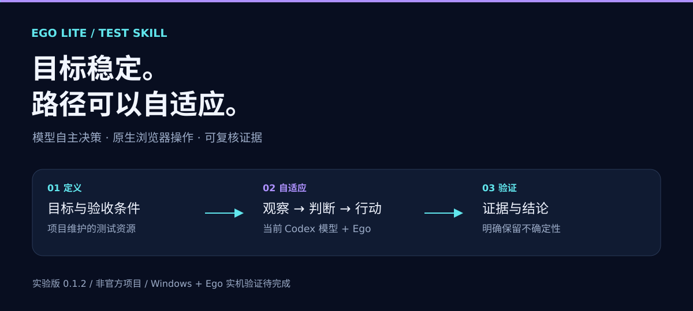
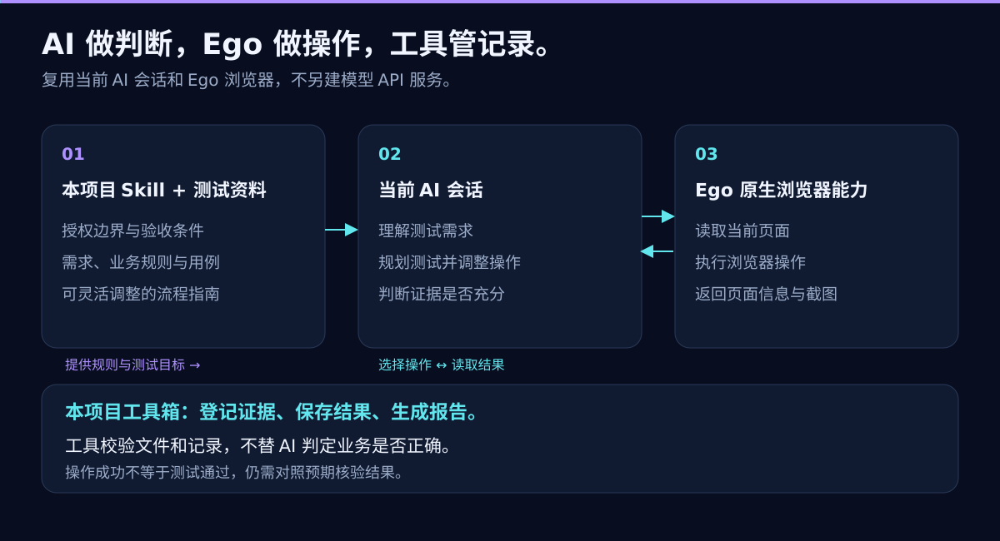
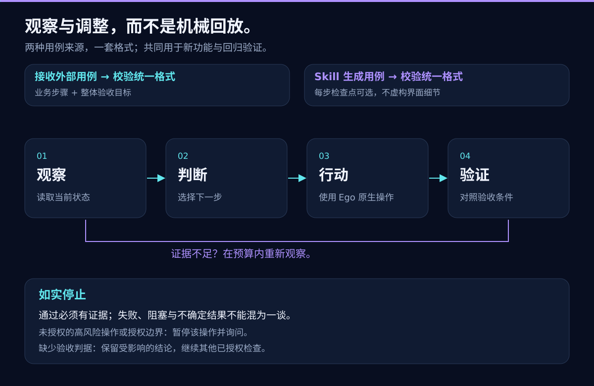
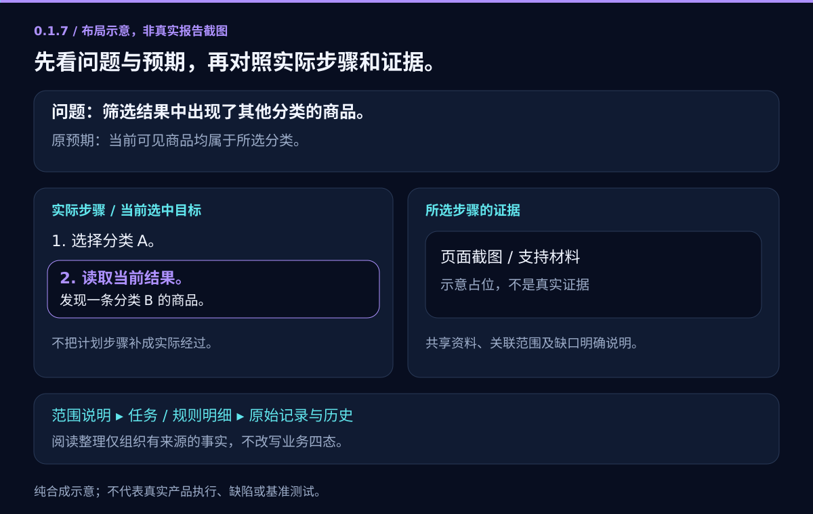

<p align="center"></p>

# Ego Lite 自主测试 Skill

<p align="center"><a href="README.en.md">English</a> · <strong>简体中文</strong><br><a href="#windows-快速开始">快速开始</a> · <a href="docs/architecture.md">架构</a> · <a href="docs/asset-formats.md">资源约定</a> · <a href="docs/privacy.md">隐私保护</a> · <a href="docs/testing.md">验证状态</a></p>

**让当前 Codex 模型通过 Ego 原生浏览器能力，验证新需求、新功能，并回归已有行为。** 你提供目标和项目验收条件，模型根据实际页面决定下一步。保留可复核的证据与不确定性，不把“点击成功”直接当成“业务正确”。

**实验版 0.1.2。** 本项目独立开发，非 Ego 官方项目，未获 Ego 背书。云端验证仅覆盖本地辅助工具；Windows + Ego 端到端实测尚未完成，不代表 Windows 集成已认证。暂不承诺生产可用性，也没有产品实测或性能基准结论。详见[当前验证记录](docs/testing.md)。

## 两种用例来源，同一套格式与执行流程

测试目的是验证新需求、新功能，也包括回归已有行为；**用例来源与测试目的相互独立**，下面两种来源均可用于任一目的。

- **接收外部用例：** 提交符合 schemaVersion 2 的用例文件，包括前置条件、操作步骤、可选步骤检查点和最终预期。Skill 先检查结构与需求依据，不擅自重写原意；若材料是文档而非标准 JSON，先转换并保留来源，实质歧义再询问。
- **Skill 自行生成用例：** 当前会话模型按 Skill 的[用例生成指南](skills/ego-lite-test/references/case-authoring.md)，从需求提取正向、反向、边界、角色、状态及受影响回归检查，生成相同格式的 JSON。明确标注 explicit / interpretation / hypothesis，不将推断冒充需求。

两类用例都先校验、冻结，再由 AI 驱动 Ego 执行业务步骤。steps 表达业务意图与必要输入，具体 UI 路径由 AI 自主探索。strict 保持业务依赖顺序；adaptive 不得漏测、弱化目标或破坏前提。

业务步骤只需表达意图和必要输入，例如“进入配置中心的模板功能，按给定名称与字段新建模板”。无需从不完整需求中猜测按钮、弹窗或提示文案；细节确有依据时仍可写细粒度步骤。每步 expected 可省略，提供时必须是有依据的独立检查点；省略不表示该步未测或自动通过，最终仍按用例整体 expected 判断。

整体 expected 与 basis 必须保留。验收细节不足时，描述已知目标并用可选 clarificationQuestions 列出待澄清问题（数组中的字符串均须非空白）。只列影响该用例验收结论的未决问题，不列普通 UI 路线探索疑问；可独立判断的目标与待澄清目标应拆开，且不弱化原要求。非空问题列表表示整体验收标准待澄清，该用例及其 attempts 不能给 pass/fail；可在授权内探索路线并记录事实，但不得把当前表现反推为验收标准。问题澄清后另存修订用例并重新冻结，不改旧基线。

AI 通过 Ego 自主探索具体路径，将实际行为、观察与证据记入已有 observed、rationale、evidence、attempts；planned steps 是计划，不是执行证据，不新增强制按步 trace 字段。

支持**仅生成用例**：无需浏览器或部署环境，交付用例和待确认问题，不声称执行过测试。实际执行才需要已部署、可访问且已授权的环境。参见[虚构需求](examples/project.example/feature-request.md)和[对应生成用例](examples/generated-cases.example.json)。

## 为什么是 Skill，而不是又一套测试引擎？

- **复用你正在使用的模型。** 仓库不另建第二套模型服务。
- **固定需求，不固定每一次点击。** 模型可以调整导航，但不能改变验收条件、关键条件或明确指定的必经路径。
- **浏览器能力保持原生。** 页面读取与操作交给 Ego，不再包一层替代浏览器驱动。
- **结果可检查。** 区分 `pass`、`fail`、`inconclusive`、`blocked`、`not_run`，保留证据、需求来源和执行尝试。
- **工程保持轻量。** 可选 Node.js CLI 只创建、检查和整理本地记录，不运行模型、不启动浏览器，也不证明业务结论。

更强的底层模型可能改善规划和判断，但不保证效果必然提升。需求清晰度、证据可用性、应用状态和人工复核同样影响结果。

## 谁负责什么？



| 层次 | 负责 | 不负责 |
| --- | --- | --- |
| 当前 Codex 模型 | 理解目标、规划、检查证据、分析不确定性 | 臆造缺失的产品需求 |
| 本 Skill + 项目资源 | 工作流、授权边界、用例、验收与证据要求 | 硬编码通用业务判定器 |
| Ego 原生浏览器 | 读取应用并执行操作 | 替项目判断业务规则是否正确 |
| 可选本地辅助工具 | 创建记录、校验结构、生成报告 | 执行浏览器/模型测试，或独立验证结论 |

已安装的官方 `ego-browser` Skill 是 Ego 安装和命令用法的依据。更多边界说明见[架构文档](docs/architecture.md)。

## Windows 快速开始

### 1. 准备官方运行环境

按 [Ego 官方 Windows 快速开始](https://lite.ego.app/document/en/docs/windows/quick-start)安装和配置 Ego，确认 Codex 能发现已安装的官方 `ego-browser` Skill，并连接 Ego。本仓库不安装 Ego，也不替代官方配置说明。

如需使用可选辅助工具，请从 [Node.js 官网](https://nodejs.org/)安装 **Node.js 22 或更新版本**，以下命令使用 PowerShell。辅助工具不依赖第三方 npm 包。

### 2. 安装本 Skill，避免覆盖已有版本

下载或克隆仓库，在仓库根目录打开 PowerShell：

```powershell
$Source = (Get-Location).Path
$SkillRoot = Join-Path $HOME '.agents\skills'
$SkillTarget = Join-Path $SkillRoot 'ego-lite-test'
if (Test-Path $SkillTarget) {
    throw 'Skill destination already exists. Review or back it up before updating.'
}
New-Item -ItemType Directory -Force -Path $SkillRoot | Out-Null
Copy-Item -Recurse -Path (Join-Path $Source 'skills\ego-lite-test') -Destination $SkillTarget
```

必要时新开 Codex 会话以重新发现 Skill。让模型同时使用 `ego-lite-test` 和已安装的官方 `ego-browser` Skill。复制的是指令文件，不是模型服务或浏览器服务。

### 3. 将私有项目资源放在源码目录之外

以下辅助命令使用绝对路径。`$LocalRoot` 必须位于 `$Source` 之外。`init` 和 `start` 的目标目录必须**尚不存在，且父目录已存在**；不会覆盖已有项目或运行记录。

```powershell
$LocalRoot = Join-Path $env:LOCALAPPDATA 'EgoLiteTest'
New-Item -ItemType Directory -Force -Path $LocalRoot | Out-Null
$Project = Join-Path $LocalRoot 'demo-project'
node .\scripts\ego.mjs init --project-dir $Project
```

执行测试前，把生成的 `$Project\cases.example.json` 改成真实、已确认的需求。参考[用例示例](examples/cases.example.json)、[资源约定](docs/asset-formats.md)和 [Skill 指令](skills/ego-lite-test/SKILL.md)。不要把密码、token、会话 cookie 或个人记录写进用例文件。

### 4. 让模型开始测试

从需求生成用例并测试（也可明确要求“只生成，不执行”）：

```text
请使用 ego-lite-test 和已安装的官方 ego-browser Skill。
阅读我的新功能需求，提炼验收点、异常和边界用例，以及受影响的
已有行为。明确标注歧义，不要把你推断的假设变成已确认需求。
生成 schemaVersion 2 用例，包含 criticalConditions、stepOrder、
steps（每步 id/action，expected 可选）和最终 expected。先校验并冻结，再在明确授权的测试环境中验证已部署的功能。
缺少环境、业务验收判据或权限时先询问。结果中保留实际观察、
待澄清问题、证据与原始尝试。
不要购买、删除、发送消息或更改权限。
```

或从已有用例开始，以下仅为虚构场景：

```text
请使用 ego-lite-test 和已安装的官方 ego-browser Skill。
读取我提供的绝对路径中的本地项目资源。
在已授权的测试环境中，验证商品目录搜索后的可见结果
是否都符合请求的分类。

保持验收条件与关键条件不变，根据当前页面自主选择导航。
不要购买、删除、发送消息、更改权限，或越过已授权环境边界。

区分明确需求、解释和假设，保留证据与原始尝试。
缺少需求依据、权限或业务验收判据时，停止询问或标记为不确定。
不要把“结果列表已显示”当成“后端数据正确”的证明。
```

另行提供实际授权的测试地址、本地项目路径、测试账户上下文、范围和执行预算。优先使用专用测试环境与合成数据。通过受支持的安全登录方式登录，不要把凭据放进提示词或仓库。

## 自适应测试如何运行？



模型读取当前页面，选择下一步被允许的操作，调用 Ego，再用观察结果对照稳定的验收条件。必经路径仍然必须经过：“自适应”不是跳过被测流程、悄悄降低标准，或抹掉失败尝试的理由。

失败首先是一条待分析的发现，并不自动等于已确认的产品缺陷。原因可能在产品、模型执行、环境、需求规格，也可能尚不明确。

## 可复用资产，统一格式约定

需求文档保留为便于人阅读的上下文。Skill 生成与外部提供的用例统一采用 schemaVersion 2；不兼容旧版格式。用例保留需求来源；结果分别记录预期、实际观察、判断理由、待澄清问题与执行尝试；证据目录描述各个引用文件。报告汇总这些记录，但不会把操作者提供的结论变成独立验证的事实。

请以[资产格式文档](docs/asset-formats.md)与 [JSON Schema](schemas/) 为共同约定，而不是每个项目自行发明字段。私有项目实例应保存在这份面向未来公开的源码目录之外。

## 可选：整理运行证据

在仓库根目录，沿用上面的变量，并使用已审阅的用例文件：

```powershell
$Cases = Join-Path $Project 'cases.example.json'
$Run = Join-Path $LocalRoot ('run-' + [guid]::NewGuid().ToString('N'))
node .\scripts\ego.mjs validate-cases --cases $Cases
node .\scripts\ego.mjs start --project-dir $Project --cases $Cases --output-dir $Run
```

`validate-cases` 是可选的只读预检：输出结构校验摘要，不写入文件；`start` 仍会自行校验输入。

**`start` 只创建文件，不执行测试。** 它保存用例基线，并将所有用例初始化为 `not_run`。之后由模型/操作者完成已授权的浏览器操作，把脱敏证据放在运行目录中，并按[资源约定](docs/asset-formats.md)填写 `results.json` 与 `evidence.json` 证据目录。

```powershell
node .\scripts\ego.mjs check --run-dir $Run
node .\scripts\ego.mjs report --run-dir $Run
```

- `check` 检查记录结构、基线一致性、用例覆盖和证据引用文件是否存在。结构合法的记录仍可能含有 `not_run`。
- `report` 生成 `report.json` 和 `report.md`，拒绝覆盖已有报告。
- `pass` / `fail` 必须附实际观察、理由与证据引用，但工具**不判断证据是否真的支持结论**。
- 基线哈希可发现普通改动，但不防篡改。绕过这些辅助工具的行为不受其约束，工具不是安全隔离边界。



这是原创说明图，**不是产品截图、真实运行结果或实测数据**。当前辅助工具输出 JSON 和 Markdown，不会生成图中样式的界面。

## 公开之前，先做好隐私保护

私有仓库**不是**存放秘密的安全保险箱；忽略文件**不等于**凭据保护。私有项目资源和运行记录应留在源码目录外。分享前检查截图、页面文本、URL、报告与 Git 历史；即使没有提交凭据文件，截图也可能泄露信息。

辅助工具不执行网络、模型或浏览器操作，但模型宿主与 Ego 各有自己的数据流和政策。本仓库不承诺模型本地推理或自动脱敏。详见[隐私与公开发布指南](docs/privacy.md)。

## 继续阅读

- [Skill 指令](skills/ego-lite-test/SKILL.md)：模型应遵循的测试工作流。
- [架构](docs/architecture.md)：决策、执行、证据与信任边界。
- [资源约定](docs/asset-formats.md)：项目资源、需求来源、结果字段及辅助工具语义。
- [用例示例](examples/cases.example.json)：合成数据的结构示例，不是产品需求。
- [测试与限制](docs/testing.md)：已验证与未验证的内容。
- [隐私保护](docs/privacy.md)：本地数据管理和公开前的检查。

## 借鉴表达方式，不借用品牌背书

README 的组织借鉴了 [Midscene](https://github.com/web-infra-dev/midscene) 的可视化说明和示例先行方式，以及 [Stagehand](https://github.com/browserbase/stagehand) 的简洁定位与快速入门结构。本仓库的文案和图解为原创，不复用它们的品牌素材、代码、宣传结论或测试结果。[Ego Lite](https://github.com/citrolabs/ego-lite) 是原生浏览器依赖，并不代表对本项目的背书。

**许可证：** 公开发布的许可证尚未选定，当前私有草稿标记为 `UNLICENSED`，请勿默认视为开源授权。
