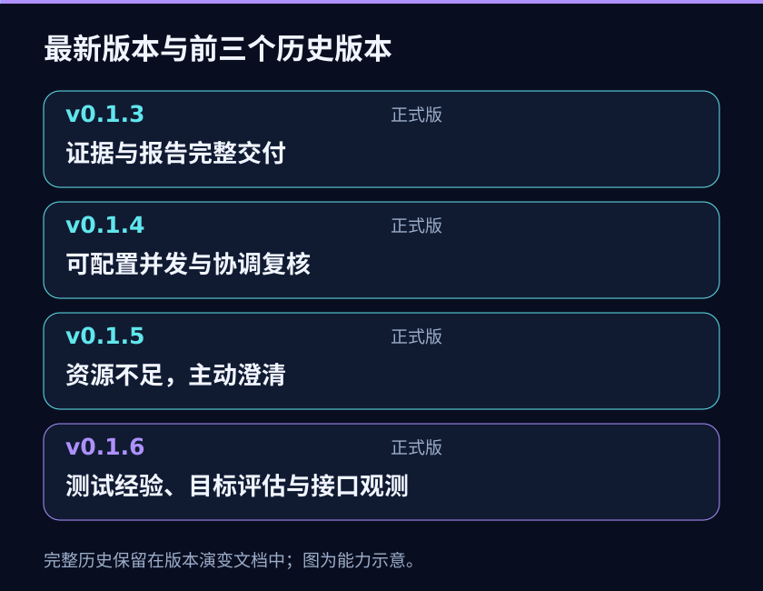

<p align="center"></p>

<h1 align="center">基于 Ego Lite 的 AI 自主测试 Skill</h1>

<p align="center"><a href="README.en.md">English</a> · <strong>简体中文</strong><br><a href="#windows-快速开始">快速开始</a> · <a href="docs/architecture.md">架构</a> · <a href="docs/asset-formats.md">格式与命令</a> · <a href="docs/privacy.md">隐私保护</a> · <a href="docs/testing.md">验证状态</a></p>

**面向新项目首次上线前、新功能首次交付时的 Web 自动化测试 Skill。** 由当前 AI 会话自主分析需求、规划测试，并通过 Ego Lite 浏览器探索页面、执行用例，对照业务规则和预期结果完成验证。保留实际观察与证据，让测试结论可以复核，而不只是给出“成功 / 失败”。

不要求项目已经积累自动化测试脚本。你可以提供现成用例，也可以提供需求、业务规则和验收预期，由 AI 按本 Skill 的格式整理用例。AI 可以灵活选择操作方法、补充验证和调整执行顺序，但不能改写测试目标、降低预期或越过授权边界。

这里的“首次上线”是重点使用场景，不代表可以从空白信息推断全部业务规则，也不承诺测试通过就能安全上线；缺失的要求需要澄清，证据不足的结论必须保留不确定性。它也可用于已有功能的回归验证。

## 名称与调用

仓库与 Skill 标识统一为 **ai-autonomous-testing-ego-lite**；Codex 展示名为 **AI 自主自动化测试 · Ego Lite**，显式调用 `$ai-autonomous-testing-ego-lite`。本页中文标题保持不变。旧仓库/Skill 用户请先看[更名与升级说明](docs/rename-upgrade.md)，更新原目录的 remote 并核对完整安装包；不要留下两个可被发现的旧/新 Skill 入口。

## 项目现状

本分支为 **0.1.6-rc.cross-host.1 / cross-host-parallel-1 开发候选版**，从测试经验分支已提交的 `d350cc5` 派生；不包含原目录尚未提交的 v5 目标评估或接口监控需求。正式版本仍见 [v0.1.5 Release](https://github.com/99Like-wjj/ai-autonomous-testing-ego-lite/releases/tag/v0.1.5)。本次修复不代表跨宿主完整并行测试已验收，也不自动更新用户安装。详见[验证记录](docs/testing.md)与[更新说明](CHANGELOG.md)。

维护源码使用严格 TypeScript，安装包提供编译后的 JavaScript，无需安装 TypeScript 或开发依赖。支持用户配置用例并发，默认串行；AI 自主判断用例独立性并调用宿主原生子代理。Space 关联与偏差记录不是强权限沙箱，也不保证账号或后端数据隔离。

Codex、Claude Code、ZCode 的子 Agent 与工具能力由各自宿主提供，本项目不硬编码宿主调度。真实完整链路均仍需按终端版本验收。入口、上下文、权限、等待、包交付与收尾见[跨宿主指南](skills/ai-autonomous-testing-ego-lite/references/host-compatibility.md)。Claude Code 显式调用使用 `/ai-autonomous-testing-ego-lite`；完整包能被读取不等于测试可以并行完成。


## 0.1.5：资源不足时主动澄清

AI 按测试目标推导所需身份、权限、环境、数据和观察条件，先查已有资料及授权内事实。仍有实质缺口时，说明缺什么、影响哪些目标和怎样补充；暂停依赖动作，独立且获授权的目标可以继续。用户补充后核实再恢复，执行中发现新依赖同样适用。

验收规则不明确、资源不足、操作授权分别处理，复用现有记录和报告工具；不要求统一资源表或固定业务路线。参阅[资源指南](skills/ai-autonomous-testing-ego-lite/references/resource-readiness.md)和[本地验收步骤](docs/v0.1.5-local-acceptance.md)。指南和工程检查不能替代实际使用验收。



## 并发与交付（自 v0.1.4）


执行测试后的默认交付包含独立离线 HTML、JSON 和 Markdown，除非用户明确要求其他格式；聊天摘要不能替代文件。关键 UI 结果及缺陷须留存真实截图，DOM / 日志 / 摘要作补充；不要求每次点击截图。缺图必须展示并由 AI 复核结论，不能自动当产品失败，也不能继续宣称证据完整。

独立安装须使用完整目录包，不能只复制 `skills/ai-autonomous-testing-ego-lite` 的说明文件。以下命令从源码仓库构建**新的、仓库外**安装目录，携带 Skill、指南、脚本、schema、示例和文件校验清单，不创建 Tag 或 Release：

```powershell
$InstallPackage = Join-Path $env:TEMP ('ai-autonomous-testing-ego-lite-' + [guid]::NewGuid().ToString('N'))
npm ci
npm run typecheck
npm run build:skill -- --output-dir $InstallPackage
node (Join-Path $InstallPackage 'scripts/ego.mjs') tool-info --expect-version 0.1.6-rc.cross-host.1 --expect-revision cross-host-parallel-1
```

经授权并按更名升级说明迁移到 Skill 根下的 `ai-autonomous-testing-ego-lite` 目录；不要继续装入旧名目录。更新前核对旧文件是否来自已知版本，出现不明修改先报告，不能覆盖用户文件、创建同名重复安装或自动增加旧版备份。运行时以**实际加载的 SKILL.md 所在目录**为工具根；源码开发先在已确认根目录构建，使用明确的 `.build/runtime` 工具根。`tool-info` 输出版本、revision、formatVersions、实际路径和编译产物指纹；安装清单缺失、文件修改或版本混用会拒绝执行。指纹不认证发布者，构建清单只包含指定分发资源，不打包真实运行目录。

`report` 生成后会读回三种文件，`verify-report --run-dir ABS_RUN --report-dir ABS_REPORT_DIR` 可再次核对内容与当前运行、证据及整理来源的一致性。回执给出路径、大小和 SHA-256，`browserOpen: not_checked` 表示浏览器尚未检查；文件校验不能冒充实际打开。访问受限时记录具体阻塞，不换通道绕过。

已有报告不得覆盖。准备一个新的仓库外目录，使用 `report --run-dir ABS_RUN --output-dir ABS_EXISTING_NEW_DIR` 另存；事后补报告再传 `--context ABS_CONTEXT_JSON`，格式见 [报告整理上下文](schemas/report-context.schema.json)。它明确整理性质、限制、现有来源与 hash、补充用例及 AI 逐目标复核，原记录结论保留单独展示，不冒充执行前冻结。工具不补造截图、采集时间、步骤或业务结论，也不为了补报告重跑业务。

本版工具 revision 为 `cross-host-parallel-1`，数据格式沿用分支基线：用例、结果与证据 v3；新 manifest/report v4，执行台账、配置和交付包 v1，executionRead v2。本次没有新增历史格式兼容层，不迁移、删除或覆盖原 run；v2 与其他分支的 v5 均不作为本包输入。安装包不需要 TypeScript 编译器。单例单 Space 是默认原则，偏差保留并由 AI 复核，必须保护用户原有 Space；这些记录不构成宿主强隔离。候选包与当前安装分别验证，用户安装不自动替换。

## 用例与判断


外部用例和 AI 按 Skill 指南整理的用例均可用于新功能与回归。用例以业务意图和必要输入描述步骤；当前 AI 根据实际页面选择被授权的执行路径。`strict` 保留业务步骤顺序，`adaptive` 只允许在不改变意图、前提与覆盖时调整路径或顺序。

整体预期与需求依据必须保留。每步 `expected` 可省略；提供时必须有独立依据，省略不会被当作未执行或自动通过。验收存在未决问题时，在冻结基线中填写 `clarificationQuestions`；只要问题非空，该用例的最终结果和每条尝试都不得为 `pass` 或 `fail`。澄清后用修订用例重新开始，不改写旧基线。

状态区分 `pass`、`fail`、`inconclusive`、`blocked`、`not_run`。`not_run` 表示尚未记录最终结论，可能已有探索尝试；报告分别显示尚无结果／尝试记录和已有尝试记录但无最终结论，执行状态另行展示。工具只校验本地数据结构、revision 和证据文件哈希，不自动诊断缺陷、选择路径、重试业务操作或判断证据是否支持结论。

## Windows 快速开始

### 准备运行环境

按 [Ego 官方 Windows 快速开始](https://lite.ego.app/document/en/docs/windows/quick-start)配置 Ego 与官方 `ego-browser` Skill。本仓库不安装 Ego，也不替代官方使用指南。本地报告工具使用 Node.js 22 或更新版本，不依赖第三方运行包。

以下命令以源码仓库为工作目录，先执行 `npm ci` 和 `npm run build`；CLI 位于 `.build/runtime/scripts/ego.mjs`。使用下载的完整安装包时，改用安装根目录内的 `scripts/ego.mjs`，不要混用两种路径。

### 将私有资源放在源码目录之外

在仓库根目录打开 PowerShell。以下目录应位于仓库之外；`init` 和 `start` 要求目标尚不存在，且不会覆盖已有目录。

```powershell
$Source = (Get-Location).Path
$LocalRoot = Join-Path $env:LOCALAPPDATA 'EgoLiteTest'
New-Item -ItemType Directory -Force -Path $LocalRoot | Out-Null
$Project = Join-Path $LocalRoot 'demo-project'
node .\.build\runtime\scripts\ego.mjs init --project-dir $Project
```

将 `$Project\cases.example.json` 改成经来源核对的用例。准备后可先只校验，然后冻结新运行：

```powershell
$Cases = Join-Path $Project 'cases.example.json'
$Run = Join-Path $LocalRoot ('run-' + [guid]::NewGuid().ToString('N'))
node .\.build\runtime\scripts\ego.mjs validate-cases --cases $Cases
node .\.build\runtime\scripts\ego.mjs start --project-dir $Project --cases $Cases --output-dir $Run
```

`start` 只创建本地文件，不执行浏览器或业务操作。Skill 的工作流和边界见 [SKILL.md](skills/ai-autonomous-testing-ego-lite/SKILL.md)；辅助工具调用步骤见[本地工具箱指南](skills/ai-autonomous-testing-ego-lite/references/local-toolbox.md)。

### 登记证据与记录结果

将确需留存的本地文件作为证据来源，并编写 UTF-8 JSON 请求文件。请求需要唯一 `operationId` 和当前 `expectedRevision`；不要为未知来源时间填写 `capturedAt`。例如：

```json
{
  "schemaVersion": 3,
  "operationId": "evidence-first-observation",
  "expectedRevision": 0,
  "caseId": "CONFIG-01",
  "sourceFile": "C:\\Users\\example\\AppData\\Local\\EgoLiteTest\\capture.png",
  "kind": "screenshot",
  "source": "本次测试中保存的本地页面截图",
  "description": "合成环境中的设置页面观察"
}
```

运行 `evidence-add --run-dir $Run --request <绝对请求文件路径>`。工具会把普通本地文件复制到运行的 `evidence/`，从实际留存副本计算 SHA-256 和字节数，返回证据 ID 与 catalog revision。`collectedAt` 由工具登记；仅当来源明确提供采集时间时才填写 `capturedAt`。

将返回的证据 ID 放入 `record` 请求的 `evidenceIds`。`mode: "final"` 更新当前最终状态；`mode: "attempt"` 追加一条历史观察，不改变最终状态。结果请求示例：

```json
{
  "schemaVersion": 3,
  "operationId": "CONFIG-01-first-attempt",
  "expectedRevision": 0,
  "caseId": "CONFIG-01",
  "mode": "attempt",
  "record": {
    "status": "inconclusive",
    "observed": "合成观察：保存后的页面没有显示明确结果。",
    "rationale": "仅凭当前页面无法确认冻结的整体预期。",
    "remainingQuestions": ["是否要求刷新后持久化？"],
    "evidenceIds": ["替换为 evidence-add 返回的 ID"],
    "cause": "unknown"
  }
}
```

请求中的 `operationId` 是幂等操作标识：同一 ID 与相同内容重试会返回原回执，不会重复追加；同一 ID 改了内容会被拒绝。新请求若 `expectedRevision` 过期会冲突拒绝。并发写入采用运行目录独占锁，冲突直接拒绝，不自动重试。响应丢失后，可用完全相同的请求重试并读取原回执。

### 查询进度并生成报告

```powershell
node .\.build\runtime\scripts\ego.mjs progress --run-dir $Run
node .\.build\runtime\scripts\ego.mjs check --run-dir $Run
node .\.build\runtime\scripts\ego.mjs report --run-dir $Run
Invoke-Item (Join-Path $Run 'report.html')
```

进度按冻结用例的**当前最终状态**统计；`blocked`、`inconclusive`、`not_run` 分开列出，pending clarification 单独列出。历史尝试不重复计入当前 pass/fail。`report` 会在 Run 目录写出 `report.json`、`report.md` 和可独立离线打开的 `report.html`；任一目标已存在都会拒绝覆盖。HTML 展示冻结目标、关键条件、必经路径、顺序策略、实际观察、判断理由、依据、未验证项、逐条尝试及其未决问题、证据来源和 SHA-256。经过 hash / 大小核验的 PNG、JPEG、WebP 截图内嵌显示；缺图、不支持格式或浏览器无法解码会明确提示，不生成替代图片。可把 `report.html` 单独复制给获准查看报告的人，不需要连同 Run 或联网打开。完整内容见[格式与运行约定](docs/asset-formats.md)。

报告会分开显示业务结论和文件完整性；SHA-256 匹配不证明截图真实或结果正确。HTML 生成前会完整校验 run 与所有登记证据；若校验失败，不写出任何报告。没有图片不会自动变成失败；业务覆盖、判断以及是否需要补证仍由 AI 根据授权与事实决定。点击成功或按钮变为 enabled 不足以证明提交成功，需观察实际后果和必要的持久化状态。


## 责任与限制


| 部分 | 负责 | 不负责 |
| --- | --- | --- |
| 当前 AI 会话 | 理解目标、选择测试、操作授权的浏览器、审阅观察 | 臆造缺失需求或超出授权 |
| Ego 原生浏览器 | 页面读取与用户授权的浏览器操作 | 判断业务规则是否正确 |
| 本地工具箱 | 登记文件、验证记录、计算当前哈希、报告进度并展示离线证据报告 | 访问网络/模型/Ego、自动判 bug、重试业务动作 |

SHA-256 用于检测留存文件是否与 catalog 一致，不证明证据真实性、来源身份或业务结论。工具不是绕过直接文件修改或本地并发程序的安全隔离边界。单个 JSON 文件通过临时文件和 rename 更新；证据文件与 catalog 不是支持任意崩溃恢复的多文件事务，也不承诺断电持久性。遗留 `.run.lock` 会拒绝写入；确认无对应进程后才由操作者检查并处理。

证据登记不会自动脱敏。截图、日志、URL 与说明可能含个人或业务数据；保存前限制范围并人工检查。真实案例、站点、凭据和运行产物留在仓库外的私有目录。私有仓库、哈希、忽略规则与启发式扫描均不构成秘密保险箱。详见[隐私指南](docs/privacy.md)。

## 继续阅读

- [Skill 工作流](skills/ai-autonomous-testing-ego-lite/SKILL.md) 与[本地工具箱调用指南](skills/ai-autonomous-testing-ego-lite/references/local-toolbox.md)
- [架构](docs/architecture.md)、[资产格式与命令](docs/asset-formats.md)
- [版本演变](docs/version-history.md)：各版解决的问题、使用变化、发布状态与升级影响
- [后续版本需求与调研记录](docs/requirements.md)：v0.1.4 并发与 Space 关联的需求演变及设计边界
- [合成用例](examples/cases.example.json)、[合成证据请求](examples/evidence-request.example.json)、[合成结果请求](examples/record-request.example.json)
- [验证状态](docs/testing.md)、[隐私保护](docs/privacy.md)、[变更记录](CHANGELOG.md)

## 问题反馈与联系

欢迎通过 [GitHub Issues](https://github.com/99Like-wjj/ai-autonomous-testing-ego-lite/issues) 或以下联系方式反馈问题、提出建议。请附上版本号、复现步骤和脱敏后的报错或截图，不要提交密码、令牌、密钥或公司内部资料。

- 作者：[99Like-wjj](https://github.com/99Like-wjj)
- 邮箱：[wjj990517@gmail.com](mailto:wjj990517@gmail.com)
- 微信：A2326543144

  
- QQ：2326543144
- X：[@99Like_ovo](https://x.com/99Like_ovo)

## 许可证

本仓库原创代码和文档按 [MIT License](LICENSE) 授权，版权声明为 2026 99Like-wjj。此许可不覆盖 Ego、Ego 官方浏览器或其他第三方软件；它们仍受各自许可和官方条款约束。本项目非 Ego 官方项目，未获其背书。源码按 MIT 许可开放；项目仍在持续开发，具体版本能力与验证范围以对应版本说明为准。

## 并发配置与开发

`maxParallelCases` 默认为 **1（逐条执行）**；用户未要求并发且未明确配置时保持串行。用户可用命令行或项目配置指定任意可准确表示的正整数，无固定产品上限。AI 决定工具调用、批次与 worker 使用，配置不要求跑满。宿主明确提供的限制单独记录，未知则保持未知，不主动探测客户端最大子代理数或修改全局配置。

```text
node ABS_TOOL_ROOT/scripts/ego.mjs start --project-dir ABS_PROJECT --cases ABS_CASES --output-dir ABS_NEW_RUN --max-parallel-cases 3
```

AI workers 独立留证、封存包，协调者显式复核并导入。完整调用和恢复语义见[并发指南](skills/ai-autonomous-testing-ego-lite/references/parallel-testing.md)。所有继续维护的 CLI、报告交互、测试、构建／检查、历史验证工具和图片生成程序以 TS 维护；`.build` 是忽略的编译产物。`npm test` 先构建再测试实际 JS；`npm run check:public` 检查源文件，独立包仍使用严格资源清单。本仓库的构建、测试不注册或更新用户级 Skill，也不推送、创建 Tag 或 Release。
