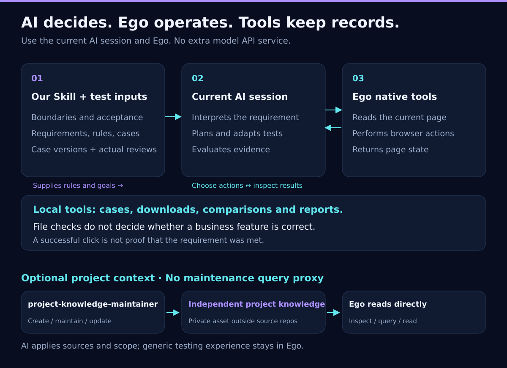
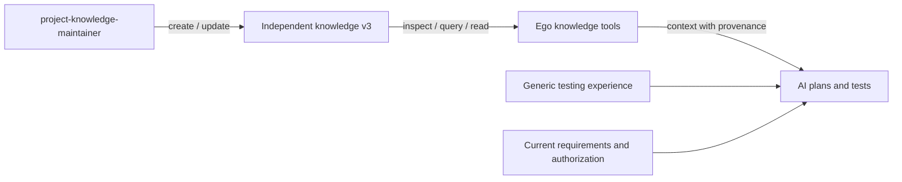

# Architecture — v9 / 0.1.9-dev.1

## Knowledge maintenance and test-time use

[project-knowledge-maintainer](https://github.com/99Like-wjj/project-knowledge-maintainer) is an independent creation/maintenance tool; its repository is private and requires existing access. It curates authorized materials into project knowledge outside source repositories. Ego reads format v3 directly with its own tools, not through a maintenance query proxy. Generic testing experience stays in Ego guidance; project knowledge is neither part of the test ledger nor shipped in an installation package.

knowledge/commands adds read-only inspection, task summaries and exact reads using format v3 shared with the independent maintenance project. The optional project/modules/rules/accounts categories are read on demand. Only matched common knowledge enters the AI context; sources, state, scope and local-version limits remain explicit. Functional details stay in source requirements. External knowledge is outside the cases/reviews/runs ledger and grants no operation permissions. Knowledge is optional task context, not a mandatory prerequisite or fixed business route.

Current development contracts use version 9, regressionVersion 2 and networkVersion 1. AI owns interpretation, planning, exploration, action choice and business assessment. Ego owns browser primitives. Local code owns deterministic transactions, integrity, file reading and report presentation, without a business decision tree or automatic retries.

Whole case versions, adjacent actual reviews and separate runs are the persistent units. core/case-versions allocates stable embedded point IDs within publication; case-review validates actual review provenance and necessary-definition hashes. Unchanged reruns reuse the original file. Rules and task semantics stay in cases; issues stay in run findings/assessments.

regression/selection computes points/status/full and declared dependencies. binding freezes scope, applicable review, current conditions, parameters and exact historical references. The complete baseline bytes remain separate from execution-plan references. sources reads exact result prefixes; compare records differences without repair attribution.

core/records and execution packets share immutable observations, action/context facts, findings, original-problem checks and four-state goals. Unselected goals have no current status; missing assessments are record gaps. Hosts own real worker identity and lifecycle, not a local permission sandbox.

ego-helpers/download composes official Ego events and saveAs in the same SDK round. Explicit downloads-manager reconciliation is a version-specific fallback. An existing execution note tracks one active/unknown run capture; clocks do not clear it. files/inspect reads bounded files in a separate process and never decides business success.

report/history retains exact source-run provenance outside current evidence/counts. Delivery uses one JSON/HTML/Markdown model plus referenced attachments. Complete history bundles remain verifiable when source directories move; missing history is explicit. review-ui exports review data without running tests or authenticating a reviewer.

core/conversations and conversation-store validate conversationVersion 1, retained-source mappings, exact quotations and actual-action ownership. Imports remap external IDs without rewriting message bytes. The explicit capture-text helper reads AI-selected DOM nodes and records scope rather than detecting site protocols or deciding completion/business success. report/conversations produces registered or retrospective views; the selected conversation drawer/fullscreen reader presents step summaries, message/source fidelity and coverage. Markdown parsing/sanitization is bundled offline; foreign HTML and remote images are not executed/loaded. reviewability emits structural prompts without choosing verdicts or further actions.

case-reader provides the scene/case overview and three-column workbench. review-ui generates readable review HTML with embedded feedback, or optional JSON, directly in the offline page. File-picker saving and explicit downloading need no server. review-feedback-document is shared by the browser and optional CLI; review-export handles CLI file transactions only. Drafts and exported feedback remain separate from formal reviews; see [offline review export](case-review.md).

See [contracts](asset-formats.en.md), [regression reuse](regression-reuse.md) and [current development validation](v0.1.9-development-validation.md). Historical user data is not migrated or overwritten.

## Report language and model provenance

core/ai-context parses, merges and verifies sourced model records without detecting models, calling models or judging business quality. Case-generation authorship and actual execution contributions remain separate; packet evidence mapping preserves the worker's declared provenance.

report/ui-text localizes explicitly marked static template fragments, leaving interpolated facts, original messages and evidence unchanged. presentation uses AsyncLocalStorage for isolated concurrent Node generation and document-bound parameters in the browser. tools/generate-ui-catalog maintains checked source keys. model-display provides one header for each of the two stages; scope-label is shared by HTML and Markdown and uses an explicit comparison baseline.
