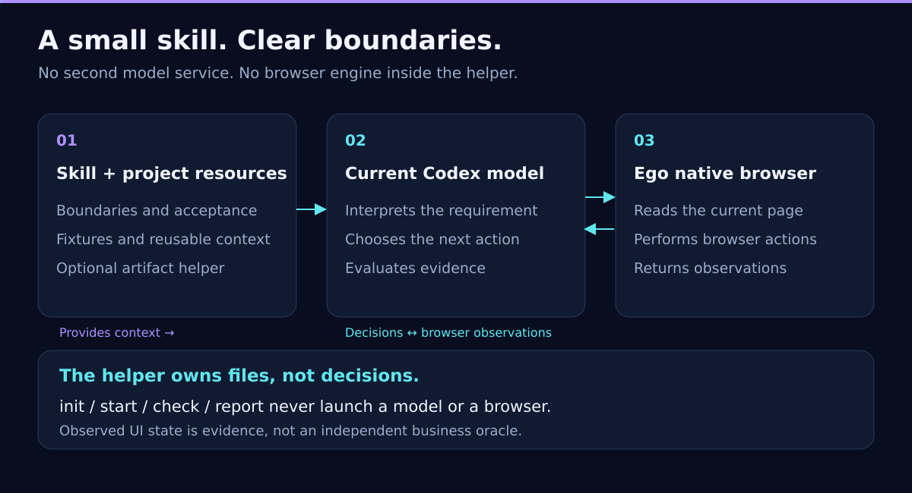

# Architecture and trust boundaries

## Three boundaries

1. **The AI session handles business intent.** It reads requirements and project context, drafts or reviews cases, chooses the next step from the page it sees, and judges evidence. Routes may adapt; frozen sources, goals, prerequisites, and explicit steps must not be silently rewritten.
2. **Ego's native browser performs authorized actions.** Browser tests require user authorization and the official `ego-browser` Skill for the installed version. The local file helper cannot access or control Ego.
3. **The local toolbox only manages factual records.** The Node CLI does not run a model, network, browser, Ego, or test-data generator. It does not automatically find bugs, choose business paths, or retry operations. It registers files, validates records and hashes, and provides progress and reports.

## Data flow

Cases are validated as schemaVersion 3, then `start` freezes `baseline.json` in a new directory and creates result and evidence catalogs at revision 0. `evidence-add` copies a user-selected local regular file into the run. Its catalog item records the case, source and description, SHA-256 and byte count of the retained bytes, helper-set `collectedAt`, and optional source-provided `capturedAt`. `record` writes results: `final` updates current status; `attempt` appends a historical observation. `progress` counts current frozen-case statuses, `check` validates files and associations, and `report` writes JSON and Markdown.

The helper does not infer whether a source, file, or conclusion is true and does not redact content. SHA-256 compares current bytes with the catalog value; it cannot prove authenticity.

## Single writer and recovery

The run-level `.run.lock` is created exclusively. A writer obtains the lock before reading the catalog/results and validating `expectedRevision`. Concurrent writers do not queue or retry; the loser receives a conflict. Idempotent `operationId` values are checked against canonical JSON payloads, where object-key order does not matter. The same request returns its original receipt without appending again. Reusing the ID with different content is rejected.

Result updates use a same-directory temporary file and atomic rename for the single `results.json` file. Evidence is copied completely to a staging file, then installed at a unique final name with an exclusive same-volume hard link; filesystems without hard-link support reject that registration. A marker around the copy and catalog update identifies paths and hashes for recovery after a partial operation or lost response. The helper recognizes known committed/uncommitted states and cleans only staging files owned by that operation. Single-file rename does not create a general multi-file transaction between the catalog and evidence file, nor does it guarantee power-loss durability. Users and other programs must not directly edit a run concurrently.

A leftover `.run.lock` blocks future writes. The helper does not guess that a PID is stale. Verify that the lock owner's process has exited before inspecting and handling the lock. If an evidence recovery marker was externally edited, or a file hash/shape is unexpected, the helper refuses automatic cleanup and leaves the state for inspection.

## Clarifications and history

`clarificationQuestions` belong to the frozen baseline. When nonempty, neither the final result nor any attempt may use `pass` or `fail`. Runtime validation applies the same veto to saved results and history; a result request cannot clear the questions. If requirements are clarified, create and freeze a revised case instead of editing the old baseline.

The attempts array excludes the current final result. It stores explicit attempt observations and snapshots of replaced final observations. Progress counts each case's current final status once, so historical failures do not get counted again as current failures, and `blocked`/`inconclusive` are not collapsed into unexecuted cases. `hasUnexecutedCases` only reflects `not_run`.

## Security and limits

Every path component is checked for symlinks; evidence sources must be regular files. IDs use a closed contract and reject dangerous property names. Evidence files use unique generated IDs and are not overwritten. Retained-copy hash checks detect later byte changes, but hashes, schemas, path checks, locks, and baseline hashes are not a security boundary against a malicious local process running as the same user.

The AI session handles execution identity, permissions, accounts, environment, write risk, redaction, and business judgments under user authorization and the installed Ego guide. Evidence registration does not filter or remove sensitive content. Keep private runs outside the repository.

JSON assets use schemaVersion 3. This version's validator does not support v0.1.2 schemaVersion 2 run directories. Rebuild cases from their sources and start a new run. The project retains valuable business-intent steps, provenance, optional step expectations, and status semantics without an additional compatibility layer.
