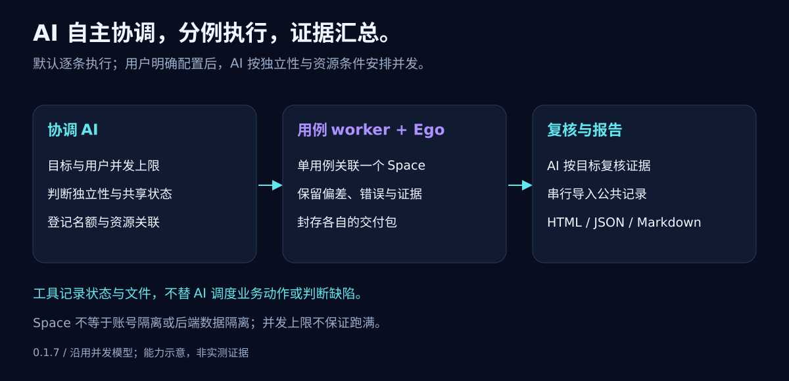

# 架构与信任边界

## 当前修复候选版架构

`0.1.6-rc.cross-host.1` 沿用已提交测试经验分支的架构与数据格式。新增跨宿主交接指南，CLI 主模块按真实路径识别链接入口；不引入宿主调度器或权限沙箱。其他分支的 v5 目标评估与接口监控不属于该基线。参阅[跨宿主指南](../skills/ai-autonomous-testing-ego-lite/references/host-compatibility.md)。

本版资源充分性分析由 AI 根据目标及事实完成，入口加载资源指南，复用已有记录/证据/交付包/报告。验收歧义、资源可用性与操作授权分别表达；没有新增资源状态机、调度器或固定业务路径。资源补充后仍须核实，辅助笔记不自动纳入报告校验，详见[资源指南](../skills/ai-autonomous-testing-ego-lite/references/resource-readiness.md)。

`0.1.4` 将稳定的数据能力集中到 `core/baseline.mts` 与 `core/file-integrity.mts`，初始化、封包、证据／结果和报告复用同一实现。`execution/read-context.mts` 只组装元数据快照，`views.mts` 只做投影。默认查询不重读历史证据或执行恢复；`--integrity full` 可严格检查后仍返回摘要，原 full 路径保持。查询结果显式标注检查范围，不从记录状态推断业务已重新验证；详见[B／C 验证](v0.1.4-bc-validation.md)。

维护源码统一为严格 TypeScript，Node `.mts` 编译为 ESM `.mjs`；`src/report-ui/main.ts` 单独使用 DOM 类型检查后嵌入报告。开发先运行 `npm ci`、`npm run typecheck`、`npm test`，编译资源暂存于 `.build/runtime`；用户安装包无需编译器或开发依赖。`src/scripts/toolchain.mts` 校验明确资源清单及实际安装指纹，开发上下文显式保护整个唯一源码目录。

AI 自主决定工具调用、执行批次，以及由当前会话执行还是通过宿主原生工具分派 worker；默认并发 1，用户未要求并发且无明确配置时逐条执行，不强制每例新建子代理。`src/execution/` 只处理配置快照、名额与资源声明、Space 回执、不可变交付包和经 AI 复核的导入事务；没有常驻调度器、模型服务或浏览器代理。用户上限与已知宿主容量分别记录；额度未知不探测，无固定产品上限，也不要求跑满。允许记录 Space 偏差和授权内恢复，不宣称强权限沙箱或账号隔离。

worker 仅写本分派目录，`packet-seal` 校验全部目标引用并计算证据哈希；协调者独立看原目标和证据后串行导入公共结果。导入记录准备请求、已提交证据／结果及回执，原样重放同一操作可恢复丢失响应。冲突的未执行事务只能经显式新操作重新准备；不重做页面业务。丢失／在途 worker 保留名额，不能仅因超时回收。

新 manifest／report 为 v4，执行／配置／worker 包为 v1，cases／results／evidence 仍为 v3。既有 v3 运行保持原格式；报告可验证旧渲染框架而不运行旧版源码。v4 报告逐项显示 AI 提交的四态与证据，并区分名额峰值和有来源的执行区间。图示与以下 v0.1.3 说明保留为历史背景；完整并发协议见 [并发指南](../skills/ai-autonomous-testing-ego-lite/references/parallel-testing.md)。

## v0.1.3 架构背景（历史）

报告交付约束：默认 HTML + JSON + Markdown，关键 UI 结果与缺陷保留真实截图；具体业务路径、取证节点及结论仍由 AI 决定。完整安装包携带工具与 schema，运行前核对实际工具根、版本和清单。文件校验与实际浏览器打开分开报告，事后整理不冒充执行前冻结。

## 三个边界

1. **AI 会话处理业务意图。** 它读取需求和项目资料，生成或审阅用例，结合实际页面选择下一步，并依据证据判断。路径可自适应，冻结的来源、目标、前提和明确步骤不可被静默改写。
2. **Ego 原生浏览器执行授权操作。** 执行浏览器测试需由用户授权并遵循本机安装版本的官方 `ego-browser` Skill。本地文件工具不能访问或控制 Ego。
3. **本地工具箱保存调用者提交的观察与结果。** Node CLI 不执行模型、网络、浏览器、Ego 或测试数据生成，也不自动判断 bug、选取业务路径或重试操作。它登记文件、校验记录和 hash、提供进度与报告。

## 数据路径

用例先按 schemaVersion 3 校验，然后 `start` 在新目录冻结 `baseline.json`，并创建 revision 0 的结果和证据 catalog。证据通过 `evidence-add` 从用户指定的本地普通文件复制到运行目录；登记项保留来源/说明、用例关联、实际留存字节的 SHA-256 和大小，以及独立的 `collectedAt` 与可选来源时间 `capturedAt`。结果通过 `record` 写入：`final` 更新当前状态，`attempt` 追加历史观察。`progress` 按冻结用例的当前状态统计，`check` 校验所有文件和关联，`report` 输出 JSON、Markdown 和可单独离线查看的自包含 HTML；HTML 将实际保存且 hash 匹配的安全光栅图片内嵌，展现目标、观察、依据、未验证项和尝试历史。

HTML 是本地数据的呈现层，不生成业务 verdict；缺失图片会提示但不会自动判失败，hash 匹配也不证明图片真实或业务结论正确。无效 hash、悬空关联或结构错误会阻止完整报告生成。报告只展示用例级结果；每步没有独立 verdict 数据，因此不会推断计划步骤已完成。

工具不推断来源、内容或结论是否真实，不做自动脱敏。SHA-256 只用于比对当前字节与 catalog 中的值，不能证明真实性。

## 单写者与恢复

run 级 `.run.lock` 使用文件独占创建。写操作先获取锁，再读取当前 catalog/results 并检查 `expectedRevision`。不同进程同时尝试写入时，失败方收到冲突，不排队或自动重试。幂等 `operationId` 按规范化 JSON 内容校验，key 顺序不影响结果；相同请求会返回原回执，不重复追加。复用 ID 并改内容会拒绝。

结果写入用同目录临时文件与原子 rename 更新单个 `results.json`。证据先完整复制到暂存文件，再通过同卷独占硬链接安装到唯一最终名称；目标文件系统不支持硬链接时该次登记会拒绝。登记 marker 记下本次操作路径和 hash，以便发现已提交但未清理的状态；当前工具可识别已知提交/未提交状态并只清理本操作拥有的暂存文件。rename 单文件不代表 catalog 与证据文件之间有通用多文件事务，也不保证断电后的持久性。用户或其他程序不得同时直接编辑运行目录。

崩溃遗留的 `.run.lock` 会阻止后续写操作，工具不通过猜测 PID 自动清除。操作者需先确认持锁进程结束，再检查锁文件。证据写入的恢复 marker 若被外部编辑、文件 hash 不符或结构不明，工具将拒绝自动清理，保留现场供检查。

## 澄清与历史

`clarificationQuestions` 属于冻结基线。问题非空时，最终结果和每条 attempt 都不能记录 `pass` / `fail`；runtime validator 对磁盘上的结果和历史也重复应用同一规则，不能通过结果请求清空问题。需要澄清时应重新整理并冻结新用例，不回头修改旧基线。

attempt 数组不包含当前最终结果。它保存显式 attempt 观察和被替换的最终观察快照；当前进度只计算每个用例的当前最终状态一次。因此历史失败不会重复计入当前 fail，也不会把 blocked/inconclusive 归成未执行。`not_run` 表示没有最终结果，可与真实 attempt 并存；只有 `not_run` 且没有 attempt 才算从未尝试，`hasUnexecutedCases` 采用该定义。

## 安全与限制

路径逐级拒绝符号链接；来源必须是普通文件。ID 封闭校验并拒绝危险属性名。独立证据文件用唯一生成 ID，不覆盖已有文件。SHA-256 的保留副本检查能发现后续字节变化，但哈希、schema、路径检查、锁与基线哈希都不构成面对同一账户恶意程序的安全边界。

执行 Ego 操作的身份、权限、账户、环境、写入风险、脱敏和业务判断由 AI 会话按用户授权与 Ego 安装指南处理。证据登记不会过滤或删除敏感内容。私有运行产物应保存在仓库之外。

所有 JSON 资产已升级为 schemaVersion 3。v0.1.2 的 schemaVersion 2 运行目录不再由此版本检查器支持；按来源重建用例并开始新 run。项目保留有价值的业务意图、来源依据、可选步骤预期和状态语义，不维护额外兼容层。
