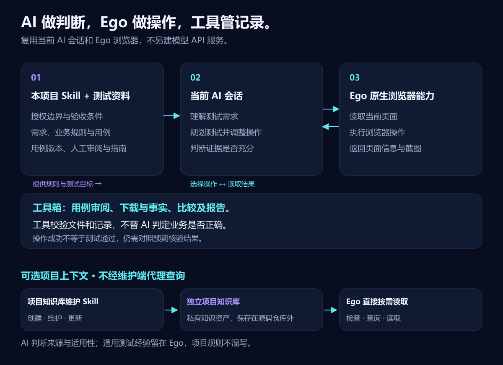
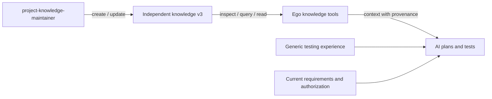
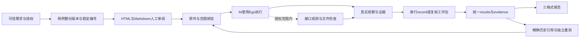

# 架构与职责（v9 / 0.1.9）

## 知识维护与测试使用的分工

[project-knowledge-maintainer](https://github.com/99Like-wjj/project-knowledge-maintainer) 是独立的创建与维护工具，仓库当前私有、需已有访问权限。它将授权资料整理为源码仓库外的项目知识资产；Ego 使用自身的只读工具直接消费格式 v3，不把维护端作为查询代理。通用测试经验仍在本项目指南中，项目知识不进入测试资产账本或安装包。

AI 理解需求、设计目标、探索页面、选择方法并判断业务四态；Ego 提供浏览器原语。固定代码负责准确的文件事务、引用、证据保管、确定性读取和同源呈现，不调用模型或替 AI 选择业务路径。默认并发 1，上限不是必须跑满。

## 资料与模块

knowledge/commands 提供只读检查、摘要检索与精确读取，contract/store及生成的Schema与独立维护项目的格式v3源一致。按需读取project、modules、rules、accounts四类资料；没有知识库时跳过。默认只将匹配的通用知识送入 AI 上下文，保留来源、状态、范围和本地版本局限；功能细则按任务读原需求。外部知识不属于 cases/reviews/runs 资产账本，读取不授予业务操作权限。原测试主链继续保留；知识是按任务选择的外部上下文，不是强制前置阶段。

core/case-versions 负责整份版本、编号和不可变发布；core/case-review 保存相邻实际意见/确认及内容指纹。资料只有用例、审阅、运行，不抽象通用 AssetStore。定义不变直接复用，规则/任务内嵌语义，问题保留原记录。

regression/selection 计算 points/status/full 与已声明依赖闭包，binding 冻结引用、审阅、当前条件、参数和历史；sources 只读验证精确结果前缀，compare 展示事实差异。baseline.json 是完整原件，run-binding.json 不另造用例定义。未选点不产生本轮四态。

core/records 和 action-events 统一管理实际上下文、动作、观察、原问题检查、额外发现和四态。操作成功不等于业务成功，attempt/首次异常不被后续 final 覆盖。串行与并行使用同一验证器；宿主负责真实执行者和生命周期，不声称工具提供权限沙箱或账号隔离。

ego-helpers/download 由 AI 显式组合官方监听与保存，在同轮取回原件；下载管理页适配是显式补证。execution note 保存一个本轮在途标记，不做自动业务重试或超时释放。files/inspect 在受限子进程只读解析，读取结果不判业务通过。

report/history 只读收集精确父运行，旧证据单独包装、不进当前目录和计数。report/assets、delivery 同源生成 HTML/Markdown/JSON、附件和校验清单；历史损坏可局部交付并明确缺口。report-ui 与 review-ui 分别负责报告阅读和离线用例审阅，不执行业务或回写账本。

core/conversations和conversation-store验证独立conversationVersion 1的消息、原件映射、精确引文和动作归属；并行导入只映射外部证据ID，不重写消息文件。ego-helpers/capture-text仅由AI显式调用，读取明确节点、保存长文本及采集范围，不识别站点协议或判断结束/业务成功。report/conversations构造注册或事后来源视图，report-ui/conversations按方案2显示步骤摘要、聊天侧栏/全屏、来源和完整性。Markdown解析与净化被打入离线脚本，不执行外来HTML或加载外部图片。reviewability只给结构提示，不替AI判定或规划补测。

用例审阅由case-reader提供场景总览和三栏工作台。review-ui在离线HTML中生成可读且内嵌完整反馈数据的评审HTML，可选JSON；浏览器文件选择器保存或显式下载，不连接服务器。review-feedback-document为浏览器及可选CLI共用纯生成器，review-export仅负责CLI文件事务。浏览器草稿、导出反馈与正式审阅分别保留，见[离线审阅导出](case-review.md)。

observation 继续按明确授权采集接口，AI 自主决定何时查询。网络格式保持 1。分发使用 layout 清单、预打包读取库和完整第三方许可，用户运行时无需 npm install。

## 约束与验证

Schema 源文件、生成类型、代码和当前指南保持一致。旧格式不兜底读取，旧资料不搬迁或覆盖。工程、合成与实际 Ego 验证分别说明；实际业务验收需其明确授权。

参见[契约](asset-formats.md)、[当前知识设计](project-knowledge-lightweight-integration-design.md)、[当前开发自测](v0.1.9-development-validation.md)及[宿主边界](../skills/ai-autonomous-testing-ego-lite/references/host-compatibility.md)。

## 语言与模型来源

core/ai-context只解析、合并及核验有来源的模型记录，不探测模型、不调用模型，也不按模型名称判业务质量。用例来源与实际执行贡献分别保存；工作包证据映射不改变真实执行者。

report/ui-text只处理显式标记的模板静态片段，业务插值、原文和证据保持原值。presentation以AsyncLocalStorage隔离Node的并发生成，浏览器按当前文档的同源参数选择语言；固定文案目录由tools/generate-ui-catalog生成并在构建时检查。model-display为两个阶段各生成一处来源展示，scope-label由HTML和Markdown共享，基于明确比较基准生成范围文案。
