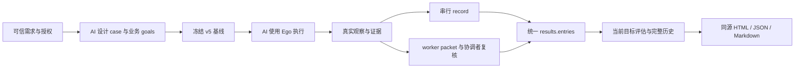

# 架构与职责（v5）

当前 AI 负责理解需求、目标拆分、选择方法、执行浏览器操作和判断结果。Ego 提供原生浏览器能力；本地工具只做确定性数据事务、结构校验和报告呈现。默认并发 1，用户配置是上限，不是要求跑满；工具不自动调度、重试或调用模型。

跨宿主执行时，宿主负责真实执行者、上下文、工具权限和生命周期，本地工具只保存分派与复核交付；不新增宿主调度器或权限沙箱。链接 CLI 入口按真实路径识别，运行/证据路径保护保持。参阅[宿主条件与交接](../skills/ai-autonomous-testing-ego-lite/references/host-compatibility.md)。

## 业务目标与必要语义

case 组织相关业务流程；goals 承载有来源、可独立判断的预期。steps、criticalConditions、requiredPath 保留必要语义，goal.requiredRefs 建立依赖。工具不把每个点击变成验收目标，不由父场景状态复制子目标通过。

observations 记录实际事实、coveredRefs 与证据 ID。assessments 引用观察并给出四态、理由、缺口及可选 diagnosis。结果与根因分离：发现违反可以根因未知；缺少目标评估是记录完整性缺口，不自动变成业务无法判断。

## 唯一结果渠道

串行 record 与并行 import 写入同形 record 和同一 entries。final 对本次提交目标增量更新，attempt 仅留历史；当前状态是 final entries 的投影，原始条目不覆写。没有额外的并行专属目标评估来源，串行不依赖 worker 或 Space 分派才能形成报告。

worker 在专属目录封存不可变 packet，协调者复核后将 local evidence key 映射为 catalog ID。分派、容量、Space 所有权、在途调用和导入恢复保留在 execution 台账，属于执行元数据，不能代替业务四态。工具不提供宿主权限沙箱，Space 不保证账号或后端隔离。

## 文件与校验

源码维护 TypeScript，完整包提供 Node ESM 与 Skill、schema、示例、文件清单。tool-info 校验实际根、版本、revision 和安装完整性。测试资产 JSON 契约为 v5；接口观测独立使用 networkVersion 1。旧格式明确拒绝，不提供兼容或自动转换，历史文件不改写。

基线指纹保护冻结内容；单写者锁、expectedRevision、operationId 和回执保护数据事务，原请求重放仅恢复回执。证据按普通文件复制、留存字节哈希和归属核验，报告拒绝覆盖。工具不认证证据真实性，也不承诺通用多文件事务或断电持久性。

## 报告与按需观测

三种报告共享当前目标投影：四态分布、unassessed 记录缺口、实际观察、必要语义、截图、历史及后续复核引用。父场景只呈现目标分布；文件完整性、缺图和根因假设单列。followUpOf 关联澄清/复测来源，不自动改变旧结论。

浏览器按需观测仍通过当前 Ego 官方能力。AI 可查询与目标相关的动作、请求/错误或下载文件，不采集全站流量或将工具超时自动判产品失败。具体能力须以当前版本和隔离验证为据，不能因 API 名称存在便宣称支持。参考执行经验（安装包路径：references/experience-execution.md）。

代码能力和合成回归不代替实际业务验收；当前开发验证见[验证记录](testing.md)。用户级已安装 Skill 不自动替换，候选构建不冒充正式发布。

接口观测采用独立 native-only 上下文，经官方 TaskSpace 控制权门禁只附着已登记页面与接口范围。network start/status/query/stop 管理后台记录、已提交事实查询和有序停止；流内容在安全完整单元处理后保存，恢复另建采集段。工具不做业务请求重发、自动业务轮询或业务判断；按需查询及证据选择由 AI 决定。正文、队列、关联表、输出和 Run 磁盘预算均有边界，缺口可见。
