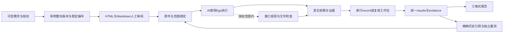

# 架构与职责（v9 / 0.1.8-rc.1）

AI 理解需求、设计目标、探索页面、选择方法并判断业务四态；Ego 提供浏览器原语。固定代码负责准确的文件事务、引用、证据保管、确定性读取和同源呈现，不调用模型或替 AI 选择业务路径。默认并发 1，上限不是必须跑满。

## 资料与模块

core/case-versions 负责整份版本、编号和不可变发布；core/case-review 保存相邻实际意见/确认及内容指纹。资料只有用例、审阅、运行，不抽象通用 AssetStore。定义不变直接复用，规则/任务内嵌语义，问题保留原记录。

regression/selection 计算 points/status/full 与已声明依赖闭包，binding 冻结引用、审阅、当前条件、参数和历史；sources 只读验证精确结果前缀，compare 展示事实差异。baseline.json 是完整原件，run-binding.json 不另造用例定义。未选点不产生本轮四态。

core/records 和 action-events 统一管理实际上下文、动作、观察、原问题检查、额外发现和四态。操作成功不等于业务成功，attempt/首次异常不被后续 final 覆盖。串行与并行使用同一验证器；宿主负责真实执行者和生命周期，不声称工具提供权限沙箱或账号隔离。

ego-helpers/download 由 AI 显式组合官方监听与保存，在同轮取回原件；下载管理页适配是显式补证。execution note 保存一个本轮在途标记，不做自动业务重试或超时释放。files/inspect 在受限子进程只读解析，读取结果不判业务通过。

report/history 只读收集精确父运行，旧证据单独包装、不进当前目录和计数。report/assets、delivery 同源生成 HTML/Markdown/JSON、附件和校验清单；历史损坏可局部交付并明确缺口。report-ui 与 review-ui 分别负责报告阅读和离线用例审阅，不执行业务或回写账本。

用例审阅通过case-reader提供场景总览和三栏工作台。可选review-session只监听带随机会话路径的127.0.0.1入口，限定CLI给定的用例和输出目录；review-export校验后原生保存可读HTML/JSON，避免Blob下载区域标记。它不调用模型、不操控浏览器、不登记确认。离线副本与兼容备份仍保留，浏览器草稿和正式审阅分开；见[审阅保存说明](v0.1.8-case-review.md)。

observation 继续按明确授权采集接口，AI 自主决定何时查询。网络格式保持 1。分发使用 layout 清单、预打包读取库和完整第三方许可，用户运行时无需 npm install。

## 约束与验证

Schema 源文件、生成类型、代码和当前指南保持一致。旧格式不兜底读取，旧资料不搬迁或覆盖。工程、合成与实际 Ego 验证分别说明；实际业务验收需其明确授权。

参见[契约](asset-formats.md)、[最终设计](v0.1.8-design.md)、[开发自测](v0.1.8-development-validation.md)及[宿主边界](../skills/ai-autonomous-testing-ego-lite/references/host-compatibility.md)。
