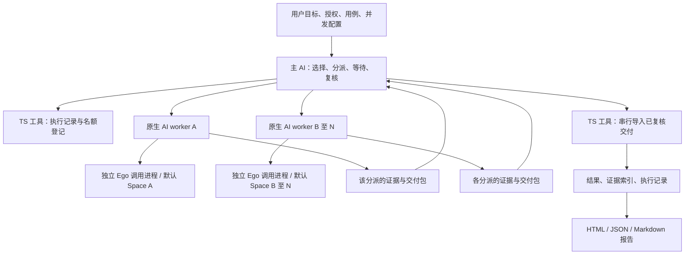

# v0.1.4 已批准设计：全量 TypeScript 与可配置用例并发

> 历史版本记录（v0.1.4）：以下“当前/尚未/待验证”等表述均以本文日期和阶段为准，不是 0.1.7 的最新状态。原始测试结果与限制保留；当前能力与契约见[格式说明](asset-formats.md)，分阶段验证见[云端审阅](v0.1.7-cloud-review.md)。

日期：2026-10-23。状态：用户已批准轻量方案，现已进入开发与验证。本文保留设计时的事实、建议与验收清单；实现现状及尚未满足项以 [验证记录](testing.md) 为准，不能把下文历史“未测试”或建议文字当作当前结果。

2026-10-24 用户补充：未明确要求或配置并发时默认 1、逐条执行；保留 AI 对工具调用、批次与 worker 使用的选择权。下文当前配置与验收项已同步，不改写已冻结运行和历史验证证据；真实 UAT 保持暂停。

唯一源码目录：当时已确认的本地源码检出目录（开发机路径已泛化）；当前分支：`feat/v0.1.4-parallel-testing`；实现基线：`ae2ce6b40ad96a4e02593767964c3e52c262cf6b`。保留此前本地修改及验证资产，不修改用户安装、不推送、不发布。下文 `scripts/*.mjs`、`tools/*.mjs`、`render.py` 的 VERIFY 引用均指设计基线提交的历史源码；当前维护代码已迁至 `src/`、`tools/*.mts`、`docs/images/render.mts`，安装入口仍是编译后的 `scripts/ego.mjs`。

本文整合[当前需求](requirements.md)、[重新评估](v0.1.4-reassessment.md)、[首轮验证](v0.1.4-capability-validation.md)与[保护补测](v0.1.4-space-protection-retest.md)。历史严格方案不再作为实现前置；旧实验结论保留原样。

## 1. 设计结论与版本范围

**推荐采用全量 TypeScript 源码、编译后的 Node.js 安装包、宿主原生 AI workers、Ego 多进程与多 Space，以及本地轻量执行记录。用户配置并发上限，AI 决定哪些用例能同时执行。**

| 当前需求 | 本版落实方式 |
| --- | --- |
| R-TS：所有维护程序统一 TS | CLI、核心事务、报告交互、测试、工具与图片生成程序全部迁移，分模块维护。 |
| R-CONFIG：用户自由配置并发数 | `maxParallelCases` 为正整数，无 2／4／8 等产品固定上限；提供配置文件与本次覆盖入口。 |
| R-CAPACITY：配置与实际透明 | 分别展示请求上限、已知宿主容量、实际活动数、峰值和受限原因。 |
| 独立用例必须能够并行 | 多个真实 AI worker 分别驱动 Ego，验收实际重叠及完整证据汇总。 |
| 单用例默认单 Space，允许执行偏差 | 保存默认关联、实际使用历史、原始错误与恢复关联，由 AI 复核业务影响。 |
| R-PRESERVE：目标与资产保护 | 不改验收语义；分开保存业务结论与执行异常；只按所有权回执处理本次 Space。 |
| R-DELIVERY：可用安装包 | 用户使用编译后程序；构建与安装资源可校验，离线报告保持自包含。 |

这仍适合作为 Skill。新增程序处理配置、名额登记、文件事务和汇总；AI 继续规划、操作页面和判断业务。采用 Node.js 单进程维护账本，不妨碍多个 worker 启动各自 Ego 调用。TS 改善内部契约维护，不保证 AI 永不误操作，也不直接提升模型推理或网页速度。

**增加的必要负担**是编译构建、类型契约、执行记录和幂等汇总。首版不引入常驻调度服务、独立模型 API、数据库、浏览器 broker、权限沙箱或固定业务 DAG。只有实测出现写入瓶颈，再评估更重的架构。

## 2. 事实依据与当前缺口

| 目标／事实 | 当前状态与依据 | 对设计的约束 |
| --- | --- | --- |
| 双进程驱动不同 Space | **已验证，有限合成范围**，有重叠、页面读回及截图。[VERIFY: docs/v0.1.4-capability-validation.md:23-29] | 使用不同调用进程；不把单个调用内的 `Promise.all` 当作跨 Space 并发证明。 |
| 常规 Space 保护 | **已验证，限常规创建、续跑、精确清理**。[VERIFY: docs/v0.1.4-space-protection-retest.md:9-17] | 保留清单、创建回执、精确 ID 和独立读回。 |
| 宿主不可绕过的工具隔离 | 历史强隔离目标存在**发现违反**；当前需求不要求这一保证。[VERIFY: docs/v0.1.4-capability-validation.md:11-17] | 不能宣传为强沙箱；不再作为并发开发的阻塞。 |
| 当前共享文件锁 | 独占创建，冲突时拒绝；不是排队器。[VERIFY: scripts/ego.mjs:157-197] | workers 分开交付，由协调者统一入账。 |
| 现有幂等与证据归属 | 结果先识别相同操作，再检查 revision，且核对 case／证据关联。[VERIFY: scripts/ego.mjs:539-597] | 复用语义，保留首次失败与尝试，响应丢失可用同一请求重放。 |
| 进度读取 | 也会占用 run 锁并恢复待处理证据。[VERIFY: scripts/ego.mjs:701-709] | worker 不轮询公共 `progress`；协调者统一刷新。 |
| 报告浏览器程序 | 当前交互代码位于 HTML 模板字符串内。[VERIFY: scripts/ego.mjs:785-829] | 提取为 TS 并编译，确保实际纳入类型检查。 |
| 两个真实 AI worker 执行并汇总 | **未测试**，已有 CLI 探针不能替代产品链路。 | 列为发布前必要验收。 |
| 截图稳定性、故障恢复、加速收益 | **无法判断／未测试**，补测记录有零视口、最小化与截图失败。[VERIFY: docs/v0.1.4-space-protection-retest.md:29-36] | 不能承诺任意并发数都稳定、任意崩溃都自动恢复或固定加速倍数。 |

宿主是否支持原生 subagents、额度多少，取决于运行环境。Codex 官方文档给出宿主并发线程设置；Skill 自身的配置不能替代该额度，也不自动更改用户配置。[Codex subagents](https://learn.chatgpt.com/docs/agent-configuration/subagents)

## 3. 组件与职责



- **主 AI**：理解目标与依赖，选择并行批次，调用宿主分派／等待／停止工具和 Ego，复核结果，决定补测、恢复及是否结束。不另写一个模型代理程序替它作业务决策。
- **worker AI**：接收冻结用例、必要步骤、预期、授权、默认 Space ID、分派 ID 及输出目录。自主执行并留证；不再把目标重新解释成较弱预期。默认一例一个活动 worker，worker 内不再递归分派用例。上一分派已交付且确认无在途操作后，可以复用空闲 worker；新分派必须重新传入完整边界与关联，不沿用旧 case 的 Space 或证据路径。
- **本地 TS 工具**：校验输入、原子登记名额／关联、核对交付、提交数据与生成报告。拒绝非法调用并说明原因，不自动选择下一业务动作或重放业务操作。
- **Ego**：沿用已安装的官方 CLI／API。Skill 不复制 Ego 内核；每次 invocation 显式选择对应 numeric Space ID，不依赖上次调用的隐式上下文。

Skill 入口保留目标、授权、判定和分派要点；并发、工具命令与恢复细节按需放入 references。可以补测、先执行其他用例或记录无法判断，不强迫 AI 走固定测试阶段。

## 4. 并发配置

### 4.1 参数、默认值与优先级

项目私有资产目录提供 `execution-config.json`，不写用户级全局配置。示例：

```json
{
  "schemaVersion": 1,
  "maxParallelCases": 6
}
```

`maxParallelCases` 表示同时活动的**用例执行数上限**，不是 Space 总数、tab 总数、CLI 进程数或全体 Agent 数。

| 项目 | 设计 |
| --- | --- |
| 合法值 | JSON 值为能精确表示的正整数，使用 `Number.isSafeInteger` 校验；CLI 对数字参数严格解析后使用同一校验。无产品层固定最大值。按需分配，不按配置值预先创建 N 个任务或 Space。 |
| 默认值 | 1，未明确要求或配置并发时逐条执行。配置 6、12 等同样合法；AI 不因用例独立或宿主空闲自行提高，也不要求跑满上限。 |
| 本次覆盖 | `start ... --max-parallel-cases 6`；自然语言“本次并发 6”由 AI 明确转成该配置，不只留在提示词。 |
| 配置文件 | `start ... --execution-config ABS_FILE`，或项目已确认的标准配置文件。不得扫描无关目录寻找配置。 |
| 优先级 | 本次显式值 > 显式指定的配置文件 > 项目标准配置 > 默认 1。显式指定的文件丢失或值非法时报错，不静默退到默认值。 |
| 固定记录 | run 保存解析后值、来源、配置内容哈希和初始快照；保存脱敏参数来源，不复制凭据。修改项目配置不追溯改变已有 run。 |

### 4.2 宿主子代理并发限制、冲突与实际并发

**用户已确认采用轻量适配。** 本版不开发跨 AI 客户端主动探测最大子代理数的模块；仅使用宿主明确提供的能力信息，没有可靠信息时标为未知，遇到明确的分派拒绝再记录原因并调整安排。不为探测上限批量创建代理，也不扫描或修改用户全局配置。最大额度与当前可用名额分别对待，不能在不知道其他占用时把最大值当作剩余值。

记录 `requestedMaxParallelCases`、`knownAvailableWorkers`（可未知）、`activeCases`、`peakActiveCases`、受限原因和时间区间；将名额占用与有执行证据的实际重叠分开统计。

已知额度时，可启动数量不超过“用户上限、可用 worker 名额、当前可独立执行用例数”的最小值。若宿主报告含主线程的总额度，扣除协调者及其他占用；若报告仅子线程额度，不再扣主线程。还要区分宿主计算的是打开线程还是活动任务，按实际口径结束／复用空闲 worker，不持续创建到额度耗尽；不把某次环境的 4 或 6 写成产品常数。未知时如实标记，记录分派被拒绝的事实，不伪造配额探测结果。

例如用户设置 8，宿主只余 3 个 worker：配置仍为 8，执行最多 3 并分批；报告写明原因。若用户明确要求“必须同时 8 例”，该目标标为未满足，不能用分批代替。用例不足或存在共享数据冲突，也分别列明；不一律禁止所有写用例并发。

同一 profile 的 cookies／缓存和后端数据可能共享。AI 在分派前判断账号、租户、记录、登录／退出与写副作用；可以显式登记互斥资源，工具只检查已声明的占用，不自行推断业务依赖。[Ego 共享状态说明](https://github.com/citrolabs/ego-lite/blob/d392204d1ea1a8027a591ab2b0129c2e11d85f26/skills/ego-browser/references/clearing-state.md)

宿主不支持多 worker 时，报告并发目标未满足。可以保留可用的串行工具能力，但不能据此宣称 0.1.4 并发验收通过；也不自动改全局设置或更换模型服务绕过限制。

### 4.3 占用口径与执行中调整

先原子登记名额，再分派 worker 和申请 Space，防止正常调用路径超发。`reserved`、`running`、`stop_requested` 与尚未对账的 `lost` 均占名额；页面等待也属于运行。确认无在途调用后可登记 `paused`／`stopped` 并释放名额。保留审计用的 Space 本身不占用例并发名额。

主 AI 可按用户新指示调用 `execution set-limit`，显式记录旧值、新值、原因及 revision。提高只允许后续分派，不自动启动；降低则停止新增并等待已有执行结束，不强杀或重放业务。降低后短时活动数高于新值时显示“等待收敛”，保留变更记录。暂停后的续跑须重新占名额，不能凭时间超时自动回收仍可能写入的任务。

## 5. 用例、Space 与异常处理

1. 主 AI 只读记录执行前已有 Space；选择独立用例，提交冻结基线哈希、授权说明、互斥声明并取得 `assignmentId` 和名额。
2. 主 AI 通过 Ego 创建本次 Space，保存原始回执、numeric ID 和所有权，再分派 worker；分派失败时核对是否仍有在途任务，释放名额并保留现场。创建后尚未登记就崩溃的 Space，不能凭名称猜测归属并清理。
3. worker 默认复用该 Space，可包含多个 Page；每次调用明确关联当前分派。正常情况下同一 Space 不同时交给两个 worker；跨进程同 Space 存在竞争风险，现有调研已记录。[VERIFY: docs/requirements.md:29-35]
4. 偏离默认 Space、误切、误开或执行失败时，追加实际 ID、调用／错误、尝试和影响；不覆盖首次失败。AI 核对身份、数据、必要步骤与已发生副作用后，决定纠正、换 Space 恢复、补测或无法判断。换 Space 属于可记录恢复，不自动等于用例失败或产品缺陷。
5. worker 完成交付；主 AI 核对证据与原目标后导入，业务结论与执行状态分别保存。worker “完成”不代表用例“通过”；主 AI 的调整也保留理由与原始结论。
6. 若需要清理，只处理本次拥有且能确认的精确 ID，随后独立读取清单核对。预先存在的用户／其他任务 Space 不接管、不恢复、不清理；归属不明时保留。现场受外部操作影响时记录事实，不静默重建原状态。

生命周期记录只约束“谁在执行、是否还有在途动作、是否可再分派”等数据不变量，不规定页面路线。worker 超时／失联后先记录未知状态；重试读回和幂等文件提交与重试业务写操作分开，后者由 AI 根据授权和副作用判断。

实际 Space 以 Ego 回执、调用记录和独立观察为依据；缺失时写明未知，不用默认 ID 冒充实际值。本方案不拦截全部原始 Ego 调用，因此不承诺能自动发现 Agent 的每次偏差。

## 6. 文件事务与结果汇总

项目资产和 run 仍位于源码／安装目录之外。建议结构如下，新增目录均为运行资产，不是第二套源码：

```text
run/
  manifest.json                 # 冻结基线关联与执行文件引用
  baseline.json / results.json / evidence.json
  execution.json                # 配置快照、分派、关联、事件、导入进度
  workers/<assignmentId>/
    captures/                   # 该分派原始证据
    packet-<packetId>.json       # 完成写入后交付，不覆盖
  evidence/                     # 经既有工具留存的证据
```

`execution.json` 保存单调 revision、配置变更、case／attempt／worker／默认及实际 Space 关联、名额状态、异常与提交回执。事件是确定性事实记录，不是业务决策引擎。一个 case 同时最多一个未结清分派；恢复新分派引用旧尝试，不删除旧历史。

workers 仅写各自新建的文件，不同时修改 `results.json`、`evidence.json` 或公共执行记录。交付包最少包含 run ID、基线哈希、case ID、assignment ID、attempt ID、packet ID、实际观察、证据路径与哈希、AI 提议结论及执行异常。先完成文件再发布交付包；重复 packet ID 内容变化拒绝，交付包发布后不再修改。

主协调者是唯一公共提交者，TS 导入工具做以下确定性事务：

1. 核对基线、分派、目标 case、路径范围、文件类型和哈希，拒绝串例与不完整交付。不能由 TS 类型断言跳过磁盘文件校验。
2. 在 run 锁内准备持久化导入进度，给证据和结果分配稳定 operation ID；保存**含 expectedRevision 的原始请求**后再执行。复用既有证据登记与结果记录语义。[VERIFY: scripts/ego.mjs:539-554] [VERIFY: scripts/ego.mjs:636-703]
3. 先登记证据，再记录结果，最后完成交付回执。多文件提交不是天然原子事务；中途失败时明确显示已提交／未提交步骤，不把部分入账当作全完成。
4. 响应丢失后用已保存的完全相同请求重放；不能改 expectedRevision 后沿用同一 operation ID。若确认外部写入导致未执行请求版本冲突，保留冲突并由协调者重新核对后创建新数据事务，不重做页面业务。
5. 主 AI 不论何时停止，都能生成注明未完、失联、未导入和未测试项的报告；不会自动把未完成 worker 的结果补成通过。

拆出可复用的“已持锁”内部函数，避免一次导入递归获取同一锁。保留独占锁、幂等和哈希校验；可在一次导入中复用同一受锁保护的已验证状态，避免每个小步骤重复扫描所有历史证据。最终报告仍完整验签，先测量提交耗时，不能为并发去掉完整性校验。

建议命令族是 `execution reserve / attach-space / note / set-limit / import / reconcile / read`。其中 `reconcile` 只按显式事实对账，不自行关闭 Space、重放写操作或判断业务通过。

## 7. 全量 TS 迁移

### 7.1 范围与模块划分

| 当前程序 | 迁移后的职责与位置建议 |
| --- | --- |
| `scripts/ego.mjs` | `src/scripts/ego.mts` 只留 CLI 入口；校验／文件事务／证据／记录／报告拆到对应模块，不在一个文件中堆叠调度器。[VERIFY: scripts/ego.mjs:904-948] |
| `scripts/toolchain.mjs` | `src/scripts/toolchain.mts` 维护工具根、版本、明确资源列表和实际产物指纹。[VERIFY: scripts/toolchain.mjs:10-22] [VERIFY: scripts/toolchain.mjs:44-64] |
| HTML 字符串内浏览器程序 | `src/report-ui/main.ts`，单独 DOM 编译，生成的 JS 嵌入离线报告。[VERIFY: scripts/ego.mjs:785-829] |
| 新并发数据能力 | `src/execution/*.mts`：配置、执行记录、名额、交付包校验与导入，不调用模型或选择页面路线。 |
| 现有测试 | `tests/*.test.mts`，继续使用 `node:test`；保留有意义的断言和失败分支，针对编译产物执行。 |
| 构建与公共资产检查 | `tools/*.mts`，覆盖独立打包、源码与安装包检查。[VERIFY: tools/build-skill.mjs:8-27] [VERIFY: tools/public-check.mjs:1-33] |
| 4 个 v0.1.4 验证工具 | 全部迁为开发专用 TS；不进入用户安装包，不作为运行时依赖。旧实验包中的原始脚本和日志不改写。 |
| `docs/images/render.py` | 迁为 TS SVG 生成器；沿用可选 Inkscape CLI 导出 PNG，明确导出缺失，不增加 Python 运行需求，也不自动重绘历史图。[VERIFY: docs/images/render.py:1-24] |

源码布局建议：

```text
src/
  scripts/                      # 安装入口与工具身份
  contracts/                    # 外部契约类型、内部 ID 与状态类型
  core/                         # 文件事务、校验、记录、证据
  execution/                    # 并发配置与执行记录
  report/                       # 报告模型、HTML / JSON / Markdown 渲染
  report-ui/main.ts             # 浏览器端交互
tests/*.test.mts
tools/*.mts
docs/images/render.mts
schemas/                        # JSON Schema 继续作为外部格式规范
skills/ego-lite-test/            # Skill 入口与按需参考
```

Node 源码采用 TypeScript 的 `.mts`，编译为 `.mjs`，明确 ESM 且保留现有安装入口 `scripts/ego.mjs`；浏览器源码使用 `.ts`。不同时维护一套手写 JS 和一套 TS。文档／Schema／用例／图片不是待改语言的程序；Ego 临时调用脚本和编译 JS 是生成产物，不算残留的维护源码。[TypeScript 模块规则](https://www.typescriptlang.org/docs/handbook/modules/reference.html)

迁移前核对尚未跟踪的本地验证工具和修复，保证其原始版本仍可从已保留的验证资产或后续明确的 Git 历史追溯，再替换维护源码；不创建 backup／legacy／版本源码目录，不删除历史报告、截图或原始证据。

### 7.2 类型、运行时验证与依赖

- Node 编译采用 `NodeNext` 模块与解析、`ES2022` 目标，开启 `strict`、`noUncheckedIndexedAccess`、`exactOptionalPropertyTypes`、`noEmitOnError`、`verbatimModuleSyntax`。Node 与浏览器分开 tsconfig，避免 Node 模块误用 DOM 全局。
- 外部 JSON／磁盘／工具响应先接收为 `unknown`，运行时核验后才进入内部模型。对 case、run、Space、分派、operation ID 和 revision 使用有区别的内部类型与校验入口；不靠普通 string 别名假装防串例，不用成片 `any`／双重强转绕过错误。
- 外部 JSON Schema 保持格式事实来源。建议开发期使用 `json-schema-to-typescript` 生成基础声明并检查漂移；锁定实际可用版本，先用本项目 Schema 验证 `$defs`／本地引用。它不能完整表达 `if/then`、pattern、唯一性等限制，因此语义约束仍由运行时校验与测试覆盖，不宣称生成类型等价于完整 Schema。[生成器的能力与限制](https://github.com/bcherny/json-schema-to-typescript)
- TS 类型在产物中会被擦除，不能替代原有 revision、路径、哈希、关联和授权检查。[TypeScript 类型擦除](https://www.typescriptlang.org/docs/handbook/2/basic-types.html#erased-types)
- 新增依赖限定在开发期：固定版本 TypeScript、Node 类型和契约生成工具，提交 lockfile。使用 Node 内置测试和编译器，不为此次迁移引入前端框架、ORM、Agent SDK 或新的运行时库。生成工具不兼容时先解决契约生成／声明映射，不降级 Schema 来迁就工具。

### 7.3 构建、路径与安装

建议流程：`npm ci` → 类型／契约检查 → 编译 Node 与浏览器程序 → 暂存运行资源 → 测试编译产物 → 资产检查 → 按需构建安装包。所有构建辅助程序也以 TS 维护；编译器 CLI 完成最初编译，不依赖先运行尚未生成的本项目 JS。

`.build/` 仅保存可再生成的编译／资源暂存产物，加入忽略列表；不保存第二套维护源码或真实运行数据。暂存时将 `src/` 中运行模块按明确规则映射到安装根下的 `scripts/`、`core/`、`execution/`、`report/`；测试／开发工具不混入安装包。浏览器程序单独编译为无外部依赖的脚本，再嵌入报告，维持断网打开与安全文本转义。

开发源码的调用方式增加构建步骤；安装后的调用仍为 `node ABS_SKILL_ROOT/scripts/ego.mjs ...`。保留 Node.js `>=22` 基线，测试支持的 Node 22／24；用户无需 `tsc`、`tsx` 或在使用时联网安装依赖。Node 的直接 TS 支持有版本与语法限制且不做类型检查，因此不采用“交付 `.ts` 让所有用户直接执行”的方式。[Node 22 TS 文档](https://nodejs.org/docs/latest-v22.x/api/typescript.html)

工具根通过明确的入口／资源上下文传入；开发暂存布局和安装布局分别测试，不能从 `.build/node/src/` 按旧父目录层数猜根，也不能依赖当前工作目录。开发模式仍禁止项目／run 资产写进整个源码目录，不能只保护 `.build/` 子目录。`.build/` 是内部编译暂存；最终独立安装目录仍须位于源码仓库之外且是新目录，保留现有拒绝覆盖规则。[VERIFY: tools/build-skill.mjs:8-27]

`runtime-manifest.json` 校验**实际交付的编译 JS 与资源**；源码指纹另列，不能把源码哈希冒充安装产物哈希。`public-check` 分开检查源码和安装包：源码允许 TS／配置／lockfile 并显式处理生成目录，安装包继续用严格允许列表和隐私检查；不能把忽略构建目录变成放行真实资产的捷径。更新 `.gitattributes`、构建资源清单、工具身份、文档入口与版本一致性检查。

## 8. 格式与既有资产

语言迁移本身不要求改用例格式。建议只升级确实携带并发语义的格式：

| 资产 | 建议版本与处理 |
| --- | --- |
| cases／冻结 baseline | 继续 v3，保留业务步骤、必要路径、预期和澄清语义。 |
| results／evidence／现有登记请求 | 继续 v3，复用原有失败历史、revision 与幂等契约。 |
| 新建 run manifest | v4，引用 execution v1 与 baseline v3，使旧工具明确拒绝新并发 run，而非忽略执行记录。 |
| 执行配置／执行记录／worker 交付包 | 各自 v1，独立 Schema，避免将执行元数据塞入闭合的用例字段。 |
| 新并发报告 | v4，在原报告内容上增加并发、执行状态、Space／尝试关联、异常与未完成项。 |
| 既有 v3 run | 0.1.4 保留原格式的读、核验、记录及报告路径，不原地升级；并发新执行从同一 v3 cases 建新 run，保留原 run。 |

以上是待审核的格式方案，不是已发生的格式升级。现有 manifest 与 report 均闭合字段，不能偷偷扩展后仍声称兼容；现有写入也明确限制 manifest v3，需要实现显式版本分派并补测，不能只改 Schema 文件。[VERIFY: schemas/manifest.schema.json:1-34] [VERIFY: schemas/report.schema.json:1-48] [VERIFY: scripts/ego.mjs:539-554]

工具元数据区分软件版本、toolRevision 与各类格式支持表；不再用一个全局数字模糊表示所有格式。安装包显示 0.1.4 开发／候选状态，正式版本号、CHANGELOG、README 和产物一致性在发布前核对；本设计不授权 Tag、Release 或修改现有安装。

## 9. 报告与验收

每个目标仍分别呈现**已验证、发现违反、无法判断、未测试**及依据。交付包和并发报告增加 `goalAssessments`，逐项引用原用例目标／预期／必要步骤，保存判断、事实与证据；由 AI 对照原文复核覆盖，工具检查结构与引用，不自行拆解或改写验收语义。

既有 case 状态展示为 `pass` → 已验证、`fail` → 发现违反、`inconclusive` → 无法判断、`not_run` → 未测试；`blocked` 额外说明执行受阻，已经尝试但证据不足的目标归无法判断，尚未尝试的目标仍为未测试。上述 case 汇总不能覆盖或代替各目标的独立状态；执行偏差本身不能被写成业务 `fail`。排队、运行、暂停、失联、待导入等执行状态另列。操作成功、worker 返回成功或 TS 编译成功都不等于业务验证通过。

报告保留原目标与必要步骤、首次失败、尝试、历史最终结论与证据，并新增配置来源、用户上限、已知容量、实际峰值、时间区间、Space 偏差、恢复与未满足项。分别给出名额峰值和有事实支持的执行重叠，不能只数开了几个 Space 来证明并发。

| 验收范围 | 必要场景与判断 |
| --- | --- |
| TS 等价迁移 | 先跑原有回归；端到端 CLI、幂等、损坏文件／证据、锁、首次失败、路径／软链接、HTML 转义与图片降级行为保持。类型通过不能代替这些结果。 |
| 安装交付 | 从与源码无关的 cwd 运行编译包；资源／版本／指纹一致；缺资源或改文件应拒绝；离线 HTML 可用；现有目录拒绝覆盖。 |
| 配置 | 缺省 1 串行、显式 1／2／6／12、优先级、显式文件错误、0／负数／小数／字符串／不安全整数、极大合法值的按需分派、执行中升降。6／12 等先用合成名额测试，不假称宿主实跑。 |
| 并发真实链路 | 至少两个真实 AI worker，各自冻结用例、独立 Ego CLI 调用与 Space、证据、交付、AI 复核和最终报告；用屏障或同等证据证明重叠，不将其扩大宣称为底层 Node 宿主完全隔离。 |
| 宿主与冲突 | 请求 8／宿主可用 3 的合成适配测试、额度未知／分派拒绝、共享写冲突与不冲突写用例；配置与实际透明，正常路径不超发。 |
| 串例与幂等 | 错 run／case／assignment／基线／证据路径、改写 packet、响应丢失、提交部分成功、重复导入、外部 revision 冲突、两个提交者同时调用。 |
| Space 与错误 | 默认关联与恢复；误开／误切／丢失 Space 不掩盖错误；证据不足不通过；正常和取消路径不误关原有 Space；清理后独立读回。 |
| 中断与续接 | worker 失败／失联、仍有在途动作、主 AI 中断、停止、暂停后续跑、陈旧锁；不自动重放未知写操作，不遗失已有结果。 |
| 性能与资源 | 同一批合成用例、相同目标与验收，记录串行与可用并发下 wall time、worker／Ego／汇总耗时、失败率及资源情况；不删失败项换取加速结论。 |

本地实机以 Windows 为主；文件与打包回归覆盖 Node 22／24，Linux 的路径／软链接差异单独验证，环境不支持的测试明确列出。更高 N 的真实运行以宿主实际能力为准，**配置测试通过不等于相同 N 的网页执行已验证**。

## 10. 实施顺序与审核范围

1. **建立迁移核对表并保留现有证据。** 核对本地修复、未跟踪工具和历史引用，冻结当前行为对照，不新建版本源码目录。
2. **全量 TS 等价迁移。** 拆分核心模块，迁移所有维护程序与报告 UI，完成构建、资源定位、安装包和既有回归；此阶段不声称已有并发能力。
3. **实现配置与本地执行记录。** 落实名额、Space 关联、事件、交付与幂等导入；先用合成数据验证大于 2 的配置和故障边界。
4. **接入 Skill 原生 worker 协作。** 按需参考文档、独立分派、复核、恢复、报告；在合成环境完成真实双 worker 全链路，再验证宿主允许的更高并发。
5. **整理验收与升级说明。** 对每个需求列明状态、证据、未满足项和性能结果；用户审核后另行决定真实业务验证、安装更新与发布。

当前具体选择是：未配置时默认并发 1（2026-10-24 用户确认）；可在 run 内显式调整并发且降低时等待收敛；Node 使用 `.mts` 编译交付 `.mjs`；manifest／并发报告升级 v4、业务资产保留 v3。AI 保留工具使用和执行安排的选择权；全量 TS 与可配置并发不是待重新确认的事项。

**可实现的结论不变，但有三项不能保证：任意用户配置数都能在任意宿主同时跑满、Space 等于账户／数据完全隔离、Agent 不会出错。** 本版通过透明配置、证据与记录处理这些限制。完整并发产品链路和性能收益目前未验证，必须经过上述验收后才可报告已实现。
