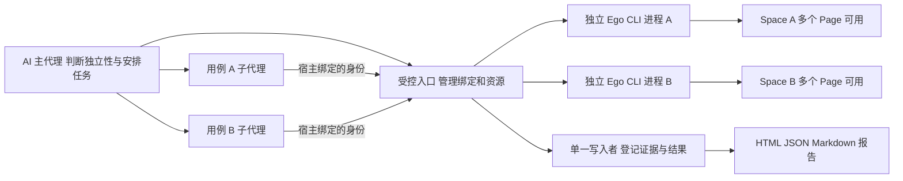

# v0.1.4 实现方案与可行性审核稿

日期：2026-10-23。状态：历史严格方案。用户已澄清单例单 Space 不要求不可绕过的强约束；本稿的硬隔离前置不再作为当前推荐。当前方案见 [v0.1.4 设计审核稿](v0.1.4-design.md)，包含已批准的全量 TypeScript 与用户可配置并发；本文保留用于追溯，不改写历史试验结论。

建议采用 **AI 判断独立性与安排任务，受控工具维护单用例单 Space 绑定，多个 Ego CLI 进程执行，单一写入者汇总证据和结果** 的结构。业务步骤、预期、重试和最终结论仍由 AI 决定。

主要限制是：**只安装 Skill、保留子代理完整 shell／原生 Ego 权限时，无法硬性禁止它绕过 wrapper 创建或切换第二个 Space。** 要完整满足强约束，需要增加受控浏览器适配器，并由宿主限制测试执行会话的工具暴露面。这是需要审核的架构扩展；不能将仅有提示词约束的版本宣称为全部需求已实现。

## 需求范围与当前依据

本稿对应用户附件的四项已确认需求及七个调研问题。附件与仓库需求的实质内容相同，差异仅为两处历史版本文字 `v0.1.3-dev`／`v0.1.3`。附件中的候选方案和“后续先补文件”等文字作为研究资料，不作为执行、安装或发布授权。仓库四项已确认需求见 [requirements.md](requirements.md)。[VERIFY: docs/requirements.md:9-12]

本次分析基线为 `feat/v0.1.4-parallel-testing`、提交 `ae2ce6b40ad96a4e02593767964c3e52c262cf6b`。读取附件、源码和官方资料；只读查询安装版本并导出本机 Codex 协议 schema，没有运行测试用例、创建测试 Space、访问真实业务或修改用户安装。

项目要求 AI 自主选择方法，工具只做确定性处理；拒绝非法调用不能替 AI 选择下一业务动作。新增机制必须遵守这一边界。[VERIFY: AGENTS.md:17-20]

### 已核实的实现基础

| 范围 | 已有事实 | 对方案的影响 |
| --- | --- | --- |
| 当前工具箱 | `scripts/ego.mjs` 提供用例冻结、证据登记、结果记录和报告；CLI 明确不执行网络、模型或浏览器操作。[VERIFY: scripts/ego.mjs:904-924] | 浏览器适配器另建模块，保留结果工具与浏览器执行的边界。 |
| 冻结用例 | 输入为 schemaVersion 3，拒绝未知字段并保留业务步骤、顺序策略、来源和澄清问题。[VERIFY: scripts/ego.mjs:204-228] | 并行信息独立记录，不把测试步骤改成执行 DAG。 |
| 文件互斥 | run 锁以 `wx` 独占创建，冲突直接拒绝，没有排队器。[VERIFY: scripts/ego.mjs:157-197] | 多个 worker 直接写同一 run 会互相冲突；需要单一结果写入者。 |
| 幂等和版本 | 结果先核对 operation ID／请求 hash，再核对 revision；相同请求可读回原回执，改内容则拒绝。[VERIFY: scripts/ego.mjs:539-554] | 复用文件事务幂等机制，不能据此声称浏览器写操作也具有幂等性。 |
| 证据和历史 | 结果引用的证据必须属于同一 case；替换 final 会保留历史观察。[VERIFY: scripts/ego.mjs:562-597] | 汇总时保留每例证据、首次失败及历史，不以成功任务数代替通过率。 |
| 报告交付 | 报告输出 JSON、Markdown、HTML，拒绝覆盖已有报告并读回验证。[VERIFY: scripts/ego.mjs:876-901] | 继续提供三种文件，并在并行报告中增加绑定和执行审计信息。 |

现有测试中有“两个写入者只有一个成功、另一个因锁或 revision 冲突失败”的场景；这是测试源码覆盖情况，本次没有重新执行，也不证明多进程 Ego 已可并行。[VERIFY: tests/ego.test.mjs:281-288]

### 官方能力与版本差异

1. **Codex 可以委派并行子代理，但权限默认继承。** 官方文档支持创建、等待、引导和停止子代理；自定义 agent 可关闭 `features.shell_tool` 等部分能力，但不能单独覆盖父会话的 sandbox、审批或 MCP 配置。因而“写一份只准用某 Space 的 agent 提示词”不构成隔离。[OpenAI Docs：Subagents](https://learn.chatgpt.com/docs/agent-configuration/subagents)
2. **本机存在可用于实现工具适配的协议基础。** 本次读取到 npm Codex CLI `0.163.0`，其导出的 `DynamicToolCallParams` 包含 `threadId`、`turnId`、`callId`、工具名及参数；`ThreadStartParams` 包含 `dynamicTools`。官方将这条动态工具接口标为实验能力。它提供了按宿主线程身份绑定调用的候选入口，尚不能证明当前桌面子代理会正确继承并路由这些工具。[OpenAI Docs：App Server](https://learn.chatgpt.com/docs/app-server)
3. **本会话暴露的创建子代理工具没有逐 worker 工具白名单参数。** 当前运行时声明共 4 个并发槽位，包含主代理；不能把 CLI 文档中的默认额度当作本会话额度。本次未创建子代理做能力验证。后续实现应读取宿主实际能力和可用额度；缺少可靠额度时采用人工给定的保守上限，不能假造自动探测。
4. **本机 Ego 是 `0.6.0.16`，安装指南为 `v2.1.0`。** 指南采用 `taskSpace(numericId)`、TaskSpace／Page API，并要求每个目标持续复用同一 Space。公开 Windows 页面仍有较旧的 helper 示例；实现以安装指南和实测为准。[Ego Windows Space](https://lite.ego.app/document/en/docs/windows/space)
5. **公开源码基线已重新确认。** 本次 GitHub 分支 API 返回 Ego `main` 为 `d392204d1ea1a8027a591ab2b0129c2e11d85f26`，与需求记录的固定基线一致。下面的源码判断均限定在此提交，不等同于本机二进制行为已验收。[Ego main 元数据](https://api.github.com/repos/citrolabs/ego-lite/branches/main)

本机协议 schema 为临时研究产物，未加入源码或安装包。它验证字段存在，不验证实际模型调用、工具隔离、认证或并发路由。npm CLI 的版本和协议也不能直接证明桌面内置运行时支持相同能力。worker 默认沿用主代理模型及推理设置，不把换模型作为并行能力或测试效果的证明。

### 对初步调研的修正和补充

- **存在性校验属于高层 helper，不属于原生选择函数。** 原生 `ego.useTaskSpace(id)` 仅更新当前 Node invocation 的选择，并不校验浏览器侧 Space；高层 `taskSpace(numericId)` 在列表中找不到 ID 时才报错。不能将“选择函数返回成功”当作绑定有效。[原生接口说明第 23—27 行](https://github.com/citrolabs/ego-lite/blob/d392204d1ea1a8027a591ab2b0129c2e11d85f26/docs/native-bindings-api.md#L23-L27) · [numeric ID 查找逻辑](https://github.com/citrolabs/ego-lite/blob/d392204d1ea1a8027a591ab2b0129c2e11d85f26/package/ego-browser/src/helpers.ts#L236-L249)
- **一个 Node 进程中的不同 Space 操作会排队。** `NativeOperationGate` 持有异步操作直至结束；跨 Space 的调用不能靠同一进程的 `Promise.all` 实现浏览器并行。独立 CLI invocation 是候选实现，是否被浏览器宿主再次串行化须实测。[NativeOperationGate](https://github.com/citrolabs/ego-lite/blob/d392204d1ea1a8027a591ab2b0129c2e11d85f26/package/ego-browser/src/native-gate.ts#L30-L108)
- **同一 Space 必须保持单一活动操作入口。** Page ledger 按 Space 存文件，但更新是 read-modify-write 加 rename，没有跨进程写锁；因此替换 worker 前必须排空旧操作，不能让新旧进程同时操作同一 Space。[PageLedgerStore 更新与写入](https://github.com/citrolabs/ego-lite/blob/d392204d1ea1a8027a591ab2b0129c2e11d85f26/package/ego-browser/src/page-ledger.ts#L353-L401) · [原子文件替换](https://github.com/citrolabs/ego-lite/blob/d392204d1ea1a8027a591ab2b0129c2e11d85f26/package/ego-browser/src/page-ledger.ts#L462-L478)
- **数字 ID 和页面标签没有足够的跨重启身份证明。** ledger 使用浏览器宿主 PID 构成实例标识，实例变化时返回空 ledger。不能仅凭重启后出现同一个数字 ID／名称就恢复原用例。[实例标识](https://github.com/citrolabs/ego-lite/blob/d392204d1ea1a8027a591ab2b0129c2e11d85f26/package/ego-browser/src/page-ledger.ts#L51-L54) · [实例变化处理](https://github.com/citrolabs/ego-lite/blob/d392204d1ea1a8027a591ab2b0129c2e11d85f26/package/ego-browser/src/page-ledger.ts#L364-L390)
- **Space 不是业务隔离保证。** 官方清理指南说明同 profile 共享 cookies／HTTP cache；公开概览中的“独立上下文”表述不能替代安装版本验证。即使浏览器存储隔离，账号权限、租户和后端记录仍可能共享。[Ego clearing-state 指南](https://github.com/citrolabs/ego-lite/blob/d392204d1ea1a8027a591ab2b0129c2e11d85f26/skills/ego-browser/references/clearing-state.md)

## 可行性与不能承诺的部分

| 需求或调研项 | 方案判断 | 本次验证状态与原因 |
| --- | --- | --- |
| 独立用例由多个 subagent 并行执行 | 有可实现的接口基础，需确认 Windows 多客户端行为 | **未测试**：没有启动子代理或并行 Ego 调用。 |
| 一例全程使用同一 Space，轮次和重试保持绑定 | 受控入口内可用不可改写绑定与拒绝规则实现 | **未测试**：尚无绑定模块。 |
| 子代理无法绕过入口创建／选择第二 Space | 需要宿主限制所有替代执行通道 | **无法判断**当前桌面集成能否充分限制；在保留完整 shell 的 Skill-only 方案下，无法提供此保证。 |
| 不关闭预先存在或归属不明的 Space | 用创建回执、保护清单和清理前读回实现 | **未测试**；单凭 `createdBy=agent` 无法识别“本次任务创建”，必须有自己的创建账本。 |
| AI 自主选择用例、路径及并发批次 | 保留 AI 决策，工具只检查资源申请和授权 | **已验证**项目规则要求如此；新流程是否遵守仍须验收。[VERIFY: AGENTS.md:18-20] |
| 浏览器重启、崩溃后无条件自动续跑 | 不能承诺；缺少稳定实例身份和状态证明时安全停止 | **无法判断**原 Space 能否可靠找回；不会另建 Space 接着执行。 |
| 自动识别一切业务数据竞争 | 无法通用可靠实现 | 需要 AI 根据具体项目识别并声明资源；未知依赖不能作为已独立。 |
| 并行一定更快或成本更低 | 不能承诺 | **未测试**；子代理 token、协调、截图和站点限流可能抵消收益。 |
| 结果汇总与不完整状态保留 | 可复用事务工具并增加执行账本 | **未测试**新增链路；已有锁拒绝并不等于并行汇总已经完成。 |

表中的“已验证”只限明确列出的规则或接口事实，不能解读为 v0.1.4 功能验收通过。新增功能当前没有业务通过结论。

## 推荐结构

### AI 与工具的职责

主代理阅读来源、冻结用例，分析独立性和授权，决定分派、等待、补证、暂停或结束。worker 接收单例完整的目标、必要步骤、预期、初始状态、资源范围和禁止事项，自主选择页面操作方法并提交观察及判断建议。最终按目标分别报告已验证、发现违反、无法判断或未测试；工具不会根据 worker 退出码生成业务 verdict。

工具维护不可改写的绑定、唯一活动操作者、资源互斥、调用记录和文件事务。资源申请冲突只返回拒绝与原因，由 AI 选择稍后执行其他用例、补充分析或保持串行；工具不生成固定业务 DAG，也不自动重试业务操作。

### 实现强约束所需的宿主条件

推荐增加一个独立于文件 CLI 的 case-scoped 浏览器适配器。可用 MCP 或 App Server 动态工具作为传输层，具体选型先通过下面的能力验证；**MCP 名称或接口包装本身不是隔离证明**。

强约束成立需要同时满足：

1. 宿主用可信的调用线程身份关联 `caseExecutionId`；worker 不能通过自己提交 `caseId` 或 `spaceId` 冒充另一个用例。若 MCP 层拿不到可信身份，必须改用专属连接／宿主分发，不能退回共享可修改的参数 token。
2. 执行会话只提供受控浏览器和记录工具；关闭 shell、任意主机代码执行、其他浏览器连接器及其他可触达原生 Ego 的工具。所有嵌套子代理也遵守同一限制。仅设置 PATH、删掉某个 helper 名、检查生成脚本文本或使用 `node:vm` 均不能替代此条件。
3. 管理工具只允许可信主代理分配新 case；worker 无创建、claim、切换或释放任意 Space 的入口。绑定后没有“改绑”命令。
4. 浏览器工具接收 Page label 和结构化动作参数，由适配器内部注入唯一的 numeric `spaceId`。不开放任意 Node 脚本和原始 Browser／Target CDP。页面 JavaScript、popup、下载及高级操作必须逐项验证不会逃离绑定；覆盖不了的操作明确报不支持，由 AI 判断该用例能否继续。
5. 所有工具调用经同一授权与绑定检查，确认当前 Space 仍存在且受本次任务控制。拒绝发生在浏览器动作派发前，并留下拒绝原因。

官方文档提供关闭部分 agent 能力和动态工具的基础，但**本次没有证明以上条件能在当前桌面会话全部成立**。优先验证项目内的宿主适配；若桌面原生子代理不能满足，严格模式需要单独的受限执行会话／App Server 客户端。该扩展要由用户审核，不能静默引入新的模型服务或修改全局安装。

此保证针对受控测试会话及其 worker。用户本人或同一 Windows 账户下的外部程序仍可改变浏览器；检测到失去控制或身份不确定时停止。不能将本地账本或 hash 称为防御同账户任意程序的安全沙箱。

### 单用例单 Space 绑定

建议每个本次运行中的冻结 case 生成一个 `caseExecutionId`，记录：`runId`、`baselineSha256`、`caseId`、分配给的宿主 agent ID、numeric `spaceId`、创建回执、创建前保护清单、运行实例信息、控制状态、lease epoch、在途操作和清理决策。

- 同一 run 中，一个 case 只有一条 Space 绑定；Space 也只分配给一个 case，不能后续转交另一例复用。一个 Space 内允许多个 Page。
- 创建前先持久化 allocation intent；每例最多派发一次创建请求。拿到回执后持久化 ID，再允许页面操作。名称只帮助审阅，不能当作定位器或所有权凭据。
- 创建请求超时、初始化失败或回执落盘前崩溃：标记创建状态未知，只读对账，不再次创建。若无法唯一证明归属，保留可能遗留的 Space，记录未完成状态。
- 每轮采用 `taskSpace(numericId)` 恢复，禁止用名称的“找不到就创建”语义恢复；不得用 `undefined`、默认 Space 或另一个空间作为回退。
- 每例同一时刻只允许一个 Ego invocation 在途。续跑、重试、worker 替换始终沿用原绑定。失去原 Space 时本例停止；不能通过悄悄换 execution ID／新 run 绕过限制。另一次业务重跑须有明确授权并保留原次记录。

### 独立性、共享资源与并发度

AI 对每例说明读写范围与判断依据，工具保存声明并校验冲突。建议资源至少考虑 profile／登录会话、账号、租户、业务对象、队列、缓存、站点配额、上传下载路径和系统剪贴板。读操作也可能有副作用，不能仅按 HTTP 方法或页面是否有保存按钮判断。

| 具体情况 | 建议处理 |
| --- | --- |
| 同账号只读查看不同对象，确认无会话切换或隐式写入 | 可作为并行候选；仍检查限流和共享页面状态。 |
| 同 profile 登录、退出、切角色或清存储 | 与依赖该会话的操作互斥。优先 `fill` 等页面输入，涉及剪贴板的动作需单独验证协调。 |
| 修改同一记录、租户配置、库存或队列 | 申请排他资源；不因 Space 不同就允许同时写入。 |
| 每例各用已授权账号和独立数据命名空间 | 可提高独立性，但仍核对共同后端副作用。 |
| 前例产物是后例前提，或资源影响不明 | AI 不应同时分派；先补充事实或保持串行。 |

建议先验证 `maxParallelCases=2`，可设为 1；未验收更高额度前不自动扩到 3 或更多。有效上限同时受宿主额度、站点配额、数据独立性、CPU／内存和用户给定上限约束。24 个逻辑处理器、约 31.1 GiB 内存是本次机器查询值，不能据此推定安全并发数。

资源的获取／释放可以使用固定事务；工具不自动替 AI 选下一例。取消或租约超时也不能立即释放业务资源：先确认在途副作用是否已停止或完成。

### 取消、暂停、失败和恢复

执行控制状态与业务结论分开保存。可采用 `allocated`、`active`、`paused`、`stopping`、`stopped`、`finished` 等控制状态，附带 missing-space、unknown-effect 等原因；它们不能自动映射为业务 pass／fail。

| 事件 | 必要处理 |
| --- | --- |
| worker 正常结束 | 主代理复核观察和证据，逐例确定结果；退出成功不代表已验证。 |
| 用户接管或登录验证 | 暂停该例并释放人机控制；用户确认后只接回同一 Space。其他例是否继续，由 AI 结合共享资源判断。 |
| 点击、提交或 evaluate 超时 | 记录派发和未知副作用；AI 先只读核对，不自动重放写操作。 |
| 取消／截止时间到达 | 先吊销新调用资格，再停止 worker；排空或确认在途 Ego 调用，保留现场和已完成例。停止信号不等于业务回滚。 |
| worker 崩溃或需替换 | 旧 lease epoch 失效；旧进程和在途浏览器操作未确认结束前，不允许新 worker 取得控制。新 worker 仍绑定原 ID。 |
| 原 Space 消失、归属改变或实例身份不确定 | 拒绝后续动作和自动清理；AI 根据已有观察记为 blocked／inconclusive，说明缺口。 |
| 浏览器重启 | 不凭 ID／名称自动恢复。先停止，待证明原空间身份与状态且取得必要授权后再决定；证明不足则本例结束为未完成。 |
| 结果已提交但回执丢失 | 对文件登记请求查询或重放同一 operation ID 读原回执；不重跑页面动作。 |

保留首次失败、后续尝试、未执行目标和额外发现。新增探索不能填充原用例的通过数，受阻也不能全部改写为从未尝试。现有工具已经区分这些进度语义，新增汇总应沿用。[VERIFY: scripts/ego.mjs:295-305]

### Space 保护与审计页面

创建前只读记录现存 Space ID，它们全部受保护，包括其他任务创建的 agent-owned Space。自动清理只能处理本次有创建回执且当前所有权仍匹配的精确 ID，不能按全局列表、名称前缀或 `createdBy=agent` 批量关闭。

结束前先保存关键截图、证据和三种报告，再根据审核的留存策略处理本次 Space。需要用户审阅的最终页面可保留；`finish({keep:[...]})` 为终结动作，保留页面后也不能把它当作可直接续跑的活动 case。取消、错误或归属不明时保留现场，不执行常规成功清理。[TaskSpace.finish 实现](https://github.com/citrolabs/ego-lite/blob/d392204d1ea1a8027a591ab2b0129c2e11d85f26/package/ego-browser/src/page-model.ts#L1029-L1114)

关闭后独立列举并读回，核对目标 ID 已关闭或已交给用户，并确认受保护 Space 没有被本工具关闭。读回失败应报告“清理状态未知”，不能根据 finish 回执宣称全部保留验证通过。不会自动清 cookie、退出账号、删除 profile 或清后端数据。

### 结果文件与格式建议

推荐保持业务用例输入 schemaVersion 3，增加独立的 `execution.json`（自身格式版本 1）保存绑定、资源声明、控制事件和调用关联。并行 run 的 manifest／报告使用新的版本 4，明确标识这是需要执行账本的运行；业务 `results.json`／`evidence.json` 继续使用版本 3 的结果和证据语义。

串行的既有 v3 run 继续按原路径检查和生成报告；不原地转换历史文件。旧 v0.1.3 工具应明确拒绝新并行 manifest，避免忽略绑定信息后生成看似完整的并行报告。当前检查器对 manifest 版本和字段封闭校验，格式变动须配套新校验器。[VERIFY: scripts/ego.mjs:383-390]

主代理与 worker 不直接并发修改共享 JSON。受控入口将每例观察、文件登记请求和判断建议交给一个结果写入者，由它串行调用原工具事务，分配 revision 并回传 evidence ID。浏览器执行不持有 run 文件锁；证据上传和结果写入串行不应把整个浏览器任务串行化。

文件写入请求和浏览器动作使用不同的 operation ID 命名空间。前者可按原请求读回幂等回执；后者若执行结果未知，必须保留未知态，由 AI 决定取证，不能自动再次派发。日志记录派发前后、绑定 ID、时间和回执，不要求每个业务步骤新增独立 verdict。

并行报告应同时呈现每例绑定、尝试、已验证目标、未完成原因和证据缺口，以及实际并发区间、总耗时和协调开销。关闭不明／孤立 Space 另列，不用浏览器执行状态推导业务结论。报告跨文件完整性检查必须能发现缺账本、错 run、错 case、证据串例和未提交记录；它仍不认证业务事实真实。

## 实现范围与替代方案

| 方案 | 满足程度 | 建议 |
| --- | --- | --- |
| 只改 Skill 提示词，worker 直接调用 Ego | 能组织并行，无法禁止绕过或误改绑 | 不作为完整 v0.1.4 验收方案。 |
| 增加受控适配器，并由宿主限制执行会话工具 | 有明确实现路径；宿主能力和 Windows 并行仍需验证 | 推荐。先验证最难的工具隔离与路由，再实现业务无关的工具。 |
| 修改 Ego 官方浏览器，加入原生 case 权限／不可变绑定 | 可能形成更底层的保证，但依赖官方源码、构建、分发和维护 | 超出本仓库默认范围，不纳入本次推荐实现。 |

建议按下列增量组织后续开发。这是开发顺序，不是强制测试业务流程。

| 增量 | 拟涉及文件／模块 | 完成标准 |
| --- | --- | --- |
| 能力验证 | 临时合成验证工具；核对宿主协议和本机 Ego | 受限 worker 不能直接执行 Ego；调用可按可信身份路由；两个 Space 的观察、截图和输入没有串线。失败时先报告具体阻塞。 |
| 绑定与资源事务 | 新执行账本、schema 和确定性资源／lease 模块 | 一例一绑定、创建未知不重建、并发互斥、取消和陈旧 worker 拒绝均有测试。 |
| 浏览器与宿主适配 | 新 case-scoped 操作入口和 Ego CLI 调用模块；项目作用域宿主模板 | 仅用已安装的官方原语；同例单入口、跨例独立进程；不提供任意脚本和跨 Space 通道。 |
| 汇总和报告 | `scripts/ego.mjs`、相关 schema／报告；新增 execution 校验 | 单一写入、历史完整、格式版本明确、三文件可独立交付，所有权和缺口可审阅。 |
| Skill 与分发 | Skill 指南、references、`scripts/toolchain.mjs`、构建清单、README／CHANGELOG | 入口、脚本、schema、宿主模板完整打包；校验实际安装文件，不修改现有用户安装。 |

现有安装构建器只向新目录写入，拒绝覆盖已有安装；新模块须加入运行文件清单后才能形成可用安装包。[VERIFY: tools/build-skill.mjs:8-27] [VERIFY: scripts/toolchain.mjs:10-22]

## 后续验收方法

先使用不接触真实业务的合成页面和合成账号状态验证。下列项目当前均未执行，不能用已有 v0.1.3 回归或一次命令返回成功替代。

| 项目 | 可观察的验收要求 |
| --- | --- |
| 第二 Space 拒绝 | 对同例申请另一 ID、名称、未知参数、raw CLI／CDP 和嵌套代理绕过：在派发前拒绝，且实际空间及绑定未改变。所有可执行替代通道都要列入检查。 |
| 唯一绑定续跑 | 多轮、页面新开 tab、worker 替换后都在原 numeric Space；Page 是同 Space 内标签。 |
| 双进程路由 | A／B 页面显示不同标记，交错导航、输入、截图和 popup；每条证据均属于正确 case，没有错空间。 |
| 共享状态 | 同 profile 登录／退出和相同后端对象写入申请被互斥；独立 Space 不作为隔离证据。 |
| 创建未知 | 注入创建成功后丢回执、初始化失败及落盘前崩溃；每例没有第二次创建请求，归属不明空间被保留。 |
| 取消和旧进程 | 吊销后旧 worker 的新调用被拒；在途副作用仍须核对；新 worker 不与旧进程同时控制空间。 |
| 丢失与重启 | 原空间消失或浏览器实例变化时停止；同名或复用 ID 不能让本例自动续跑。 |
| 用户 Space 保护 | 预先存在普通 Space、其他任务 agent Space、同名空间及用户新开 tab；清理后独立读回，均未被本工具误关。 |
| 剪贴板和下载 | 不同 case 的输入、下载文件和弹窗不串线；系统级资源的等待和失败可区分。 |
| 并行汇总 | 乱序完成、重复提交、丢回执、写入中断和坏证据：无丢失、无重复 final、无串例；受阻与额外发现独立呈现。 |
| 历史及格式 | 旧 v3 资产前后字节保持；新 manifest 版本明确；缺 execution 或 hash／关联错误被拒绝，旧工具不能误接收新并行 run。 |
| 交付 | HTML／JSON／Markdown 内容一致；关键截图可看；当前本机实际打开和检查 HTML，单独报告未验收项。 |

性能验证建议选至少三组可独立执行的相同合成任务，分别以并发 1 和 2 重复运行，交替顺序，记录总耗时中位数、分派／等待／汇总耗时、峰值内存、错误、实际并发重叠和可获得的 token 用量。没有可靠 usage 数据时明确缺失，不估造成本；固定模型、任务和页面条件。只有准确性和保护要求满足后，才能用这些数据判断是否节省时间；不预先承诺两倍加速。

## 供用户审核的决定

1. **推荐批准架构方向：** 保留 AI 的业务决策，增加项目内受控浏览器／宿主适配器；旧文件工具继续只做确定性记录。
2. **推荐先批准能力验证范围：** 合成环境、并发上限 2、无真实业务和现有安装改动；首先证明工具隔离和 Windows 多进程路由。它们通过前，不承诺完整强约束或加速。
3. **推荐批准保守恢复与格式原则：** 原 Space 丢失／身份不明就停止，不换 Space；原始运行和证据保留；新并行格式明确标版，不静默转换旧数据。

若要求“仍然只安装 Skill，并且不限制现有完整工具权限”，可以实现并行安排和绑定审计，但**不能完整实现禁止绕过使用第二个 Space 的强约束**。若要求“浏览器重启后任何情况都自动续跑”或“所有项目均能自动判定业务独立且保证更快”，现有依据也不支持这些承诺。以上限制保留为未满足项，不降低原验收要求。

本次仅形成审核草案；没有功能实现、真实业务执行、安装替换、推送、Tag 或 Release。
