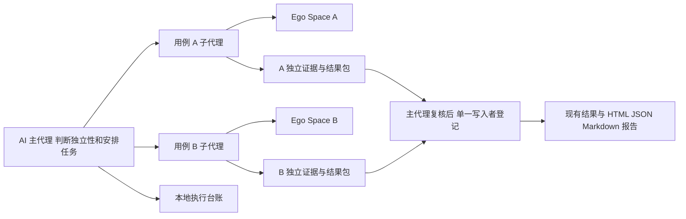

# v0.1.4 需求重新评估与轻量方案

> 历史版本记录（v0.1.4）：以下“当前/尚未/待验证”等表述均以本文日期和阶段为准，不是 0.1.7 的最新状态。原始测试结果与限制保留；当前能力与契约见[格式说明](asset-formats.md)，分阶段验证见[云端审阅](v0.1.7-cloud-review.md)。

日期：2026-10-23。状态：重新评估阶段的历史分析，本次未开始功能开发。用户随后批准全量 TypeScript，并明确并发上限须由用户配置；当前统一方案见 [v0.1.4 设计审核稿](v0.1.4-design.md)。本文后续“无需换语言／TS 可选”等文字只表示当时的可行性判断，不再表示当前版本范围。

**结论：按用户澄清后的目标，v0.1.4 可实现，适合继续作为轻量 Skill 演进。推荐保留 Node.js，增加少量执行记录与结果汇总能力，由原生 subagents 并行操作 Ego。无需先搭建受限宿主、浏览器 broker 或换语言。**

此前方案将“能否建立强约束”的调研问题推成了必须通过的门槛，增加了不必要的范围。当前要求是并发必须实现，单用例单 Space 是默认执行原则、允许 Agent 出错。原生子代理可访问原始 CLI 的历史事实保持不变，但不再据此阻塞当前方案。旧记录不是被重新判为通过，而是其强隔离验收目标不再属于本次必需范围。

## 当前可行性依据

| 能力 | 现有事实与状态 | 对实现的含义 |
| --- | --- | --- |
| 不同 Space 同时被操作 | **已验证，限合成范围**：两路独立 CLI 调用完成双成员屏障，页面和截图未串例。[VERIFY: docs/v0.1.4-capability-validation.md:23-29] | 具有并发浏览器调用基础，不应继续以“Ego 不支持并行”作阻塞。 |
| 常规 Space 保护 | **已验证，限常规生命周期**：创建、续跑及精确清理时原有 Space 保留，安装的 Skill 未变。[VERIFY: docs/v0.1.4-space-protection-retest.md:9-17] | 可沿用创建回执、精确 ID 清理和独立读回。 |
| 文件记录与证据隔离 | **已验证现有校验逻辑**：写操作检查 case 和证据关联，并保存历史；不是并行产品链路已验收。[VERIFY: scripts/ego.mjs:562-597] | 现有记录工具可复用，无需重写结果系统。 |
| 两名真实 AI worker 完整执行并汇总 | **未测试** | 仍需完成 Skill 编排、交付契约和真实双 worker 验收，不能用两个测试脚本代替。 |
| 实际减少整批等待时间 | **未测试**：已有重叠证据，没有串行／并行性能对照。[VERIFY: docs/v0.1.4-capability-validation.md:25-29] | 并发能力必须提供，时间收益另作实测，不承诺两倍加速。 |
| 所有异常恢复与 UI 稳定性 | **无法判断**：已有零视口、最小化和截图失败，异常生命周期未全面验证。[VERIFY: docs/v0.1.4-space-protection-retest.md:16-17] [VERIFY: docs/v0.1.4-space-protection-retest.md:29-36] | 如实记录局限，不能把常规流程通过扩展为任意故障都能自动恢复。 |

Ego 官方 Windows 文档支持将不同任务放入不同 Space。[Ego Windows Space](https://lite.ego.app/document/en/docs/windows/space) 本次查到的公开 main 仍为 `d392204d1ea1a8027a591ab2b0129c2e11d85f26`。[主分支元数据](https://api.github.com/repos/citrolabs/ego-lite/branches/main) 本机已有实测比仅看源码推断更直接。

## Space 原则如何处理错误

默认一例使用一个 Space，续跑使用 numeric ID；一个 Space 内可有多个 Page。登记默认关联是为了减少误操作、整理证据和恢复上下文，不是为 Agent 建立不可绕过的安全沙箱。

发现误开或误切时，AI 核对实际 Space、身份、租户、数据状态和已发生动作，再决定纠正、补证、在授权内重新尝试或暂停。需要换 Space 恢复时记录前后关联和原因，保留原尝试，不为了维持“始终一个 Space”的表面结论删掉错误。

Space 偏差与业务结论分开：如果业务前提、必要步骤和证据仍可确认，允许带执行偏差说明给出有效业务结论；如果错误身份、错误对象或证据缺口影响了判据，应补证或保留无法判断。不能仅因多开 Space 就判产品失败，也不能因最终看似成功而吞掉首次错误。

允许 Agent 出错不改变业务目标、授权或用户 Space 保护要求。清理工具继续核对本次创建回执及当前归属；不根据名称猜测归属，不全局清场。不承诺能防御同账户程序或 Agent 绕过工具的任意操作。

## 推荐架构

主代理创建、等待、引导和停止子代理的动作留在 AI 宿主层，Node 工具只整理状态和文件。不要让一个本地 Node CLI 伪造或自行调用不可用的 `spawn_agent` API。宿主必须真的暴露子代理能力；不支持的环境要明确报告并发不可用，不能悄悄串行后声称并发已实现。

建议正常批次以并发 2 起步，上限可配置。至少两个用例独立且宿主额度允许时，应实际同时分派；只有特定依赖、共享资源冲突或容量限制影响的部分保持串行。独立的写用例也可以并发，不把“只读”作为唯一资格。

建议的默认执行方式：

1. 主代理冻结业务用例，识别身份、对象和共享写状态，为候选并发组分配各自 Space 和独立输出位置。
2. 每个 worker 只接收自己的用例、必要项目资料、授权、默认 Space ID 和交付约定。路径、观察和业务判断由 AI 决定，不把测试编译为固定点击 DAG。
3. worker 各自调用安装版本的 Ego 原生接口，写自己的证据目录和不可覆盖的结果包；后续调用尽量复用原 numeric ID。
4. 主代理接收完成消息并复核。需要补查的部分再取证，不把每条用例都串行重跑一遍。尚有独立工作时，由 AI 继续安排新的并发任务。
5. 单一写入者将已复核的结果包登记到现有 run，保留每例证据与历史；最后输出统一报告并仅清理确认自有的 Space。

这是一条推荐方法，不是强制业务状态机。工具只处理显式 case 分配、重复提交、关联和文件完整性；不自动选下一用例、替 AI 判断业务独立性或重试业务动作。

OpenAI 官方文档支持原生子代理分工和结果合并，也明确其额外 token 成本；这支持复用现有宿主，避免本项目重复实现模型运行服务。[OpenAI Docs：Subagents](https://learn.chatgpt.com/docs/agent-configuration/subagents)

## 现有架构需要补什么

当前 Skill 将 AI 推理、Ego 操作及本地结果工具分开，本地 CLI 不调用模型或浏览器。这一主体边界适合保留。[VERIFY: skills/ego-lite-test/SKILL.md:11-15] [VERIFY: scripts/ego.mjs:904-919]

| 改动 | 为什么需要 | 控制负担的方法 |
| --- | --- | --- |
| 并发执行指南和单例任务包 | 让模型真实分派独立用例，而不只是增加一个“并发数”参数 | 入口简述规则，具体指南按需读取；不给每个 worker 复制整个会话和全部用例。 |
| 轻量执行台账 | 记录 case、worker、默认 Space、创建归属、Space 变化、尝试及完成状态 | 一个 run 的本地结构化文件即可起步，不引入常驻服务和分布式租约系统。 |
| 分例结果包与独立证据目录 | 多个 worker 必须避免抢写共享文件和串用证据 | 每例独立写，主代理单一提交；重复消息靠 operation ID 对账。 |
| 统一汇总与报告中的执行说明 | 区分执行失败、产品异常、未测及 Space 偏差 | 延用现有观察、理由和 attempts；结构化并行信息可另设有版本的元数据文件。 |
| 合成端到端验收 | 证明实际两个 AI worker 可以工作、交付、结束 | 用当前原生宿主做功能验证，不继续将硬权限隔离作为先行门槛。 |

现有锁会拒绝并发文件操作，并不自动排队；progress 也获取同一 run 锁。因此不应让每个 worker 同时直接调用共享 run 的 record／evidence-add／progress。[VERIFY: scripts/ego.mjs:157-197] [VERIFY: scripts/ego.mjs:701-709]

单一结果写入者串行处理短文件事务，不代表浏览器用例串行；AI 与页面等待仍可重叠。导入中断时利用原 operation ID 和已保存请求对账，不重放业务动作。现有结果请求的幂等检查先于 revision 检查，提供了复用基础。[VERIFY: scripts/ego.mjs:539-554]

还有一项潜在扩展成本：写入前会完整检查 run，证据校验读取文件计算 hash；证据量大时，反复检查会增加磁盘开销。这是源码可见的潜在瓶颈，尚未测得它阻碍两例并发。先采用单一提交和合理批次，测量后再优化，最终完整性检查保留。[VERIFY: scripts/ego.mjs:318-330] [VERIFY: scripts/ego.mjs:636-650]

不预设全面升级全部资产到 v4。业务用例优先沿用 v3，新增并行台账独立标版；若报告结构确需扩展，只调整受影响格式与版本。当前 schema 拒绝未知字段，不能直接往旧 JSON 塞 worker／Space 字段。[VERIFY: schemas/record-request.schema.json:1-30] [VERIFY: schemas/report.schema.json:43-48]

现有导出的记录与报告函数可以复用。核心脚本目前约 948 行，包含校验、记录、渲染和 CLI 分派；新增职责应放在独立模块，不继续把调度代码堆入同一个文件，也不必先完成一次全量重构才实现并发。[VERIFY: scripts/ego.mjs:539] [VERIFY: scripts/ego.mjs:701] [VERIFY: scripts/ego.mjs:785] [VERIFY: scripts/ego.mjs:876] [VERIFY: scripts/ego.mjs:904]

## 语言选择

当前包采用 ESM、要求 Node.js 22 以上，未声明第三方运行依赖。[VERIFY: package.json:1-15]

我的工程判断是：问题主要在 AI／浏览器等待、共享状态和结果组织，不在 JavaScript 的计算能力。Node 本身支持异步启动子进程；使用原生子代理和独立 Ego 调用，不会因 Node 的单线程事件循环就必然串行。[Node.js 子进程文档](https://nodejs.org/docs/latest-v22.x/api/child_process.html)

| 选择 | 对本项目的收益与成本 | 建议 |
| --- | --- | --- |
| 继续 JavaScript／Node.js | 复用现有工具及 Ego 的 JS 调用方式，运行依赖少；靠 schema、测试和模块边界维护契约 | **v0.1.4 首选**。不为并发重写既有模块。 |
| 新模块逐步使用 TypeScript，仍运行于 Node.js | 类型能减少 case／worker／Space 字段混用，代价是增加构建、类型及产物清单维护；仍需运行时校验 | 可选的维护升级，不是并发前提，也不会让模型或浏览器自动变快。 |
| 改用 Python | 可以实现，但需要重写现有工具或增加与 Ego JS 的桥接；仅为了两例并发，暂无足以抵消迁移的收益 | 若未来主体转为数据分析或依赖 Python 生态，再重新评估。 |
| 改用 Go／Rust | 如果将来需要长期服务、跨机任务和独立二进制，可有新的工程价值；当前会新增编译分发、跨平台维护和接口桥接 | 暂不推荐；不是语言做不到，而是当前需求不需要那类服务结构。 |

TypeScript 类型不会改变程序运行行为，不能替代收到 JSON 后的校验，也不能解决 Space 路由错误或业务数据冲突。[TypeScript 官方说明](https://www.typescriptlang.org/docs/handbook/2/basic-types.html#erased-types)

如果选择 TypeScript，安装包交付编译后的 JS 和所需运行资源，不要求使用者为跑测试配置 TypeScript 开发环境；这属于后续实现细节，不在本次修改。

## 对 Skill 的实际负担

轻量方案属于可控的中等演进：增加任务交付、台账与汇总，而非重新实现一套 Agent 平台。负担需要分别控制：

- **运行负担：** 更多 Space 的页面和更多 AI worker 会增加浏览器资源及 token，这部分无法靠换语言消除。先并发 2，再按机器、站点配额和真实耗时调整。
- **上下文负担：** 每个 worker 只接收本例所需资料；主代理接收结构化摘要和证据引用，避免反复搬运全部日志与图片。关键事实不能因缩短上下文而丢失。
- **维护负担：** 新能力拆成少数职责清楚的模块；不引入全局工具代理、模型鉴权服务、数据库或固定业务 DAG，除非以后出现具体需求。
- **安装负担：** 现有构建按显式清单打包，调查用的 App Server／浏览器探针不在当前运行清单内，不必全部带入正式 Skill。[VERIFY: scripts/toolchain.mjs:10-22] [VERIFY: tools/build-skill.mjs:20-27]

环境审计也要按目标区分。没有用户明确要求时，不把“整个全局 Codex 配置文件字节始终不变”捆绑成 Space 保护或业务通过的前提；应记录与判据有影响的环境变化。此前已冻结的组合测试不改历史结论，正式流程避免继续制造这种关联过宽的阻塞。

## 仍然真实存在的限制

Ego 的操作路由隔离不等于共享状态全部隔离。官方指南明确，同 profile 的 cookies 和 HTTP cache 可能影响其他 Space；不同页面也可能修改同一后端对象。由 AI 依据具体项目判断独立性，对会话切换和冲突写操作协调即可，不需要因此将所有用例退回串行。[Ego clearing-state 指南](https://github.com/citrolabs/ego-lite/blob/d392204d1ea1a8027a591ab2b0129c2e11d85f26/skills/ego-browser/references/clearing-state.md)

窗口最小化、零视口和截图超时是已出现的实际问题，换语言不会自动修好。应验证后台操作与取证方法；必要时仅协调确实冲突的短操作，避免给整条用例加全局锁而失去并发。

取消和崩溃不能承诺撤回已经发送的业务动作。可实现停止新派发、保存部分结果和现场、读取状态后由 AI 决定续接。身份或副作用不明时如实保留无法判断；这不要求自建一个保证任何故障都自动恢复的服务。

## 建议的实现和验收范围

先实现最小完整链路：**两名真实 worker → 两个 Space → 各自证据包 → 单一提交 → 统一报告**。它应是 v0.1.4 的核心验收，不再继续先做新的硬隔离宿主。

验收至少覆盖正常并发、一个 worker 失败而另一例保留、结果乱序／重复送达、Space 偏差记录和复核、精确清理、以及同一批用例的串行／并行耗时对照。测试应验证错误被如实处理，不能要求 Agent 永远没有错误。

增加模型任务和等待的 token 成本要与节省的时间一起记录；无法取得可靠 usage 时明确缺失。并发能力是必需项，实际加速比例是测量结果，不能互相替代。

本次只更新评估与需求记录。没有实现上述模块、重跑真实业务、修改用户级 Skill、切换源码目录、推送或发布。历史的严格方案和试验结果保持可追溯。
