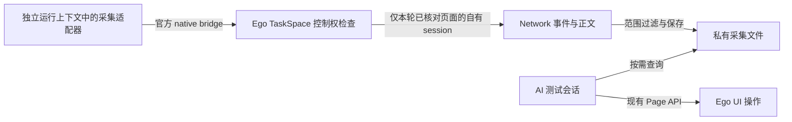

# v0.1.6 接入修订稿：官方 native bridge 隔离验证

本文保留接入修订及验证过程；最终开发范围、接口和验收清单统一以[总设计 v3](v0.1.6-api-observation-design.md)为准。

日期：2026-10-28。状态：**用户已批准并执行 native-only 隔离验证（含自建 Space 交接、停止、恢复）。N8 释放证据经独立补测补足，八项技术目标在各自限定范围内已验证。产品功能尚未实现。**

用户已经批准接口监控整体设计，并明确将 SSE、WebSocket 流式正文纳入范围。原 Page.cdp 路线的 refs 失效和活动页变化仍是有效失败结论，见[首轮验证](v0.1.6-api-observation-feasibility.md)。本稿只调整底层接入候选，不修改业务目标、授权、AI 自主决策和正文覆盖要求。

## 1. 调研结论与建议

当前没有找到满足完整正文采集且不干扰 UI 的现用公开 Agent API。官方文档化的 native bridge 可作为**运行时维护者开发的独立采集适配器候选**。本地隔离探针初次为 7 项已验证、1 项无法判断；[N8 独立补测](v0.1.6-native-cleanup-retest.md)已补足该能力，当前八项技术目标均在限定范围内已验证。总体证据见[原生隔离验证记录](v0.1.6-api-observation-native-validation.md)，仍须保留对未验证异常路径和宿主版本的限制。

这个候选不修改 Ego 安装，不使用私有 CDP 连接，不导入 SDK 私有模块。它使用 Ego 自己提供的原生消息通道，保留 TaskSpace 控制权门禁。它也不是当前 ego-browser Skill 已支持的普通 Agent 用法，因此不能直接在测试 Skill 中写成现成能力。

## 2. 本轮核对到的事实

核对官方 main：`aecc5831fc5a9ea01a078b632185992a3a7ac448`，提交时间 2026-10-26 06:17:13 UTC。本机仍为 Ego 0.6.1.13，内嵌 Node v24.22.1。SDK 提交与浏览器安装包未建立字节对应关系。

| 核查项 | 当前证据 | 结论边界 |
| --- | --- | --- |
| 当前 Agent API | 本机 `help()` 与固定提交 public-api-schema 只提供 Page.cdp 的 timeout 参数、TaskSpace.cdp 和破坏性读取 Page.events | 未发现 passive/no-activate/独立网络订阅入口 |
| 官方 native 文档 | 明确记录 globalThis.ego，区分普通 Agent 使用 Skill 与运行时维护者直接访问 native bridge | 官方公开接口，不是从私有字段猜出的通道；仍没有无副作用承诺 |
| 本机接口存在性 | 只读 typeof 检查：sendCDPMessage、useTaskSpace、listTabs 为 function；两个 CDP 回调槽为 undefined | 只证明该调用上下文当时可见，未发送任何原生 CDP 命令，不证明通道可靠或隔离 |
| 控制权门禁 | sendCDPMessage 要求已选择且 agent 所有的 Space，missing/inactive/delegated/unavailable 时拒绝 | 文档只明确发送门禁，未保证已有事件订阅在用户接管后立即撤销 |
| 回调与 SDK | onCDPMessage、onSendCDPMessageError 是单槽；SDK 在第一次 rawCdp 时安装自己的回调 | 与 SDK 混用可能互相覆盖，必须避免在同一采集上下文调用高层辅助工具 |
| SDK 发布 | 最新公开 SDK Release v2.1.0，2026-10-16，没有列出被动网络观测修复 | 不把 SDK Release 号当作 Windows 浏览器版本，也不建议仅靠升级解决 |
| 相关上游提案 | Issue #460 请求不激活页面的 CDP/Page 路径，当前 open；官方尚无时间表 | 它讨论 macOS 后台调度，不等于官方已确认本项目 Windows 的全部干扰 |

主要来源：

- [native bridge 定位与维护者范围](https://github.com/citrolabs/ego-lite/blob/aecc5831fc5a9ea01a078b632185992a3a7ac448/docs/native-bindings-api.md#L3-L14)。
- [TaskSpace 选择语义](https://github.com/citrolabs/ego-lite/blob/aecc5831fc5a9ea01a078b632185992a3a7ac448/docs/native-bindings-api.md#L23-L27)、[listTabs 返回与拒绝语义](https://github.com/citrolabs/ego-lite/blob/aecc5831fc5a9ea01a078b632185992a3a7ac448/docs/native-bindings-api.md#L247-L304)。
- [发送门禁与回调](https://github.com/citrolabs/ego-lite/blob/aecc5831fc5a9ea01a078b632185992a3a7ac448/docs/native-bindings-api.md#L689-L781)、[SDK 生命周期](https://github.com/citrolabs/ego-lite/blob/aecc5831fc5a9ea01a078b632185992a3a7ac448/docs/native-sdk-lifecycle-requirement.md)。
- [SDK 回调绑定](https://github.com/citrolabs/ego-lite/blob/aecc5831fc5a9ea01a078b632185992a3a7ac448/package/ego-browser/src/browser-runtime.ts#L385-L403)、[调用前重绑](https://github.com/citrolabs/ego-lite/blob/aecc5831fc5a9ea01a078b632185992a3a7ac448/package/ego-browser/src/browser-runtime.ts#L453-L467)。
- [当前 Skill API 限制](https://github.com/citrolabs/ego-lite/blob/aecc5831fc5a9ea01a078b632185992a3a7ac448/package/ego-browser/skill-body/SKILL.md#L103-L109)、[SDK v2.1.0](https://github.com/citrolabs/ego-lite/releases/tag/v2.1.0)、[相关提案 #460](https://github.com/citrolabs/ego-lite/issues/460)。

## 3. 候选接入结构

这里的“独立运行上下文”不是“已证明独立操作系统进程”。上一轮不同调用报告相同 PID；本次必须核验实际回调和会话是否隔离，不通过 PID 假定隔离。

### 3.1 初始化

1. UI 仍使用当前正式 TaskSpace/Page API 建立本轮自有合成页面，获取 snapshot，并记录原有 Space 清单。
2. 单独的采集调用检查两个 native 回调槽。只有均为空才注册自有回调；发现函数或未知占用立即返回不支持，绝不清除、覆盖或接管。
3. 使用官方 useTaskSpace 选择本轮 Space；它只选择、不验证，所以随后必须检查 listTabs 的结果与错误。
4. 在当前调用中根据已经授权的唯一合成页面匹配真实 targetId，歧义或不匹配时停止。不得猜 targetId、使用其他 Space 的 target，或复用旧运行的 target。
5. 通过原生通道 attach 到该 target，保存本连接返回的 sessionId。后续 Network 命令只能使用这个自有 session。

采集上下文中不调用 Page.cdp、全局 legacy cdp、page.events 等 SDK 传输辅助方法，也不通过反射取得内部 services。避免 SDK 在同一上下文重新注册回调，或触发共享 Page ledger 的 refs 失效。

### 3.2 协议能力与串行处理

探针仅使用所需的确定性协议操作：attach/detach 自有会话、启用/关闭自有 Network 订阅、读取指定已观察请求的正文、开启指定请求的流内容传递。禁止主动业务请求、重放、拦截修改、页面激活及 Runtime 执行。

原生发送失败回调没有 CDP 命令 id（逐条命令关联标识，不同于网络请求的 Network.requestId），探针一次只允许一个待完成协议请求。事件到达独立入有界队列，不能因等待命令结果而丢弃事件。命令超时或连接错误应留记录并结束该采集段，不自动重新绑定、更换 Space 或重试业务动作。

普通正文在可读时取得；SSE 同时核验 EventSource 与 POST fetch/XHR。对 POST SSE，先保留 streamResourceContent 的 bufferedData，再按顺序解码后续 dataReceived.data；必须覆盖非空前缀、跨 UTF-8、一个事件跨多个块及多行 data。WebSocket 保留双向消息、编码、顺序和关闭事实，测试文本、二进制与消息分片还原。

CDP 的 WebSocketFrame 按协议提供浏览器重组后的完整消息。分片测试核对该完整消息与服务端 oracle 一致；适配器不重复重组，也不承诺保留原始网络分片边界。[官方协议定义](https://github.com/ChromeDevTools/devtools-protocol/blob/ebca9061ecc4c77b7d6b5b8f7b8afe19dc3ab9ed/pdl/domains/Network.pdl#L514-L524)。

这些是采集器内部数据事务，不规定 AI 何时查询或如何判定业务。

### 3.3 范围与控制权

- Space 和页面来源先核对，再接入；事件必须属于自有 session 和已授权目标。请求/正文范围约束继续适用。
- 原生发送门禁不能由适配器绕过。未选择、错误 Space、不可用或失去控制时停止；不调用自动 claim/takeOver。
- 已启用的事件流可能在失去控制后继续投递，这是待验证事项。适配器必须检查当前控制状态，在发现失去控制后停止记录，丢弃未通过控制检查的排队内容，并报告覆盖终点。
- 应披露检查与写入之间的竞态和实际停止延迟，不宣称文件过滤构成浏览器侧原子权限隔离。若仅靠本地检查不足以满足授权要求，保留阻断并明确上游依赖。

### 3.4 退出

正常结束时只关闭自有 Network/session。清除回调前检查它仍是本适配器注册的函数，不能清掉后来注册的其他所有者。回调被替换、通道断开或 TaskSpace 失去控制时，不执行越权清理；记录未完成释放，让宿主生命周期处理其负责的资源。

不得调用私有 dispose、覆盖预装 SDK、修改 Ego 二进制或安装目录、打开调试端口、增加代理或安装证书。

## 4. 隔离探针的验收目标

所有目标在执行前冻结；只访问本地合成服务器，原始日志和截图另存新目录，不覆盖首轮失败证据。

| 目标 | 必须核验的事实 |
| --- | --- |
| 回调占用保护 | 槽为空才启动；占用时拒绝，原回调不变；并存 UI 调用不会夺取采集回调或被采集器破坏 |
| 初始 attach 不干扰 | p2 保持 active，p1 原 snapshot ref 仍有效；采集器初始化没有更改 UI ledger 的可观察行为 |
| 后台正文不干扰 | p1 snapshot → 仅 Node 层等待正文取得 → 使用原 ref 点击；中间不运行 evaluate、waitForFunction 或额外 snapshot；点击后才核对计数 |
| 并存操作与来源 | 多个独立 UI 调用产生的请求都由持续采集上下文记录；服务端计数证明没有重发；不同 session/requestId 不串联 |
| 普通 HTTP | 请求、响应与错误内容可得，状态/正文可得性明确，不自动给业务结论 |
| SSE 正文 | EventSource 与 POST 流未结束时可读；非空初始前缀与后续块逐字节对账，无缺失、重复或乱码 |
| WebSocket 正文 | 双向文本、二进制、服务端分片消息还原与独立 oracle 一致；消息、编码及关闭事实来源明确 |
| 控制权与停止 | 发送门禁仍生效；停止后不再落盘；不能只因发送被拒绝就声称事件订阅已撤销 |
| 资源清理 | 自有会话、采集上下文、合成服务和 TaskSpace 结束并独立读回，原有用户 Space 保留 |

本次执行批准已明确包含自建 Space 的 handOff、停止及显式恢复，这个合成往返已完成；不得将其视为对真实用户接管时自动夺回控制的授权。后续真实任务没有该具体批准时，不擅自完成接管循环。

## 5. 推进与停止条件

用户批准并完成的是本稿的 **native-only 隔离探针**，未因此授权产品安装或上游改动。满足以下条件后，才把接入修订提交为可进入实现的方案：

- refs、活动页、回调、session 不干扰的关键目标通过；
- HTTP、两类 SSE、WebSocket 正文的核心验证有实际证据；
- 授权、控制权变化和停止语义有可解释边界；
- 不要求 AI 为每步 UI 动作增加锁、重新 snapshot 或调度指令。

若本机回调不隔离、原生 attach/读正文仍激活页面、事件归属无法约束或控制权停止无法满足，则不继续增加补丁来隐藏问题。交付失败事实和官方所需的接入合同，等待受支持能力或重新审核设计。

## 6. 此前单独审核的原因

原设计获批不被撤销，已批准的本地验证也不重新申请。本次新增的是：从当前 Skill 列出的 Page API 转向由本项目维护的官方 native bridge 适配器。

已读取本机安装的 ego-browser 入口 Skill（实际位置由当次安装核验，不在公开文档保留开发机路径），其要求运行 `ego-browser skill` 并遵循输出；输出对普通自动化规定“Use only … APIs explicitly listed in this Skill”。官方 native 文档则将直接访问定位于 runtime maintainer 工作。

这些文档没有要求用户对每次 API 调用审批。这里单独提交审核，是依据用户先审设计的约定，对进入另一类接入方式及其回调/会话管理责任作出的工程判断，而不是因为读取官方资料或已获准的验证还需再次许可。

支持面核对后的执行批准已到达；原生探针、受控交接与恢复以及清理已完成，实际结果另存上述验证记录。产品功能代码和安装仍未变更。
