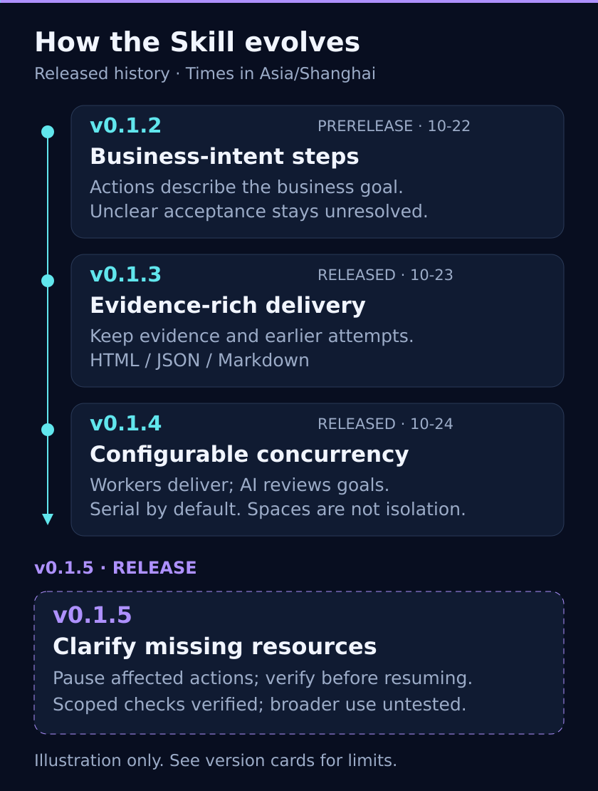

# Version history

[简体中文](version-history.md) · [Local acceptance steps (Chinese)](v0.1.5-local-acceptance.md)

The AI interprets goals and judges business outcomes, Ego operates the browser, and local tools retain evidence and deliver reports.

## v0.1.6 · Experience, goal assessment and network observation

2026-10-29: [release and full package](https://github.com/99Like-wjj/ai-autonomous-testing-ego-lite/releases/tag/v0.1.6). Separate design/execution experience, unified v5 goal records and reports, scoped native observation and host handoff guidance. Old formats are rejected without conversion; historical files remain unchanged. See [release validation (Chinese)](v0.1.6-release-validation.md). The image above retains the historical v0.1.2–v0.1.5 overview.

See the planned [v0.1.7 preview (Chinese)](v0.1.7-preview.md).

## v0.1.5 · Resource clarification

**Formal version: 2026-10-25.** [Release, package and checksums](https://github.com/99Like-wjj/ai-autonomous-testing-ego-lite/releases/tag/v0.1.5). Scoped behavioral acceptance has been completed. The source adds resource-readiness guidance, discoverable from the Skill entrypoint. The AI infers prerequisites from each goal, checks available facts within authorization, asks about material gaps, pauses dependent actions and may continue independent authorized work. Supplied resources require verification before resuming; new dependencies can emerge during execution.

Acceptance ambiguity, resource availability and permission to act remain separate. Existing evidence, result and worker-packet tools are reused; no new resource JSON contract or fixed business workflow is introduced. Cases/results/evidence v3 and manifest/report v4 remain unchanged. This page and bilingual overview images explain the history.

The AI still judges sufficiency, questions and recovery. Auxiliary notes are not automatically covered by report verification. Engineering checks do not prove reliable behavior in real projects. The complete Node.js 22+ package and Codex Skill metadata report 0.1.5 without a dev suffix. Repository/Skill identifiers are ai-autonomous-testing-ego-lite; see the [rename guide](rename-upgrade.md) before an authorized installation migration. Formal release does not imply every scenario is verified.

## Released versions

Earlier release times below are GitHub published_at converted to Asia/Shanghai; use the v0.1.5 Release for its exact publication time. Development dates in the historical changelog retain their original meaning.

### v0.1.4 · Configurable concurrency

**Formal release, 2026-10-24 19:56.** [Release, package and checksums](https://github.com/99Like-wjj/ai-autonomous-testing-ego-lite/releases/tag/v0.1.4)

Independent cases may run within explicit user limits; the default is serial. Native workers seal evidence for coordinator review. Execution records track Spaces, deviations, unfinished work and explicit per-goal assessments. Maintained TypeScript is distributed as compiled JavaScript.

New manifests/reports use v4; business records remain v3. Execution/configuration/worker packets use v1 and executionRead uses v2. Existing v3 runs retain their format. A concurrency limit does not guarantee host capacity, and Spaces do not guarantee account or backend isolation. See the Release for validation limits.

### v0.1.3 · Evidence and complete delivery

**Formal release, 2026-10-23 00:05.** [Release, package and checksums](https://github.com/99Like-wjj/ai-autonomous-testing-ego-lite/releases/tag/v0.1.3)

Evidence registration, revisioned results, retained attempts, progress and integrity checks make conclusions reviewable. Default delivery includes offline HTML, JSON and Markdown, with real screenshots required for key UI conclusions. Complete packages and report readback address missing-tool and delivery gaps; retrospective assembly preserves original records.

Assets moved to v3. Rebuild v2 cases from original sources into a new run; do not only change version numbers or overwrite history. Hashes prove byte consistency, not authenticity or business correctness. Synthetic checks and local trials do not cover every real scenario.

### v0.1.2 · Business-intent steps

**Experimental prerelease, 2026-10-22 17:11.** [Prerelease, package and checksums](https://github.com/99Like-wjj/ai-autonomous-testing-ego-lite/releases/tag/v0.1.2)

Business-intent actions and optional step checkpoints avoid inventing UI details. Overall expectations and sources remain required. Acceptance questions prevent pass/fail until resolved. External and AI-authored cases share the format and can be drafted without execution.

Asset format stayed v2. This version did not include v0.1.3 evidence-rich delivery or v0.1.4 concurrency. Historical synthetic tests were not Windows/Ego business acceptance.

## Earlier development

The changelog records v0.1.0/v0.1.1 development. No corresponding remote Tags/Releases were found during this review, so these are not presented as verified formal releases. Feature attribution follows tagged source, Releases and the changelog; v0.1.5 strengthens resource clarification rather than introducing acceptance questions for the first time. Illustrations are not test screenshots.
