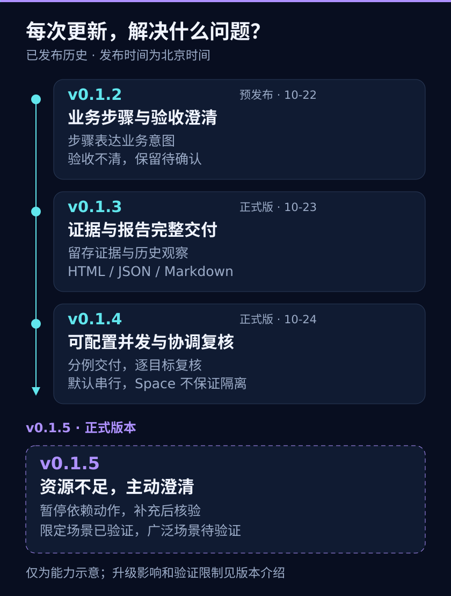

# 版本演变

[English](version-history.en.md) · [本地验收步骤](v0.1.5-local-acceptance.md)

基于 Ego Lite 的 AI 自主测试 Skill：AI 理解目标、选择方法并判断业务，Ego 操作浏览器，本地工具保存证据和交付报告。

## v0.1.5 · 资源不足时主动澄清

**正式版本：2026-10-25。** [Release、安装包与校验值](https://github.com/99Like-wjj/ai-autonomous-testing-ego-lite/releases/tag/v0.1.5)。已完成限定场景专项验收。 当前源码包含以下规范与文档；专项结果不代表所有模型和业务场景均已验证。

- **解决的问题：** 测试目标需要的身份、权限、项目、数据或观察条件不足时，AI 可能继续执行，却没有主动说明缺口。
- **变化：** Skill 入口明确加载资源指南，按目标判断前提，先在授权内核验；无法自行确认的实质缺口主动询问，只暂停依赖动作。用户补充后核实，再决定恢复；执行中有新依赖也适用。
- **使用收益：** 用户知道缺什么、影响哪些目标、怎样补充；独立且获授权的目标可以继续，缺资源不算通过或产品缺陷。
- **工具与升级：** 复用现有记录、证据和报告，区分验收歧义、资源可用性和操作授权；不新增资源台账 JSON 或固定业务流程。用例/结果/证据 v3、manifest/report v4 等既有格式保持。
- **本版同时新增：** 本演变页、README 入口和双语版本总览图。
- **限制：** 是否资源充分、提问内容及恢复仍由 AI 判断；辅助笔记不自动受报告校验。工程回归不能替代真实使用验收。

需要 Node.js 22+，更新时使用完整包并核对实际加载版本。完整安装包版本与 Codex Skill 元数据统一为 0.1.5，不带 dev；仓库和 Skill 更名为 ai-autonomous-testing-ego-lite。升级先核对不明安装修改与历史资产，参阅[更名与升级说明](rename-upgrade.md)。正式版本不等于所有场景已验证。

## 已发布

以下较早版本的发布时间来自各 Release 的 published_at，统一为北京时间；v0.1.5 的精确发布时间以 Release 为准。CHANGELOG 内开发/归档日期保持其原含义。

### v0.1.4 · 可配置并发与协调复核

**正式发布：2026-10-24 19:56。** [Release、安装包与校验值](https://github.com/99Like-wjj/ai-autonomous-testing-ego-lite/releases/tag/v0.1.4)

- **解决的问题：** 多用例测试需要在用户设置的并发范围内分工，同时保留各用例证据、共享资源限制与复核责任。
- **主要变化：** 默认串行，用户可配置并发；原生 worker 独立封包，由协调者按原目标复核后导入。增加执行台账、Space 关联/偏差、逐目标四态和轻量查询。维护源码迁为 TypeScript，用户使用编译后的 JavaScript。
- **使用收益：** 允许独立用例并发执行；报告说明哪些目标已验证、违反、无法判断或未测试，并保留首次错误和未完成项。
- **升级影响：** 新 manifest/report 为 v4，cases/results/evidence 仍 v3；execution/configuration/workerPacket 为 v1，executionRead 为 v2。已有 v3 run 保持原格式。
- **限制：** 默认并发 1；用户上限不保证宿主跑满。Space 不保证账号或后端隔离；文件一致性不证明结论正确，历史实测限制见对应 Release。

### v0.1.3 · 图文证据与完整交付

**正式发布：2026-10-23 00:05。** [Release、安装包与校验值](https://github.com/99Like-wjj/ai-autonomous-testing-ego-lite/releases/tag/v0.1.3)

- **解决的问题：** 聊天摘要和零散文件不便复核，单独复制说明文件也可能漏掉实际工具。
- **主要变化：** 增加证据登记、revision 化结果、历史尝试、进度及完整性检查。默认交付离线 HTML、JSON、Markdown；关键 UI 结果/缺陷要求真实截图。完整安装包附工具、schema 和文件清单；支持报告读回及明确标识的事后整理。
- **使用收益：** 可查看观察、理由、截图、来源与历史；缺图和未验证项保留，旧报告不被补写覆盖。
- **升级影响：** 资产改为 v3，v0.1.2 的 v2 不能直接使用；从原始需求重新整理后新建运行，不只改版本号，不自动迁移或删除。
- **限制：** hash 证明留存字节一致，不认证截图或业务结论；本地试用和合成回归不代表所有真实业务场景已验收。

### v0.1.2 · 业务意图步骤与验收澄清

**实验性预发布：2026-10-22 17:11。** [预发布说明、完整工具包与校验值](https://github.com/99Like-wjj/ai-autonomous-testing-ego-lite/releases/tag/v0.1.2)

- **解决的问题：** 不完整需求不应被编造成按钮级操作和无依据的逐步预期。
- **主要变化：** 步骤表达业务意图与必要输入；步骤检查点可选，整体 expected 和 basis 保留。clarificationQuestions 表示验收待澄清，未解决时不判 pass/fail。
- **使用收益：** AI 可按实际界面选择方法，同时保留业务目标；外部用例和 AI 生成用例均支持，也可只生成草案。
- **升级影响：** 资产仍为 v2，软件版本和资产格式独立编号。
- **限制：** 该版主要交付 JSON/Markdown，没有 v0.1.3 的图文证据交付链路，也不含 v0.1.4 并发能力。历史合成测试不代表 Windows/Ego 业务实测。

## 更早的开发历史

v0.1.0/v0.1.1 在仓库 CHANGELOG 中记录了初始工具、中文优先说明、统一步骤及用例校验。本轮历史核对未发现对应远端 Tag/Release，因此仅作为早期开发介绍，不标为已核验的正式发布。

能力归属以对应 Tag 源码、Release 和 CHANGELOG 共同核对。验收澄清在 v0.1.2 已有，v0.1.5 是补强资源充分性与主动询问。图中内容是能力示意，不能代替真实测试截图。
